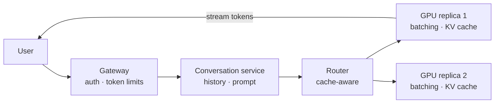

# GenAI and agent platforms

*Part of [System design for the technical PM](./README.md)*

*Last reviewed: 2026-10 · Volatility: fast*

## TL;DR

A chat service for a large language model looks like any web service: a gateway, a stateful conversation layer, a router and a fleet of workers. The difference is the workers. Each one is an accelerator whose **memory** and **bandwidth**, not its compute, limit how many users it can serve. Weights fill part of the memory. Each active conversation adds a **KV cache** that grows with every token. Reading the weights for every generated token makes decoding slow.

An **agent platform** adds a loop on top: the model plans, calls tools and sees results until the task is done. That loop needs **durable orchestration** so a crash resumes instead of repeating paid actions, a **tool gateway** with permissions, **sandboxes** for code and browsing, and **budgets** on steps and cost. Safety is layered: least privilege, isolation, human approval, kill switches and an audit log.

The details of how models work are in the [transformers](../transformers/README.md) module. This lesson shows how they become a service.

> 🎯 **For the technical PM**
>
> **Why it matters** — Cost per conversation, time to first token and the number of users per machine all come from the serving design. An agent that can act can also do damage, so its controls are product requirements.
>
> **What it changes in your decisions** — You size capacity by memory, not by weights alone. You ask for token-based rate limits and per-agent budgets. You decide which actions need a person's approval.
>
> **Ask your eng team** — *"How many concurrent long conversations fit on one accelerator, what limits us, and what is the most damage one agent run can do before something stops it?"*
>
> **Risk if ignored** — A launch that runs out of GPU memory at a fraction of planned concurrency. An agent that repeats a payment after a crash, or runs up a large bill overnight.

## The mental model: a service with an expensive, memory-bound worker



Every layer before the workers is ordinary system design. The workers are where the AI-specific costs live.

## Mechanics

### The LLM chat service

- **Edge and gateway.** Authentication, and rate limits counted in requests and in tokens, plus safety checks.
- **Conversation service.** Stores history and assembles the prompt: system prompt, history, retrieved context and tool results.
- **Routing.** Picks the model and region, and sends requests to replicas that already hold a matching prompt prefix in cache.
- **Inference engines.** Continuous batching, KV cache management, prefix caching, and streaming tokens back, for example with server-sent events.
- **After.** Metering for billing, logging, evaluation and abuse monitoring.

### Why memory is the limit

**Prefill** reads the whole prompt at once and is limited by compute. **Decode** produces one token per step. Each step reads every weight from memory, so decode is limited by memory bandwidth. The KV cache holds keys and values for every token of every active conversation, and it lives beside the weights. The lessons on [generating text and the KV cache](../transformers/generating-text-and-the-kv-cache.md) and [variants and model cards](../transformers/variants-and-reading-a-model-card.md) give the formulas.

### Continuous batching

With **static batching**, a group of requests runs together until the longest one finishes, and short requests wait. With **continuous batching**, a finished request leaves at once and a waiting one takes its slot at the next step. Throughput rises, because the accelerator never idles on finished requests. Paged cache management avoids wasting memory on reserved but unused space.

### The agent platform

- **Agent loop.** The model proposes a tool call. The platform runs it and returns the result, until the task is done.
- **Durable orchestration.** Long-running agents checkpoint their state in a workflow engine, so a crash resumes at the last committed step.
- **Tool gateway.** Authentication, per-tool permissions, quotas and timeouts.
- **Sandboxes.** Isolated environments for code execution and browsing.
- **Memory.** The context window plus a retrieval store.
- **Budgets and traces.** Step, time and cost limits, and a full trace of every model and tool call.

See [agentic AI](../agentic-ai/README.md) and [tool calling](../tool-calling/README.md) for how agents work.

### Keeping agents safe

- **Least privilege.** Scoped credentials per agent and task, with no standing access to production.
- **Isolation.** Sandboxed execution, allow-listed network egress and no access to other agents' data.
- **Human approval** for high-impact actions: payments, deletions, external messages.
- **Limits and kill switches.** Rate, spend and step caps that stop runaway behaviour quickly.
- **Audit and detection.** Immutable logs of every action, and monitoring for unusual patterns.
- **Red-teaming** before launch and after changes.

Each control is independent, so an action must pass all of them before it touches the real world. [AI security and guardrails](../ai-security-and-guardrails/README.md) goes deeper.

## Tradeoffs and decisions

- **Latency vs. throughput.** Bigger batches serve more users per accelerator and make each user wait a little longer.
- **Long context vs. concurrency.** Every extra token of context costs cache memory.
- **Autonomy vs. approval.** Fewer prompts make agents faster, and the cost of a mistake is higher.
- **Shared vs. dedicated capacity.** Shared pools are cheaper, and noisy neighbours add latency.
- **Hosted model vs. self-hosted.** Control and cost at scale against operating effort.

## Failure modes

- **Out of memory.** Concurrency planned on weights alone.
- **Cache fragmentation.** Memory reserved for the maximum length and not used.
- **Head-of-line blocking.** Short requests stuck behind long ones in a static batch.
- **Repeated side effects.** An agent re-runs a paid or irreversible call after a crash.
- **Runaway loops.** An agent retries a hopeless task and spends the budget.
- **Over-broad access.** A tool credential that can reach more than the task needs.
- **Prompt injection.** Text in a page or file steers the agent into misusing a tool.

## Under the hood

Two files in `system-design/code/` model the ideas.

- `llm_serving.py` computes how many long conversations fit beside the weights, the decode speed for one stream and for a batch, and the steps needed by static and continuous batching.
- `agent_budget.py` runs a permissioned agent loop with step and cost budgets, a kill switch and a checkpoint.

```python
def continuous_steps(lengths, slots):
    pending, running, steps = list(lengths), [], 0
    while pending or running:
        while pending and len(running) < slots:
            running.append(pending.pop(0))          # a free slot is refilled at once
        steps += 1
        running = [r - 1 for r in running if r - 1 > 0]
    return steps
```

## Worked example: memory, batches and a crash

*The model shape and rates are illustrative. The numbers come from `llm_serving.py` and `agent_budget.py`.*

**Concurrency.** An 80 GiB accelerator holds a model with 32 layers, hidden size 4,096 and 16-bit numbers. With 32 key-value heads, the weights take 12.6 GiB and each 8,192-token conversation needs 4.0 GiB of cache, so 16 conversations fit. With grouped-query attention and 8 key-value heads, the weights take 11.1 GiB and each conversation needs 1.0 GiB, so 68 fit. The same hardware serves more than four times as many long conversations.

**Decoding.** With 2 TB per second of memory bandwidth and 12.6 GiB of weights, one stream decodes about 148 tokens per second. A batch of 16 shares each read of the weights and yields about 2,365 tokens per second in total. This is an upper bound that ignores compute, cache reads and overhead.

**Batching.** 64 requests of 20 to 400 tokens run on 8 slots. Static batching needs 2,890 steps. Continuous batching needs 1,887, which is 1.53 times faster.

**Agent safety.** An agent plans five tool calls and crashes after the third. With a checkpoint, the resumed run makes only the remaining two calls: five calls in total and no repeats. A call to a tool the agent is not permitted to use is denied. With a cost budget of 10, the run stops after three calls, before the 20-unit card charge. A kill switch stops the run at once.

## Practitioner checklist

- [ ] Is capacity planned as weights plus cache at our real context length and concurrency?
- [ ] Do we measure time to first token and time per token separately?
- [ ] Are rate limits counted in tokens, not only requests?
- [ ] Do shared prompt prefixes get cached and routed to the same replica?
- [ ] Does every agent run have step, time and cost budgets?
- [ ] Does every tool call go through a gateway with per-tool permissions?
- [ ] Are paid or irreversible actions checkpointed, idempotent or approved by a person?
- [ ] Is there a kill switch, an audit log and a red-team before launch?

## Related lessons

- [Generating text and the KV cache](../transformers/generating-text-and-the-kv-cache.md) — why memory limits serving.
- [Agentic AI](../agentic-ai/README.md) — how agents plan and act.
- [Tool calling](../tool-calling/README.md) — how models call tools.
- [AI security and guardrails](../ai-security-and-guardrails/README.md) — injection, least privilege and approval.
- [Cost optimization](../cost-optimization/README.md) — token budgets and caching.

## Sources

- Woosuk Kwon et al., *Efficient Memory Management for Large Language Model Serving with PagedAttention*, SOSP 2023: cache memory waste and paging.
- Gyeong-In Yu et al., *Orca: A Distributed Serving System for Transformer-Based Generative Models*, OSDI 2022: continuous (iteration-level) batching.
- Reiner Pope et al., *Efficiently Scaling Transformer Inference*, 2022: the memory-bound decode phase.
- OWASP, *Top 10 for Large Language Model Applications*: prompt injection and excessive agency.
- Model shapes, rates and costs are illustrative. The numbers come from `system-design/code/`. These sources were not re-opened during this revision, and the lesson's fact-check is pending. Serving software changes fast, so this lesson is stamped fast.
