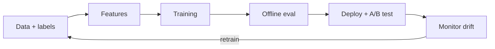

# ML system design: recommendations, ads and search

*Part of [System design for the technical PM](./README.md)*

*Last reviewed: 2026-10 · Volatility: medium*

## TL;DR

A classic system's behaviour comes from its code. An ML system's behaviour comes from its **data** too. So the design must cover data collection and labels, features, training, offline and online evaluation, serving within a latency budget, and monitoring for **drift**: the model quietly gets worse as the world changes.

Most large ML products share one shape, the **funnel**. A catalogue of billions of items cannot be scored by a heavy model on every request. So a cheap **retrieval** stage narrows it to thousands. A **ranking** model scores those. A **re-ranking** stage applies diversity, freshness and policy rules. Each stage has its own cost and its own errors, and an item lost at retrieval can never be recovered later.

This lesson covers four designs that use the funnel: short-video recommendation, ads click prediction, product search ranking and reverse image search.

> 🎯 **For the technical PM**
>
> **Why it matters** — The metric you pick becomes the product. A model that maximizes clicks can hurt long-term satisfaction. A model whose probabilities are off misprices every ad auction.
>
> **What it changes in your decisions** — You separate offline metrics from online ones, and you ask for both. You ask where in the funnel a quality problem starts. You plan for retraining and monitoring as running costs, not one-time work.
>
> **Ask your eng team** — *"Which stage drops the items users would have wanted, what is our online metric and how does it differ from the offline one, and how do we know when the model has drifted?"*
>
> **Risk if ignored** — A model that wins offline and loses in an A/B test. A feed that slowly narrows. An ad system whose revenue falls because its predictions are miscalibrated.

## The mental model: a funnel, and a loop around it



The lifecycle is a loop: production data feeds the next model. Inside it, the serving path is a funnel: corpus, retrieval, ranking, re-ranking.

## Mechanics

### How ML design differs from classic design

Frame the problem as a learning task and pick metrics. **Offline** metrics, such as AUC or NDCG, run on logged data. **Online** metrics, such as watch time or revenue, run in an A/B test and are the ones that count. Then design the path: data and labels, features, model, serving with a latency budget, A/B test, and monitoring for drift and retraining. A **feature store** keeps the same feature definitions for training and serving, so the model sees in production what it saw in training.

### The recommendation funnel

For short-video recommendation, the stages are:

- **Candidate generation.** From millions of items to hundreds or thousands, using two-tower embedding models with approximate nearest-neighbour search, plus other sources such as follows and trending items.
- **Ranking.** A deeper model predicts several outcomes, such as watch time, like and share, and combines them into a score.
- **Re-ranking.** Diversity, freshness, integrity and business rules.

The 2016 YouTube paper describes this two-stage structure: a candidate generation model, then a separate ranking model. Add real-time features, such as what the user just watched, and some exploration so new content gets a chance.

### Ads click prediction

The model predicts the click probability for each candidate ad (pCTR). An auction typically ranks ads by expected value, roughly bid times pCTR, often with quality factors. So **calibration** matters as much as ranking accuracy. A model whose probabilities are three times too high keeps the same order and misprices everything. Features come from the user, the ad, the advertiser and the context. Models train on fresh data, because performance decays quickly, and serving must fit a tight latency budget. Facebook's 2014 paper reports that combining decision trees with logistic regression beat either alone by over 3%, and that the right features mattered more than tuning data freshness or learning rates.

### Product search and classification

For search, retrieve candidates with lexical matching (BM25) and with embedding similarity, merge them, then apply a learning-to-rank model trained on relevance and conversion signals, with business rules last. For listing classification, such as category or policy violations, use multimodal models over title, description and images. Act automatically on high-confidence predictions and route low-confidence ones to human reviewers, whose labels feed back into training.

### Reverse image search

Embed each image as a vector with a vision model. Similar images land close together. Search becomes **approximate nearest-neighbour** lookup with an index such as HNSW or IVF with product quantization. Do the memory arithmetic first: 100 billion images × 128 dimensions × 4 bytes is 51.2 TB. Compressing each vector to 32 bytes makes it 3.2 TB, which can be sharded across machines. Retrieve candidates from the compressed vectors, then re-rank them exactly. The [RAG and vector databases](../rag-vector-databases/README.md) module covers the same indexes.

## Tradeoffs and decisions

- **Retrieval recall vs. cost.** Pulling more candidates costs more in ranking.
- **Offline vs. online metrics.** Offline is fast and cheap. Online is the truth.
- **Engagement vs. satisfaction.** Optimizing one can damage the other.
- **Freshness vs. stability.** Frequent retraining adapts quickly and can amplify noise.
- **Exact vs. approximate search.** Approximate search trades recall for speed and memory.
- **Automation vs. review.** Confidence thresholds decide what humans see.

## Failure modes

- **Drift.** The world changes and the model does not.
- **Training-serving skew.** A feature computed one way offline and another way online.
- **Feedback loops.** The model shows what it already predicts, so it never learns about the rest.
- **Retrieval blind spots.** Items that never reach the ranker cannot win.
- **Miscalibration.** Good ranking, wrong prices.
- **Cold start.** New users and new items have no history.
- **Proxy metric gaming.** The metric rises and the product gets worse. See [reward hacking](../fine-tuning/preference-tuning-and-reward-hacking.md).

## Under the hood

Three files in `system-design/code/` model the ideas on small synthetic data.

- `funnel.py` retrieves 500 of 20,000 items with a cheap dot product, then ranks them with a heavier score.
- `calibration.py` ranks four ads by bid times pCTR and shows what a miscalibrated model does.
- `ann_search.py` builds a coarse index of 64 buckets and measures recall against the share of vectors scanned.

```python
def search(data, centroids, buckets, q, nprobe, k=10):
    order = sorted(range(len(centroids)), key=lambda c: -dot(q, centroids[c]))[:nprobe]
    cand = [i for c in order for i in buckets[c]]
    return sorted(cand, key=lambda i: -dot(q, data[i]))[:k], len(cand)
```

## Worked example: a funnel, a price and an index

*The data is random and the costs are assumed. The numbers come from the three files above and from `estimator.py`.*

**Funnel.** 20,000 items. A cheap retrieval step keeps the top 500. The heavy model costs 100 units per item and retrieval costs 1. Scoring everything with the heavy model costs 2,000,000 units. The funnel costs 70,000, which is 29 times cheaper, and the 500 retrieved items contained all of the heavy model's top 20. That worked because the cheap score correlates strongly with the heavy one. If it did not, retrieval would drop good items for ever.

**Calibration.** Four ads have bids of $2.00, $1.00, $0.50 and $3.00 per click and click probabilities of 1.0%, 3.0%, 5.0% and 0.5%. Ranking by bid times probability gives b, c, a, d. If the model's probabilities are all three times too high, the order is the same, but predicted clicks are 3.00 times the actual clicks, and an impression of ad a is valued at $0.060 instead of $0.020. If the model over-estimates only one ad, the order changes to a, b, c, d.

**Approximate search.** 20,000 vectors in 64 buckets. Probing 1 bucket scans 2% of the vectors and finds 24% of the true top 10. Probing 4 scans 6% and finds 60%. Probing 16 scans 26% and finds 94%. More probes buy recall at the price of work. **Memory.** 100 billion vectors take 51.2 TB uncompressed and 3.2 TB at 32 bytes each.

## Practitioner checklist

- [ ] Is the objective written down, with an offline metric and an online metric?
- [ ] Do we know the recall of the retrieval stage against the full ranker?
- [ ] Are training and serving features computed by the same code?
- [ ] Is the model calibrated, and is calibration monitored?
- [ ] Is drift monitored, and is retraining automated?
- [ ] Is there exploration for new items and users?
- [ ] Are low-confidence predictions routed to people, and do their labels feed back?
- [ ] Is the memory arithmetic done for any vector index?

## Related lessons

- [GenAI and agent platforms](./genai-and-agent-platforms.md) — serving language models.
- [Social and media systems](./social-and-media-systems.md) — feeds, likes and matching.
- [Machine learning](../machine-learning/README.md) — training, metrics and drift.
- [RAG and vector databases](../rag-vector-databases/README.md) — embeddings and approximate search.
- [Evaluation and observability](../evaluation-and-observability/README.md) — offline and online evaluation.

## Sources

- Paul Covington, Jay Adams and Emre Sargin, *Deep Neural Networks for YouTube Recommendations*, RecSys 2016: the two-stage structure. The abstract was read for this lesson.
- Xinran He et al., *Practical Lessons from Predicting Clicks on Ads at Facebook*, ADKDD 2014: trees plus logistic regression, and the importance of features. The abstract was read for this lesson. The paper's calibration and evaluation details were not re-opened.
- Yury Malkov and Dmitry Yashunin, *Efficient and robust approximate nearest neighbor search using Hierarchical Navigable Small World graphs*, 2016, and Hervé Jégou et al., *Product Quantization for Nearest Neighbor Search*, 2011: ANN indexes. Not re-opened.
- Chip Huyen, *Designing Machine Learning Systems*, O'Reilly, 2022: the lifecycle and drift. Not re-opened.
- The data, costs and bids are invented. The numbers come from `system-design/code/`. The module's fact-check is pending.
