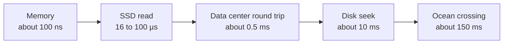

# Numbers, formulas and papers to know

*Part of [System design for the technical PM](./README.md)*

*Last reviewed: 2026-10 · Volatility: stable*

## TL;DR

Good design starts with arithmetic. A few numbers let you say, in a minute, whether a design needs one machine or a thousand. You need five kinds of figure. **Latency orders of magnitude** tell you what is cheap and what is slow. **Availability tables** turn "three nines" into minutes of downtime. **Estimation shortcuts** turn "a billion requests a day" into a rate per second. **Size facts** give you bytes per ID and per record. **Classic papers** name the ideas that real systems still use.

None of these numbers is exact. Say "roughly", show your working, and round hard. Being right to a factor of two is enough. Being wrong by a factor of a thousand is the failure to avoid.

> 🎯 **For the technical PM**
>
> **Why it matters** — Most scope and cost arguments are really arithmetic arguments. A PM who can do the arithmetic can tell a reasonable plan from a fantasy in the room.
>
> **What it changes in your decisions** — You turn an availability promise into a downtime budget. You turn a growth forecast into queries per second. You spot a design that needs a hundred times more capacity than the forecast supports.
>
> **Ask your eng team** — *"What are the peak requests per second, the storage per year and the downtime this SLO allows? How did you get each number?"*
>
> **Risk if ignored** — A promise of "five nines" that allows 26 seconds of outage a month, with no way to meet it. Or a design reviewed for the wrong scale.

## The mental model: a ladder of costs

Each rung is about a thousand times slower than the one above it. A memory read is nanoseconds. A network round trip in a data center is a fraction of a millisecond. A disk seek is milliseconds. A trip across an ocean is hundreds of milliseconds. Design means keeping the hot path on the upper rungs.



## Mechanics

### Latency orders of magnitude

| Operation | Roughly |
| --- | --- |
| L1 cache reference | 1 ns |
| Main memory reference | 100 ns |
| SSD random read (NVMe, order of magnitude) | 16 to 100 µs |
| Round trip within a data center | 0.5 ms |
| Hard disk seek | 10 ms |
| Round trip California to Europe | 150 ms |

Exact values change with hardware. The ratios are what matter.

### Availability: allowed downtime

| Availability | Per year | Per 30-day month |
| --- | --- | --- |
| 99% | 3.65 days | 7.2 hours |
| 99.9% | 8.77 hours | 43.2 minutes |
| 99.99% | 52.6 minutes | 4.32 minutes |
| 99.999% | 5.26 minutes | 26 seconds |

Services in series multiply: two 99.9% services give about 99.8%. Independent copies in parallel multiply the failure chances: two 99.9% replicas give 1 − 0.001² = 99.9999%, but only if their failures are truly independent, and they rarely are.

### Estimation shortcuts

| Fact | Value |
| --- | --- |
| Seconds in a day | 86,400, close to 10⁵ |
| 1 million requests a day | about 12 per second |
| 1 billion requests a day | about 11,600 per second |
| Peak against average | plan for 2 to 3 times the average, and measure yours |
| Powers of two | 2¹⁰ is about a thousand (KB), 2²⁰ a million (MB), 2³⁰ a billion (GB), 2⁴⁰ a trillion (TB) |

### Sizes

A UUID is 16 bytes. A 64-bit ID is 8 bytes. An ASCII character is 1 byte. A short code of 6 Base62 characters gives about 56.8 billion values. 7 characters give about 3.52 trillion.

### Classic papers worth knowing

| Year | Paper | Why it still matters |
| --- | --- | --- |
| 2003 | The Google File System | Distributed storage on cheap machines |
| 2004 | MapReduce | Batch processing as map and reduce steps |
| 2006 | Bigtable | A wide-column store |
| 2006 | Chubby | A lock service built on consensus |
| 2007 | Dynamo | A leaderless, highly available key-value store |
| 2010 | Haystack | Photo storage that avoids extra disk seeks |
| 2011 | Kafka | A distributed log |
| 2012 | Spanner | A globally consistent database |
| 2013 | TAO | A social-graph store |
| 2014 | Raft | Consensus designed to be understood |
| 2015 | Borg | Cluster management, the ancestor of Kubernetes |
| 2016 | Deep Neural Networks for YouTube Recommendations | The two-stage recommender |

## Tradeoffs and decisions

- **Precision vs. speed.** More decimals rarely change the design. Stop when the next digit would not.
- **Average vs. peak.** Sizing for the average fails at the peak. Sizing for the worst peak wastes money.
- **Nines vs. cost.** Each extra nine costs far more than the last.
- **Memorized numbers vs. measured numbers.** Use the table to start. Replace it with your own measurements.

## Failure modes

- **No units.** "A lot of storage" is not an estimate.
- **Peak ignored.** A plan that holds on average and fails at the daily peak.
- **Nines in the contract, not in the design.** An SLA that no architecture can meet.
- **Independent failures assumed.** Two replicas in the same rack are not independent.
- **Latency numbers from 2005.** Disks and networks have changed. Use the ratios, not the digits.

## Under the hood

The file is `system-design/code/estimator.py`. It is the same file as in the [foundations lesson](./foundations-and-framework.md), and it also holds the availability and Base62 functions.

```python
def downtime_minutes(availability, days=30):
    return (1 - availability) * days * 24 * 60

def series(*avail):
    out = 1.0
    for a in avail:
        out *= a
    return out

def parallel(*avail):
    out = 1.0
    for a in avail:
        out *= (1 - a)
    return 1 - out
```

## Worked example: three promises, checked

*The numbers come from `system-design/code/estimator.py`.*

**An availability promise.** A product page promises 99.99% a month. That is 4.32 minutes. A single bad deploy that takes five minutes to roll back breaks the promise on its own.

**Two dependencies.** A checkout depends on a payment service and an inventory service, each at 99.9%. In series they give 99.8%, which allows about 86 minutes of downtime in a 30-day month, double what either promises alone.

**A memory estimate.** A reverse image search holds 100 billion images as 128-dimension vectors of 4-byte numbers: 100 billion × 128 × 4 bytes = 51.2 TB. Compressing each vector to 32 bytes gives 3.2 TB, which fits on a handful of machines.

## Practitioner checklist

- [ ] Are the inputs to every estimate written down, with units?
- [ ] Is peak traffic estimated, not only the average?
- [ ] Is every availability promise converted to minutes of allowed downtime?
- [ ] Are series dependencies multiplied?
- [ ] Are failures in a redundant pair checked for independence?
- [ ] Are the latency numbers replaced by measurements before launch?

## Related lessons

- [Foundations and framework](./foundations-and-framework.md) — the four-step framework and a full estimate.
- [Core building blocks](./core-building-blocks.md) — IDs and Base62 in practice.
- [Cost optimization](../cost-optimization/README.md) — turning capacity into money.
- [Generating text and the KV cache](../transformers/generating-text-and-the-kv-cache.md) — the same counting habit for model serving.
- [Evaluation and observability](../evaluation-and-observability/README.md) — measuring the real numbers.

## Sources

- Jeff Dean, "Numbers everyone should know", and the widely circulated "latency numbers every programmer should know": the latency orders of magnitude. Exact values vary by hardware.
- Betsy Beyer et al., *Site Reliability Engineering*, O'Reilly, 2016 (sre.google/sre-book): SLIs, SLOs and error budgets.
- Martin Kleppmann, *Designing Data-Intensive Applications*, O'Reilly, 2017: the standard reference for the papers above.
- The Google File System (SOSP 2003), MapReduce (OSDI 2004), Bigtable (OSDI 2006), Chubby (OSDI 2006), Dynamo (SOSP 2007), Haystack (OSDI 2010), Kafka (NetDB 2011), Spanner (OSDI 2012), TAO (USENIX ATC 2013), Raft (USENIX ATC 2014), Borg (EuroSys 2015) and Covington et al., *Deep Neural Networks for YouTube Recommendations* (RecSys 2016).
- The availability and size figures are computed. They come from `system-design/code/estimator.py`. These sources were not re-opened during this revision, and the lesson's fact-check is pending.
