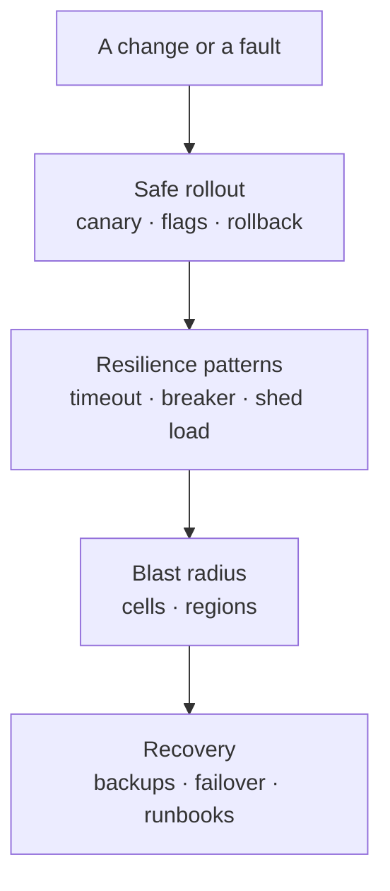

# Reliability and operations

*Part of [System design for the technical PM](./README.md)*

*Last reviewed: 2026-10 · Volatility: stable*

## TL;DR

Every system fails. Reliability is the work of deciding how much failure is acceptable, noticing it quickly, limiting its spread and recovering fast. It has five parts. **Targets**: an SLO and an error budget say how much unreliability you can spend. **Visibility**: metrics, logs and traces tell you what is wrong and where. **Resilience patterns**: timeouts, retries, circuit breakers and load shedding stop a small failure from becoming a large one. **Safe change**: canaries, feature flags and staged rollouts limit the damage of your own changes. **Recovery**: multi-region design, cells and tested backups limit how long and how far a failure reaches.

Most large outages are not new bugs in new code. They are a small change plus a missing safeguard. The case studies below, written from the operators' own postmortems, show the same few causes: a change pushed everywhere at once, a command with too much reach, a backup nobody tested, and a clock that went backwards.

> 🎯 **For the technical PM**
>
> **Why it matters** — Reliability is a product feature with a price. Each extra nine of availability costs more than the last. The SLO is a product decision, not only an engineering one.
>
> **What it changes in your decisions** — You set SLOs from what users need. You use the error budget to decide when to ship and when to slow down. You ask how a change is rolled out, and how it is rolled back.
>
> **Ask your eng team** — *"What is our SLO and how much error budget is left? How is a change rolled out? When did we last restore a backup, and how long did it take?"*
>
> **Risk if ignored** — A global change with no staged rollout. A backup that fails silently for months. An outage that takes your own recovery tools down with it.

## The mental model: layers of defence



No layer is perfect. Each one catches what the layer above missed.

## Mechanics

### SLIs, SLOs, SLAs and error budgets

An **SLI** is a measurement, such as the fraction of requests that succeed. An **SLO** is the target for it, such as 99.9% over 30 days. An **SLA** is a contract with consequences. The gap between 100% and the SLO is the **error budget**, the amount of failure you can spend on change. When the budget is gone, slow down releases and fix reliability. [Numbers, formulas and papers](./numbers-and-formulas.md) turns nines into minutes.

### Observability

- **Metrics.** For services, use the **RED** method: rate, errors and duration. For resources, use **USE**: utilization, saturation and errors.
- **Logs.** Structured, with request and trace IDs.
- **Traces.** Distributed tracing, for example with OpenTelemetry, shows where time goes across services.
- **Alerts.** Alert on user-facing symptoms, such as an SLO burn rate, not on every internal cause.

Metrics say something is wrong. Traces show where. Logs explain why.

### Resilience patterns

- **Timeouts** on every network call. No unbounded waits.
- **Retries** with exponential backoff and **jitter** (randomness), plus a **retry budget** that caps the extra load. Naive retries can turn a blip into a storm.
- **Circuit breakers** stop calling a failing dependency and fail fast. They have three states: closed, open and half-open. In half-open, one trial call decides whether to close again.
- **Bulkheads** isolate resource pools, so one bad dependency cannot use up everything.
- **Load shedding** and **backpressure** reject work early when overloaded.
- **Idempotency**, so that retries are safe.

### Safe change

Roll out gradually. A **canary** exposes a change to a small slice of traffic, compares its health with the baseline, then widens, or rolls back automatically. **Blue-green** deployment keeps the old version running for an instant switch back. **Feature flags** separate deploying code from releasing it. Treat configuration like code: review it, test it and roll it out in stages.

### Regional failure and recovery

**RPO** (recovery point objective) is how much data you can afford to lose. **RTO** (recovery time objective) is how long recovery may take. **Active-passive** keeps a standby region and is simpler. **Active-active** serves from several regions and needs conflict handling or partitioned ownership of data. Practise failover regularly. Keep your recovery tools independent of the thing that failed.

### Blast radius

Partition the system into **cells**: complete, independent copies of the stack, each serving a subset of customers. One bad change or fault then reaches only one cell. Add guardrails to operational tools: validate input, change capacity slowly and refuse to go below safe minimums.

### Backups that restore

Use several independent backup methods, with off-site copies. Archive the write-ahead log continuously for point-in-time recovery. Alert when a backup job fails or produces suspiciously small output. Above all, **test restores** on a schedule. An untested backup is a hope, not a backup.

## Case studies from operators' own postmortems

*Each summary comes from the company's own write-up, which was read for this lesson. Quoted numbers are the writers' own.*

**Cloudflare, 2 July 2019: a regular expression, deployed everywhere.** A new rule for the web application firewall contained a regular expression that backtracked enormously and used up the CPU on every core that handled web traffic. The rule was pushed to the whole network at once, without a staged rollout, because the procedure treated rule changes as safe. Cloudflare's post says the service was down for 27 minutes. Traffic and CPU were back to normal two minutes after the firewall was switched off globally. Fixes listed: restore the CPU-use protection, check all 3,868 managed rules, add performance profiling to the test suite, switch to a regex engine with run-time guarantees and use staged rollouts for rules.

**Meta, 4 October 2021: a maintenance command and a DNS safeguard.** During routine maintenance, a command meant to check backbone capacity instead took down all backbone connections. The tool that should have blocked such commands had a bug. The DNS servers are built to withdraw their BGP (Border Gateway Protocol) route advertisements when they cannot reach the data centers, so they did, and the rest of the internet could no longer find Meta's servers. Internal tools that depended on DNS broke too, and engineers had to go to the data centers in person. The post gives no duration. The lessons: safeguards need safeguards, and recovery tools must not depend on the thing that failed.

**Amazon S3, 28 February 2017: a mistyped input.** An authorized team member, following an established playbook to remove a few servers, entered one input incorrectly. A larger set of servers was removed than intended, including servers in two subsystems that store the index and place new data. Both needed a full restart, and the post says they had not been fully restarted in the large regions for many years, so recovery took longer than expected. The index subsystem was fully recovered at 1:18 PM Pacific time and the placement subsystem at 1:54 PM. The status dashboard itself depended on S3. AWS changed the tool to remove capacity more slowly and to refuse to go below minimum capacity, audited its other tools, and moved to split services into cells.

**GitLab, 31 January 2017: four recovery mechanisms, none usable.** An engineer, resyncing a database replica, ran a command to wipe a data directory on the primary instead of the secondary. About 300 GB had been removed before it was stopped. Of the four backup procedures, the daily dump had been failing because of a version mismatch and the failure emails were being rejected, the snapshot was not meant for disaster recovery, cloud disk snapshots were not enabled for the database servers, and replication was not a backup. The team restored from a snapshot taken about six hours earlier. The write-up says at least 5,000 projects, 5,000 comments and about 700 users were affected, and that no one owned testing the recovery procedure. Fixes included hourly snapshots, point-in-time recovery, automated restore tests and an owner for data durability.

**Cloudflare, 1 January 2017: time went backwards.** When a leap second arrived, a calculation of elapsed time produced a negative number. That value was passed to a random-number function that panics on a negative argument. Customers using CNAME records saw errors, at about 0.2% of DNS queries at peak. The post says the root cause was "the belief that time cannot go backwards". Google avoids leap-second steps by smearing the extra second over 24 hours, noon to noon UTC, so that each second runs about 11.6 microseconds long.

## Tradeoffs and decisions

- **More nines vs. cost.** Each nine costs more than the last.
- **Retries vs. overload.** Retries rescue brief faults and can sustain an overload.
- **Fast rollout vs. safe rollout.** A canary slows a release by minutes and prevents global outages.
- **Active-active vs. active-passive.** Higher availability against conflict handling.
- **Strict tools vs. flexible tools.** Guardrails slow operators and stop disasters.
- **Alert on symptoms vs. causes.** Fewer, better pages against more detail.

## Failure modes

- **Global change with no stages.** One push reaches every machine.
- **Retry storm.** Clients multiply load on a struggling service.
- **Cascading failure.** A slow dependency fills every thread, and the failure spreads upward.
- **Recovery depends on the failed system.** Dashboards, DNS and access tools go down together.
- **Untested backups.** They fail when needed, and nobody noticed.
- **Alert fatigue.** Pages for causes, not for user pain.
- **No owner.** Reliability work that belongs to everyone belongs to no one.

## Under the hood

Three files in `system-design/code/` model the patterns with a fake clock and random seeds.

- `circuit_breaker.py` is a closed, open and half-open state machine.
- `retries.py` simulates a retry storm and the same load with backoff, jitter and a budget.
- `canary.py` rolls a change out in stages and rolls back when the canary slice is worse than the baseline.

```python
def record(self, now, ok):
    if ok:
        self.state, self.failures = "closed", 0
    else:
        self.failures += 1
        if self.state == "half-open" or self.failures >= self.threshold:
            self.state, self.opened_at = "open", now
```

## Worked example: a blip, a storm and a rollout

*The loads and rates are invented. The numbers come from the three files above.*

**Circuit breaker.** A dependency fails three times, and the breaker opens. For the next 20 seconds, 20 calls are refused without touching the dependency. After 30 seconds one trial call is allowed. It fails, so the breaker opens again. Another 30 seconds later a trial succeeds, and the breaker closes.

**Retry storm.** A service handles 100 requests per second and is offered 90. For one second it returns errors to everyone. With naive clients that retry each failed request three times, the offered load jumps to 360 per second. The service stays overloaded for 24 seconds after the blip. With backoff, jitter and a retry budget of 10% of the base load, the peak is 96 per second and the service is never overloaded again.

**Canary.** A bad version has an 8% error rate against a baseline of 0.2%. A staged rollout checks the canary at 1%, 10%, 50% and 100% of traffic. The bad version is rolled back at the first stage, with only 1% of traffic exposed. A good version passes every stage and completes.

## Practitioner checklist

- [ ] Is there an SLO per user journey, and is the error budget visible?
- [ ] Do alerts fire on SLO burn, not on every internal cause?
- [ ] Does every network call have a timeout, and every retry a backoff, jitter and a budget?
- [ ] Do critical dependencies have circuit breakers and bulkheads?
- [ ] Are all changes, including configuration, rolled out in stages with automatic rollback?
- [ ] Is the blast radius limited by cells or regions?
- [ ] Do operational tools validate input and refuse to go below safe minimums?
- [ ] Are RPO and RTO written down, and is failover practised?
- [ ] Are restores tested on a schedule, and does a person own durability?
- [ ] Do recovery tools work when the main system is down?

## Related lessons

- [Numbers, formulas and papers](./numbers-and-formulas.md) — nines, downtime and availability maths.
- [Distributed data and consistency](./distributed-data-and-consistency.md) — replication and failover.
- [Traffic, caching, APIs and storage choice](./traffic-caching-apis-and-storage-choice.md) — health checks, draining and cold caches.
- [Evaluation and observability](../evaluation-and-observability/README.md) — measuring AI systems the same way.
- [AI security and guardrails](../ai-security-and-guardrails/README.md) — limits and kill switches for agents.

## Sources

- Cloudflare, "Details of the Cloudflare outage on July 2, 2019", blog.cloudflare.com, 2019-07-12: read in full for this lesson.
- Cloudflare, "How and why the leap second affected Cloudflare DNS", blog.cloudflare.com, 2017-01-01: read in full for this lesson.
- Santosh Janardhan, "More details about the October 4 outage", engineering.fb.com, 2021-10-05: read in full for this lesson.
- Amazon Web Services, "Summary of the Amazon S3 Service Disruption in the Northern Virginia (US-EAST-1) Region", aws.amazon.com/message/41926: read in full for this lesson.
- GitLab, "Postmortem of database outage of January 31", about.gitlab.com, 2017-02-10: read in full for this lesson.
- Google, "Google Public NTP: Leap Smear", developers.google.com/time/smear: read for this lesson. The 2012 Linux leap-second incident was not re-opened and is not described here.
- Betsy Beyer et al., *Site Reliability Engineering*, O'Reilly, 2016: SLOs, error budgets and cascading failures. Michael Nygard, *Release It!*, 2nd ed., 2018: circuit breakers and bulkheads. Marc Brooker, "Timeouts, retries and backoff with jitter", Amazon Builders' Library. These three were not re-opened.
- The loads, rates and traffic in the worked example are invented. The numbers come from `system-design/code/`. The module's fact-check is pending.
