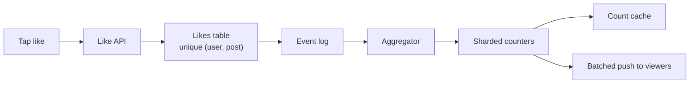

# Social and media systems

*Part of [System design for the technical PM](./README.md)*

*Last reviewed: 2026-10 · Volatility: stable*

## TL;DR

Social and media products share a pattern: a small action by one person must reach many people, quickly, at huge volume. A like must update a counter that millions of people watch. A friend search must walk a graph. A swipe must be matched with another person's swipe. A photo from fifteen years ago must come back on demand. A video upload must become a dozen playable files within minutes. And a live event must stream to tens of millions of people at once.

The same few tools solve them. **Shard** a hot counter so no single row is a bottleneck. **Count approximately** where exact counts are not needed. Keep **inverted indexes** so queries become set operations. **Tier** storage by how often data is read. Split work into a **graph of parallel jobs**. Push the heavy load to a **CDN**. And degrade non-essential features before the essential ones fail.

> 🎯 **For the technical PM**
>
> **Why it matters** — These systems decide the feel of your product: whether a like appears instantly, whether old memories load, whether a live event holds up. They also decide a large part of your infrastructure bill.
>
> **What it changes in your decisions** — You decide which numbers must be exact and which can lag or be approximate. You decide which features to switch off first under load. You pick storage tiers by access pattern and cost.
>
> **Ask your eng team** — *"Which counts are exact, which are approximate, and how stale can each be? What do we turn off first when load spikes?"*
>
> **Risk if ignored** — A viral post that overloads one database row. A live event where login and ads fail before the video does. A storage bill that grows with every photo ever uploaded.

## The mental model: many small actions, one hot spot

Picture a stadium with one ticket window. Every fan queues at the same window, and it does not matter how fast the clerk is. Add sixteen windows and a screen that sums their tallies, and the queue disappears. The fix is the same for counters, feeds and live events: spread the hot spot, then combine the results when someone looks.



## Mechanics

### Likes at global scale

- **Write path.** Record each (user, post) pair once, so a double tap does not count twice. Publish a like event to a log.
- **Counts.** Aggregate asynchronously and cache the result. For a viral post, use **sharded counters**: split one counter into many, write to a random shard, and add the shards when reading.
- **Real-time updates.** Push batched count changes to viewers over WebSockets or server-sent events, not one message per like.
- **Approximation.** Displayed counts can lag by seconds. For unique counts, such as distinct viewers, use a probabilistic structure like **HyperLogLog**. Redis's version uses up to 12 KB per counter and gives a standard error of 0.81%.

### Search over a social graph

Store the graph as **objects** (people, pages) and **associations** (friend-of, lives-in). Facebook's TAO serves this from caches in front of sharded MySQL. For search, build **inverted indexes over edges**: for each term, such as `lives_in:london` or `friend:alice`, keep a sorted list of matching IDs. A query like "friends of Alice who live in London" is the intersection of two lists, run across shards and then ranked. Facebook's Unicorn system, described in 2013, worked this way.

### Swipe and match

Pre-compute candidate stacks by location and preferences, and filter out people already swiped. Swipes are a very high write rate, so store (swiper, target, direction) in a partitioned store. On a right swipe, look up whether the target already swiped right on you. That is one key lookup. If so, create the match atomically, once, and notify both people. A ranking model balances relevance, freshness and fairness of exposure.

### Photo storage that lasts

Keep **metadata** (who, when, where, which album) in a database and **blobs** in an object store, with a CDN in front for popular content. Tier by access frequency. Facebook's Haystack (2010) packed many photos into large files, so a read needs about one disk read instead of several metadata lookups. Its f4 system (2014) moved older, rarely read "warm" photos to erasure-coded storage. The f4 paper reports cutting the effective replication factor of warm data from 3.6 to either 2.8 or 2.1. The principle: keep hot data fast and warm data cheap, and keep cold fetches correct even if slower.

### Video upload and processing

Clients upload directly to object storage with signed, resumable multipart URLs. The upload event starts a workflow, a directed graph of jobs. Jobs transcode the video into an adaptive-bitrate ladder of resolutions and bitrates, package it for HLS and DASH, generate thumbnails, run moderation and feature extraction. Finally the system writes metadata, warms the CDN and feeds the video into recommendation pools. Speed comes from splitting the video into segments and transcoding them in parallel, and from doing the most common formats first.

### Live streaming at peak concurrency

The video path runs from encoder to ingest, transcoder, packager and origin, and then out through several CDNs. Players pull short segments over HTTP, so the CDNs absorb most of the load. The hard part is often everything around the video. Login, home-page APIs, ads and concurrent-viewer counters all spike together when a big moment arrives. Reactive autoscaling is too slow for a sudden surge. So pre-scale before known events, load-test at target concurrency and plan **graceful degradation**: switch off non-essential features under load.

### Delivery routing in one paragraph

Next-day delivery is a vehicle routing problem. It is NP-hard, so production systems use heuristics and solvers under constraints: time windows, vehicle capacity, driver hours and traffic. [Location and geo services](./location-and-geo-services.md) shows a small example.

## Tradeoffs and decisions

- **Exact vs. approximate counts.** Exact counts cost a hot row. Approximate counts cost a small error.
- **Push vs. pull for counts.** Pushing batches feels live and costs connections.
- **Replicated vs. erasure-coded storage.** Fast repair and reads against lower storage cost.
- **Parallelism vs. orchestration cost.** More jobs finish faster and need a workflow engine.
- **Pre-scaling vs. autoscaling.** Pre-scaling costs money before the event and avoids the surge.
- **Feature richness vs. survival.** Decide what to drop first.

## Failure modes

- **Hot counter.** One row takes all the writes for a viral post.
- **Double counting.** Retries or double taps counted twice.
- **Duplicate matches.** Two simultaneous swipes create two matches.
- **Graph explosion.** A celebrity's friend list makes a query touch too many shards.
- **Cold tier surprise.** Old photos slow to load, or too costly to fetch.
- **Transcoding backlog.** A queue of uploads delays publishing.
- **Collateral failure.** Login and APIs fail before the video does.

## Under the hood

Eight files in `system-design/code/` model the ideas on small data.

- `sharded_counter.py` spreads 50,000 likes over 16 shards, and dedupes double taps.
- `hyperloglog.py` is a small HyperLogLog with 16,384 registers.
- `graph_search.py` answers a query with inverted indexes and set intersection.
- `match.py` detects a mutual swipe with one lookup.
- `photo_tiers.py` compares storage with and without tiers.
- `video_dag.py` compares serial, per-rendition and per-segment transcoding.
- `vrp.py` improves a delivery tour with a heuristic.
- `funnel.py` and `ann_search.py`, from the [ML lesson](./ml-system-design.md), cover recommendation and image search.

```python
def count(self):
    alpha = 0.7213 / (1 + 1.079 / M)
    est = alpha * M * M / sum(2.0 ** -r for r in self.reg)
    zeros = self.reg.count(0)
    if est <= 2.5 * M and zeros:
        est = M * math.log(M / zeros)           # small-range correction
    return est
```

## Worked example: a viral post, a match and a photo archive

*The traffic and data are invented, except where a published figure is named. The numbers come from the files above.*

**Counters.** 50,000 likes arrive in a second. With one counter, the busiest row takes all 50,000 writes. With 16 shards, the busiest row takes 3,195. Reads sum the 16 shards and still get 50,000. A user who taps twice is counted once.

**Unique counts.** A HyperLogLog with 16,384 registers counts 100,000 distinct items as 99,583, an error of 0.42%. The theoretical standard error is 0.81%, the figure Redis quotes. Two overlapping sets of 100,000 merge to an estimate of 150,032 against a true 150,000.

**Graph search.** "Friends of Alice who live in London" is the intersection of two lists and returns Bob and Dev. "Friends of Alice who live in Berlin" returns nothing.

**Match.** Ana swipes right on Ben, and nothing happens. Ben swipes right on Ana, and a match is created. A repeated swipe reports the match again and stores no second one.

**Photos.** The f4 abstract reports 65 PB of logical warm data and an effective replication factor falling from 3.6 to 2.1. That is 234 PB of physical storage against 136.5 PB, a saving of 97.5 PB. For an archive that is 10% hot and 90% warm, 100 PB of photos takes 225 PB tiered against 360 PB without tiers, 38% less.

**Video.** A 10-minute video is 60 segments of 10 seconds, in 5 renditions: 300 jobs of 4 seconds each. One worker needs 1,200 seconds. One worker per rendition, each doing the whole video, needs 240 seconds. 30 workers on segments need 40 seconds.

## Practitioner checklist

- [ ] Which counts must be exact, and which may be approximate or lag?
- [ ] Are counters sharded for hot items, and are writes deduplicated?
- [ ] Are matches and other pairings created atomically, once?
- [ ] Are graph queries bounded for very popular nodes?
- [ ] Are storage tiers chosen from measured access patterns?
- [ ] Is video processing parallel by segment, with a plan for backlog?
- [ ] Is there a pre-scale plan, a load test and a list of features to drop for live events?

## Related lessons

- [ML system design](./ml-system-design.md) — recommendation and ranking.
- [Web-scale services](./web-scale-services.md) — the news feed and fan-out.
- [Real-time systems](./real-time-systems.md) — video streaming and chat.
- [Storage and sync](./storage-and-sync.md) — object storage and erasure coding.
- [Core building blocks](./core-building-blocks.md) — consistent hashing and rate limiting.

## Sources

- Nathan Bronson et al., *TAO: Facebook's Distributed Data Store for the Social Graph*, USENIX ATC 2013. Not re-opened.
- Michael Curtiss et al., *Unicorn: A System for Searching the Social Graph*, VLDB 2013. Not re-opened.
- Subramanian Muralidhar et al., *f4: Facebook's Warm BLOB Storage System*, OSDI 2014: the 65 PB figure and the replication factors. The abstract was read for this lesson. The Haystack paper (Doug Beaver et al., OSDI 2010) was not re-opened.
- Redis documentation, "HyperLogLog", redis.io: the 12 KB and 0.81% figures. Read for this lesson. Philippe Flajolet et al., *HyperLogLog: the analysis of a near-optimal cardinality estimation algorithm*, 2007. Not re-opened.
- R. Pantos and W. May, *HTTP Live Streaming*, RFC 8216, 2017. Not re-opened.
- Alex Xu, *System Design Interview*, volumes 1 and 2: related chapters. Not re-opened.
- Traffic, data and rates are invented. The numbers come from `system-design/code/`. The module's fact-check is pending.
