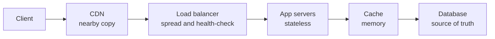

# Traffic, caching, APIs and storage choice

*Part of [System design for the technical PM](./README.md)*

*Last reviewed: 2026-10 · Volatility: stable*

## TL;DR

Before a request reaches your code, it passes through a few shared layers. A **load balancer** spreads traffic over servers. A **CDN** answers from a nearby copy. A **cache** answers from memory. Behind them sit a database, chosen for the way you read and write, and an **API** that clients depend on for years.

Each layer is a choice with a cost. A layer 7 load balancer can route by URL, and it costs more per request than a layer 4 one. A write-back cache is fast, and it loses data if it crashes. A document store is flexible, and it makes some questions hard to ask. An offset-paged API is easy to build, and it shows users repeated rows. This lesson names the choices and what each one costs.

> 🎯 **For the technical PM**
>
> **Why it matters** — These layers decide your latency, your cost per request and what you can promise users about freshness. Most "slow page" and "wrong number" bugs live here.
>
> **What it changes in your decisions** — You ask what happens on a cache miss and on a cache failure. You choose a store by your queries, not by fashion. You treat an API as a contract: once clients use it, you cannot change it freely.
>
> **Ask your eng team** — *"What is our cache hit rate, what happens to the database when the cache is cold, and how do clients page through results while data changes?"*
>
> **Risk if ignored** — A cache outage that takes the database down with it. A page that shows the same row twice. A public API you cannot change without breaking customers.

## The mental model: a request passes four doors



Each door tries to answer before the request goes deeper. The deeper it goes, the slower and costlier it gets. A good design makes most requests stop at the first or second door.

## Mechanics

### Load balancers: layer 4 and layer 7

A **layer 4** balancer routes by IP address and port, and does not read the request. It is very fast. A **layer 7** balancer reads the HTTP request. It can route by path, header or cookie, end TLS, retry and rewrite. It costs more per request.

Common algorithms:

- **Round robin** sends each request to the next server in turn. It is fair when requests cost the same.
- **Least connections** sends the request to the server with the fewest open connections. It is better when some requests are slow.
- **Hashing** sends the same key to the same server, which helps cache hit rates.

**Health checks** remove failing servers from the pool. **Connection draining** lets in-flight requests finish before a server leaves, which makes deploys safe. Run balancers in pairs or fleets, so the balancer is not a single point of failure.

### Caching strategies

| Strategy | How it works | Cost |
| --- | --- | --- |
| Cache-aside | The app reads the cache. On a miss it reads the database and fills the cache. | Stale data until expiry or invalidation. The most common choice. |
| Read-through | The cache layer loads from the database itself. | Simpler app code, more cache logic. |
| Write-through | Writes go to the cache and the database together. | Consistent, and slower writes. |
| Write-back | Writes go to the cache and are flushed later. | Fast, and unflushed writes are lost if the cache crashes. |

**Eviction** decides what to drop when the cache is full. LRU drops the least recently used entry. Expiry by time to live bounds staleness. **Invalidation**, deleting or updating entries when data changes, is the hard part. A common rule is to update the database, then delete the cache key.

The **cache stampede** is covered in [Web-scale services](./web-scale-services.md). Always state what happens on a cache miss and on a cache failure. The database must survive a cold cache.

### CDNs

A CDN keeps copies of content at edge locations near users. It fits static files, images, video segments and cacheable API responses. In a **pull** CDN, the edge fetches from your origin on the first miss. In a **push** CDN, you upload ahead of time. Control freshness with cache keys and time to live. Prefer versioned URLs (`app.3f9c.js`) over purges, because a new URL cannot be stale. Many CDNs also add TLS termination, DDoS absorption and edge compute.

### Choosing a store

Choose from your access patterns and consistency needs. Start with a relational database unless you can name the pattern it cannot serve.

| Family | Shape | Fits |
| --- | --- | --- |
| Relational | Tables, joins, ACID transactions | Most business data, flexible queries |
| Key-value | Get and put by key | Sessions, caches, counters |
| Wide-column | Partition key plus sorted columns | Huge write rates, queries designed around the key |
| Document | JSON-like records | Flexible, nested records |
| Graph | Nodes and edges | Relationship-heavy traversals |

Many systems use several stores, each for what it does best.

### Queues and logs

A queue hands each message to one consumer and removes it after acknowledgement. A log keeps ordered, replayable partitions that many consumer groups read. Both absorb bursts and decouple producers from consumers. [Data infrastructure](./data-infrastructure.md) covers delivery guarantees in depth.

### API design

- **REST** over HTTP and JSON is universal, cacheable and fits public APIs.
- **gRPC** uses HTTP/2 and Protocol Buffers. It is compact, typed and supports streaming, so it fits calls between internal services.
- **GraphQL** lets clients ask for exactly the fields they need. Watch for expensive queries.

Use **cursor pagination** for large or changing lists. Offsets get slower with depth, and they skip or repeat rows when data changes. Make unsafe operations safe to retry with **idempotency keys**: the client sends a unique key, and the server stores the result of the first request and replays it for retries. Version the API and rate-limit it.

## Tradeoffs and decisions

- **Layer 4 vs. layer 7.** Speed against routing power.
- **Round robin vs. least connections.** Simplicity against fairness with uneven requests.
- **Write-through vs. write-back.** Safety against write speed.
- **Pull vs. push CDN.** Less work against control over what is cached.
- **Relational vs. specialized store.** Flexible queries against scale in one pattern.
- **REST vs. gRPC vs. GraphQL.** Reach and cacheability against efficiency and flexibility.
- **Offset vs. cursor.** Simple jumps to a page against stable results.

## Failure modes

- **Cold cache.** A restart sends all traffic to the database.
- **Stale cache.** Updated data does not reach readers, because invalidation was missed.
- **Hot key.** One popular key overloads one cache node.
- **Uneven balancing.** Round robin piles slow requests on one server.
- **Health check too slow or too eager.** Failing servers stay in, or healthy servers get removed under load.
- **Wrong store.** A document store used for data that needs joins and transactions.
- **Broken clients.** An API change that existing apps cannot handle.
- **Duplicate side effects.** A retried POST that charges twice, because there is no idempotency key.

## Under the hood

Three files in `system-design/code/` measure the choices.

- `load_balancer.py` has a pool with round robin, least connections, health-check removal and draining.
- `cache_policies.py` runs an LRU cache under a skewed load and counts what a write-back cache loses in a crash.
- `pagination.py` shows offset paging repeating rows while new rows arrive, and cursor paging not repeating them.

```python
def pick_least_connections(self):
    return min(self.eligible(), key=lambda s: self.active[s])

def eligible(self):
    return [s for s in self.active if s in self.healthy and s not in self.draining]
```

## Worked example: four layers, four numbers

*The traffic is invented. The numbers come from the three files above.*

**Balancing.** Every third request is slow (5 seconds) and the rest are fast (0.1 seconds), across 3 servers. Round robin sends every slow request to the same server, and that server reaches 17 open connections. Least connections peaks at 6. After a failed health check on server `b`, round robin uses only `a` and `c`. After `c` is drained, it uses only `a`.

**Cache size.** The load is skewed: a few keys get most of the requests, across 100,000 keys. An LRU cache of 1,000 entries (1% of the keys) hits 67% of requests. A cache of 10,000 entries hits 83%. A small cache goes a long way, and each extra tenfold gives less.

**Write-back risk.** A write-back cache flushes every 100 writes. It crashes after write 457. The last 58 acknowledged writes are lost. A write-through cache would lose none.

**Pagination.** A user reads page 1 of a newest-first feed. Two new rows arrive. Offset paging shows rows 92 and 91 again on page 2. Cursor paging, which asks for "rows older than the last one I saw", repeats nothing.

## Practitioner checklist

- [ ] Do we know our cache hit rate, and what the database does when the cache is cold?
- [ ] Is the invalidation rule written down, and tested?
- [ ] Do health checks and draining exist for every pool?
- [ ] Is least connections, not round robin, used where request cost varies widely?
- [ ] Is the data store chosen from named access patterns?
- [ ] Do list endpoints use cursors?
- [ ] Does every unsafe endpoint accept an idempotency key?
- [ ] Is every public API versioned and rate-limited?

## Related lessons

- [Web-scale services](./web-scale-services.md) — the cache stampede and the news feed.
- [Core building blocks](./core-building-blocks.md) — rate limiting and consistent hashing.
- [Distributed data and consistency](./distributed-data-and-consistency.md) — what replicas and caches promise about freshness.
- [Data infrastructure](./data-infrastructure.md) — queues, logs and delivery guarantees.
- [Cost optimization](../cost-optimization/README.md) — caching as a cost lever, including prompt caching.

## Sources

- Martin Kleppmann, *Designing Data-Intensive Applications*, O'Reilly, 2017: storage models, replication and caching trade-offs.
- Stripe API documentation, "Idempotent requests", stripe.com/docs/api/idempotent_requests: the idempotency key pattern.
- R. Fielding and J. Reschke, *HTTP Semantics*, RFC 9110, 2022: safe and idempotent methods.
- Alex Xu, *System Design Interview*, volumes 1 and 2: load balancing, caching and API chapters.
- The traffic, keys and load are invented. The numbers come from `system-design/code/`. These sources were not re-opened during this revision, and the lesson's fact-check is pending.
