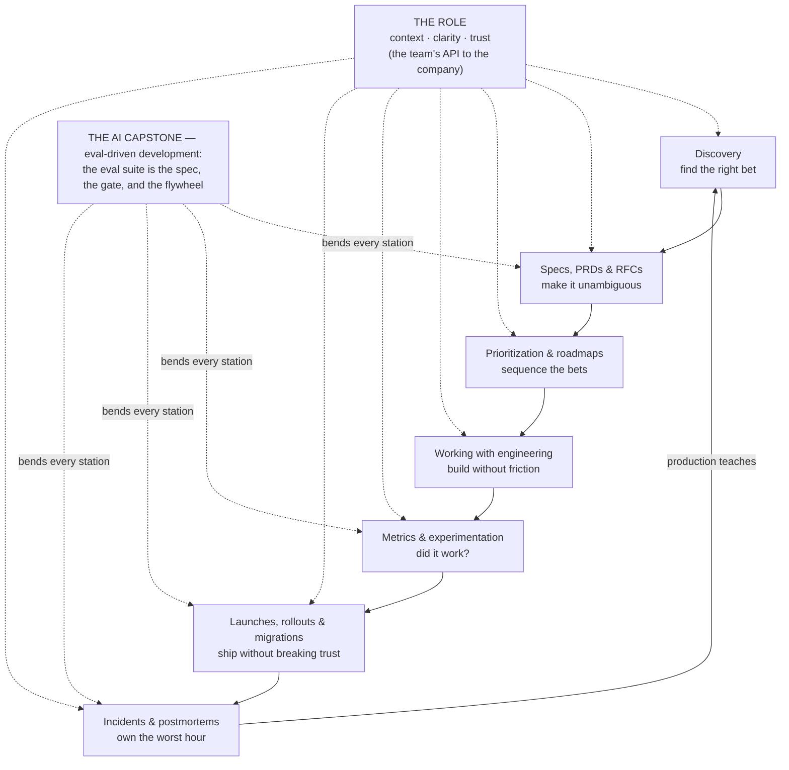

# Technical product management for the AI PM

<!-- voice: human -->

Product sense tells you *what* to build, and technical product sense tells you what the system will
*let* you build. Technical product management is the discipline that turns those judgments into
shipped software. It covers the role, the documents, the rituals and the release machinery that
carry an idea from a hunch to a feature running reliably in production, and it's the part of the
job you're actually judged on when the quarter ends.

For a PM moving into AI product management, the craft matters twice over. An AI feature is harder
to specify, because its behaviour is probabilistic, and harder to estimate, because you discover
its quality rather than design it. It's harder to launch, since a model can regress without
anyone touching your code, and harder to measure, since its most interesting failures don't throw
errors. Each lesson here teaches the general practice first and then shows what changes when
there's a model in the build. Each one also has a diagram you can redraw on a whiteboard.

## How the lessons fit together

The craft is a loop that runs every quarter, with the role at the centre and the AI capstone
bending every station.

1. [**The technical PM role**](./the-technical-pm-role.md) covers what a technical PM owns, how
   the PM, TPM and engineering manager roles differ, and where your influence comes from.
2. [**Discovery to delivery**](./discovery-to-delivery.md) covers dual-track discovery and
   delivery, the four risks, and why an AI feature needs a feasibility spike.
3. [**Specs, PRDs & RFCs**](./specs-prds-and-rfcs.md) covers the document stack, a PRD engineers
   respect, acceptance criteria for a feature that's sometimes wrong, and reading an RFC.
4. [**Prioritization & roadmaps**](./prioritization-and-roadmaps.md) covers RICE, cost of delay
   and the Kano model, roadmaps as bets rather than promises, and how to say no.
5. [**Working with engineering**](./working-with-engineering.md) covers the rituals, what
   velocity can and can't tell you, and the trust that makes estimates honest.
6. [**Metrics & experimentation**](./metrics-and-experimentation.md) covers the metric tree,
   instrumentation as a requirement, and A/B tests that don't fool you.
7. [**Launches, rollouts & migrations**](./launches-rollouts-and-migrations.md) covers feature
   flags, progressive delivery, rollback, and finishing a migration.
8. [**Incidents & postmortems**](./incidents-and-postmortems.md) covers severity, incident
   command, honest communication, blameless learning, and the AI cases such as quality incidents
   and kill switches.
9. [**Technical product management for AI**](./tpm-for-ai-products.md) is the capstone. It covers
   eval-driven development, model upgrades as migrations, the data flywheel and vibe coding.

Each lesson opens with a situation, works through one invented example step by step, and ends with
things to do next. Most include short, credited moments from practitioners who have been guests on
The Growth Podcast with Aakash Gupta ([news.aakashg.com](https://www.news.aakashg.com)).

## Where the depth lives

This module touches several ideas that other lessons cover in full. When you want the deeper
version, go here.

| Idea in this module | Where it's covered in depth |
| --- | --- |
| Product strategy, focus and saying no | [Creativity](../product-sense/creativity.md) |
| Reviewing an AI-drafted document | [Communication](../product-sense/communication.md) |
| Influence without authority | [Executive influence and stakeholders](../business-acumen/executive-influence-and-stakeholders.md) |
| Reading estimates, and sizing tech debt | [Tech debt & estimation](../technical-product-sense/tech-debt-and-estimation.md) |
| Non-functional requirements and how systems fail | [Technical product sense](../technical-product-sense/README.md) and [Reliability & failure](../technical-product-sense/reliability-and-failure.md) |
| Delivery metrics when agents write the code | [Measuring and governing](../ai-assisted-development/measuring-and-governing.md) |
| Building and grading an eval set | [Evals: golden sets, adversarial, LLM-as-judge](../content/04-evals-observability/evals.md) |
| Drift and quality monitoring in production | [Observability](../content/04-evals-observability/observability.md) |
| Specifying the context a model needs | [Context engineering for the product leader](../context-engineering/README.md) |
| A migration worked end to end | [Versioning & migration (Flowable)](../flowable/phases/08-versioning-and-migration/README.md) |

## Connects to other tracks

- [Product sense](../product-sense/README.md), the judgment that decides what's worth shipping.
- [Technical product sense](../technical-product-sense/README.md), for reading the system you're
  shipping on.
- [Evals: golden sets, adversarial, LLM-as-judge](../content/04-evals-observability/evals.md), the
  measurement layer under eval-driven development.
- [Versioning & migration (Flowable)](../flowable/phases/08-versioning-and-migration/README.md),
  where model upgrades as migrations are made concrete.

**📌 Close out the module:** [Recap & real-world examples](./recap.md) has a real incident, a
summary table and a self-test.
