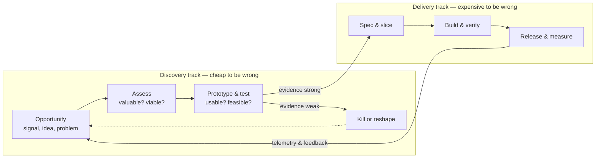

# Discovery to delivery

*Part of [Technical product management for the AI PM](./README.md)*

<!-- voice: human -->

Picture a planning meeting. Someone senior says customers keep asking for an AI assistant, and the
room nods. Three months later it ships. A handful of people try it, and most of them never come back.
Then somebody asks the question that should have come first. Did anyone check that people wanted
this, that they could use it, and that the model could even do the job?

This lesson is about asking that question early, while the answer is still cheap.

## Two tracks, running at the same time

Products don't move in a straight line from idea to launch. They move through two tracks that run
side by side.

**Discovery** answers "should we build this, and what exactly?" You work it cheaply, with
prototypes, data and user conversations. **Delivery** answers "how do we build it well?" That's
specs, sprints and releases.

The classic failure is to skip discovery and use delivery, the expensive track, to find out an idea
was wrong. The fix is a habit called **dual-track**. Discovery runs all the time, a step ahead of
delivery. It hands over only ideas that have already survived a risk check. Telemetry from shipped
work then flows back and seeds the next round of discovery.

The two tracks run at once. They don't take turns. While engineering delivers this month's
validated bet, you're de-risking next month's, with a designer and an engineer giving it part of
their time. Delivery should never have to stop and wait for discovery to work out what's next. And
discovery should never hand delivery an unvalidated guess.

## Discovery is where ideas die cheaply

Teresa Torres sums up the whole case for discovery in one line:

> "I prefer to learn if something's going to work or not before I do all the work."
> — Teresa Torres, [*Teresa Torres' Step-by-Step Guide to AI Product Discovery*](https://www.youtube.com/watch?v=wGuRuuPuYNQ), The Growth Podcast, around 04:42

So how do you learn it? Marty Cagan's four risks are the standard checklist. Each one also tells
you who you need in the room.

- **Valuable.** Will anyone's behaviour change because this exists? Good evidence is user
  interviews, funnel data, support tickets and signs that people would pay. An executive really
  wanting it doesn't count. That's an input to weigh, and it validates nothing.
- **Usable.** Can the target user actually operate it? Prototype tests are the evidence, even five
  of them. This is the cheapest of the four to check, and the one teams skip most often.
- **Feasible.** Can we build it with the time, tech and data we have? You want an engineering
  spike here. An engineer's *opinion* isn't enough. For anything novel, budget real days to try it.
- **Viable.** Does it work for the business? Think cost to serve, legal, support load and brand.
  PMs carry this risk more than anyone, because nobody else is looking.

What should discovery hand over? A decision, with the evidence behind it. You build, you kill, or
you reshape. A long document is no substitute. And treat a kill as a win. Every idea killed for
$5k of discovery is a quarter of delivery capacity saved.

## Why AI features change feasibility

For most software, an engineer can tell you in a meeting whether something is feasible. For an AI
feature, nobody can. Feasibility has to be *demonstrated*. Can the model actually do the task, at a
quality and cost you can live with? You can't know until you've run it against real examples.

So discovery for an AI feature always includes a **feasibility spike**. That's a prompt or a
fine-tune, tested against a few dozen real inputs and scored, *before* the feature enters
delivery. "The demo looked great" is not a discovery output. A scored eval set is.

Skip the spike and one of two things tends to happen. The team spends a quarter productionizing a
feature whose quality ceiling you could have found in a week. Or you ship the demo-day version,
and it collapses on real user inputs.

Here's a question to ask yourself before any bet crosses over. What evidence do I have that this
is valuable, usable, feasible and viable, and which of those four am I taking on faith?

## Worked example: an AI reply drafter

This case is invented, and so is every number in it. Say you're the PM for a customer support
tool. Sales wants a feature that drafts replies to incoming tickets with a model. You give it one
week of discovery.

**Valuable.** You read a sample of recent tickets and talk to five support agents. Writing replies
to routine questions is the part of the job they complain about most. That's a real signal, though
not a strong one yet.

**Usable.** Those five agents try a clickable prototype that shows a draft next to each ticket. Two
of them never notice the draft. You move it above the reply box and test again.

**Feasible.** An engineer runs a three-day spike. They take 40 real past tickets, write a prompt,
and generate a draft for each one. Two agents score every draft: could you send it as is, or with
light edits? You agreed the bar up front at 80% usable drafts.

| Ticket type | Tickets | Usable drafts | Rate |
| --- | --- | --- | --- |
| Billing questions | 15 | 14 | 93% |
| Everything else | 25 | 12 | 48% |
| All tickets | 40 | 26 | 65% |

**Viable.** You estimate the model cost per draft at your ticket volume. Legal confirms you're
allowed to send ticket text to the model provider.

Now decide. Overall, 26 of 40 is 65%, well under the bar. A "build" call here is the demo trap. But
billing questions clear it easily, at 14 of 15. So you reshape. The bet that enters delivery is
"drafts for billing questions only", and the other ticket types go back to discovery.

The first slice in delivery is billing tickets, email only, with a draft the agent must approve.
The PRD predicts that most billing drafts will be sent with light edits or none, as in the spike.
The team logs how often agents send a draft without changes. And you book a review three weeks
after launch to compare the real rate against the spike's 93%.

What did the week cost? One engineer for three days, five agents for an hour or two, and some of
your time. What did it save? A quarter spent building a drafter that would have been wrong on about
half of all tickets.

## Delivery: slice thin, check constantly

Once a bet enters delivery, the craft becomes breaking it down. The unit of progress is a
**vertical slice**. That's a thin, end-to-end piece a user could actually touch, such as one happy
path or one input type. The opposite is a horizontal layer, as in "first we build the whole
backend."

Why slice vertically? You find integration problems early. You have something to demo every
sprint. And you keep honest options. If the quarter goes sideways, you still have a smaller thing
you can ship, instead of 80% of everything and 100% of nothing.

Sprint by sprint, your delivery job comes down to a few things. Keep acceptance criteria
unambiguous ([next lesson](./specs-prds-and-rfcs.md)). Make scope calls fast when reality drifts
from the spec. And protect the definition of done, instrumentation included, so that the release
actually closes the loop back into discovery.

## The arrow that matters most

Look at the diagram again. Its most important arrow is the last one, where release feeds
discovery. A shipped feature is a hypothesis put into production. Telemetry and user feedback are
the results coming back. Teams that skip this arrow ship feature after feature into the void and
call it velocity.

So on launch day, put a date in the calendar 2–4 weeks out. When it arrives, review the metrics
against what the PRD predicted, and write down what you learned. That note is where next quarter's
best discovery leads come from.

## From the show: how much discovery is enough?

Practitioners on The Growth Podcast agree on the goal. They differ a little on the dose.

Itamar Gilad describes how decisions tend to get made when nobody has evidence:

> "And then usually the decision will come to either highest paid person opinion or some consensus or whatever the customer asks. And those are very weak heuristics."
> — Itamar Gilad, [*Make More of Your Product Launches Succeed with Itamar Gilad, Ex-Google PM*](https://www.youtube.com/watch?v=FOow1L7jkmA), The Growth Podcast, around 46:54

That's his case for evidence over opinion. It's also why this lesson treats an executive's wish as
an input, never as validation.

Pawel Huryn pushes the other way, on how much process a bet really needs:

> "sometimes the problem is so obvious and the solution is so obvious that you can skip discovery completely and just deliver a thing to production."
> — Pawel Huryn, [*How to Do Product Discovery Right with Pawel Huryn, 175K+ on LinkedIn, Senior PM and Author*](https://www.youtube.com/watch?v=KkqYDbSPrbQ), The Growth Podcast, around 35:48

So who's right? Both, depending on the bet. Treat Huryn's point as a test, and apply it honestly.
If the problem and the solution really are obvious, and the bet is small, skipping can be the right
call. An AI feature rarely passes that test, because nobody can call feasibility obvious until a
spike has run. And know what skipping costs you. If you're wrong, you find out in delivery, at
delivery prices.

## Where it goes wrong

- **Waterfall in agile clothing.** A quarter of "discovery" produces a giant spec, and a quarter
  of delivery follows. The feedback loops are long, and all the risk turns up at the end.
- **Discovery done in delivery.** "Let's build it and see." This is the most expensive way there
  is to learn an idea is wrong.
- **Validation theater.** You run interviews and tests, but you only hear confirmation. If
  discovery never kills anything, it isn't discovery.
- **The demo trap.** This one is specific to AI. A feature moves to delivery because a hand-picked
  demo impressed a VP, and nobody ran an eval on realistic inputs.
- **Horizontal slicing.** "The API is done, the UI is done, they've just never been connected."
  All the integration risk lands in the final week.

Teresa Torres calls the third one discovery theater. Her description of it makes a handy self-test:

> "Nothing in their backlog changes. They don't kill any ideas. They always end up building what they started with."
> — Teresa Torres, [*Teresa Torres' Step-by-Step Guide to AI Product Discovery*](https://www.youtube.com/watch?v=wGuRuuPuYNQ), The Growth Podcast, around 30:57

When did your team last kill an idea because of something discovery found? If you can't remember,
start there.

## What to do this week

- [ ] Take your biggest current bet. Write down your evidence on valuable, usable, feasible and
      viable. Circle the weakest.
- [ ] Check that discovery is running *now* for what the team builds *next month*. If it isn't,
      delivery will sit idle while you work it out.
- [ ] If the bet is AI-shaped, make sure a feasibility spike has run against real inputs, with
      scores.
- [ ] Look at the current build. Is it sliced vertically? Could you ship the smallest slice on its
      own if you had to?
- [ ] Book the post-launch review now. Make it compare results to what the PRD predicted.

## Related lessons

- [Specs, PRDs & RFCs](./specs-prds-and-rfcs.md)
- [Metrics & experimentation](./metrics-and-experimentation.md)
- [Technical product management for AI](./tpm-for-ai-products.md)
- [User research](../product-sense/user-research.md) (product sense): the interviews and tests that
  supply discovery's evidence.
- [Evals: golden sets, adversarial, LLM-as-judge](../content/04-evals-observability/evals.md): how to
  build the scored set a feasibility spike needs.

## Sources

- Marty Cagan, [*The Four Big Risks*](https://www.svpg.com/four-big-risks/), Silicon Valley Product Group (SVPG), 4 December 2017
  (as of 2026-11).
- Quotes from The Growth Podcast with Aakash Gupta ([news.aakashg.com](https://www.news.aakashg.com)), used under its licence. The transcript text is machine-made and the quotes have not been checked against the audio.
