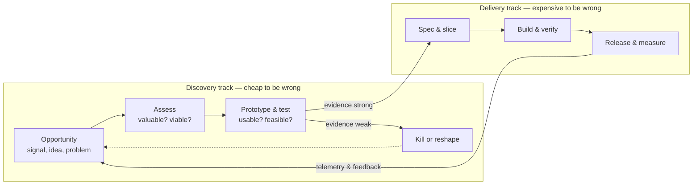

# Discovery to delivery

*Part of [Technical product management for the AI PM](./README.md)*

*Last reviewed: 2026-11 · Volatility: medium*

<!-- voice: human -->

Picture a planning meeting where someone senior says customers keep asking for an AI assistant, and
the room nods along. Three months later it ships, a handful of people try it, and most of them never
come back. Only then does somebody ask the question that should have come first. Did anyone check
that people wanted this, that they could use it, and that the model could even do the job? This
lesson is about asking that question early, while the answer is still cheap.

## Two tracks, running at the same time

Rather than moving in a straight line from idea to launch, products move through two tracks that run
side by side. **Discovery** answers "should we build this, and what exactly?", and you work it
cheaply, with prototypes, data and user conversations. **Delivery** answers "how do we build it
well?", which is the world of specs, sprints and releases.

The classic failure is to skip discovery and use delivery, the expensive track, to find out that an
idea was wrong. The fix is a habit called **dual-track**, in which discovery runs all the time, a
step ahead of delivery. It hands over only the ideas that have already survived a risk check.
Telemetry from shipped work then flows back and seeds the next round of discovery.

The two tracks run at once rather than taking turns. While engineering delivers this month's
validated bet, you're de-risking next month's, with a designer and an engineer giving it part of
their time. Delivery should never have to stop and wait while discovery works out what's next, and
discovery should never hand delivery an unvalidated guess.

## Discovery is where ideas die cheaply

Teresa Torres sums up the whole case for discovery in one line:

> "I prefer to learn if something's going to work or not before I do all the work."
> — Teresa Torres, [*Teresa Torres' Step-by-Step Guide to AI Product Discovery*](https://www.youtube.com/watch?v=wGuRuuPuYNQ), The Growth Podcast, around 04:42

Marty Cagan's four risks are the standard checklist for learning that, and each one also tells you
who you need in the room.

- **Valuable:** will anyone's behaviour change because this exists? Good evidence is user
  interviews, funnel data, support tickets and signs that people would pay. An executive really
  wanting it doesn't count, because that's an input to weigh and it validates nothing.
- **Usable:** can the target user actually operate it? Prototype tests are the evidence, even a handful of them. It's quick to check, and it's often skipped.
- **Feasible:** can we build it with the time, tech and data we have? You want an engineering spike
  here rather than an engineer's *opinion*, and for anything novel you should budget real days to
  try it.
- **Viable:** does it work for the business, once you count cost to serve, legal, support load and
  brand? On Cagan's account, the PM is the one responsible for this risk.

What discovery hands over is a decision to build, kill or reshape, with the evidence behind it. A
long document is no substitute. Treat a kill as a win, since every idea killed for, say, $5k of discovery
(an illustrative figure) is a quarter of delivery capacity saved.

## Why AI features change feasibility

For most software, an engineer can tell you in a meeting whether something is feasible, but for an
AI feature nobody can, so feasibility has to be *demonstrated*. The real question is whether the
model can do the task at a quality and cost you can live with. You can't know that until you've run
it against real examples.

That's why discovery for an AI feature always includes a **feasibility spike**, run *before* the
feature enters delivery. A spike is a prompt or a fine-tune, tested against enough real inputs to see the shape of the
results, and scored. A scored eval set counts as a discovery output, while "the demo looked great" does not.
Skipping the spike makes two outcomes likely, and this is a judgment rather than a finding.
Either the team spends a quarter productionizing a feature whose quality ceiling a week could
have found, or it ships the demo-day version, which can collapse on real user inputs.

Before any bet crosses over, ask yourself what evidence you have that it's valuable, usable,
feasible and viable, and which of those four you're taking on faith.

## Worked example: an AI reply drafter

This case is invented, and so is every number in it. Say you're the PM for a customer support tool.
Sales wants a feature that uses a model to draft replies to incoming tickets, so you give it one
week of discovery.

**Valuable:** you read a sample of recent tickets and talk to five support agents. Writing replies
to routine questions is the part of the job they complain about most. That's a real signal, though
not a strong one yet.

**Usable:** those five agents try a clickable prototype that shows a draft next to each ticket. Two
of them never notice the draft, so you move it above the reply box and test again.

**Feasible:** an engineer runs a three-day spike, taking 40 real past tickets, writing a prompt and
generating a draft for each one. Two agents then score every draft on whether they could send it as
is or with light edits. You agreed the bar up front at 80% usable drafts.

| Ticket type | Tickets | Usable drafts | Rate |
| --- | --- | --- | --- |
| Billing questions | 15 | 14 | 93% |
| Everything else | 25 | 12 | 48% |
| All tickets | 40 | 26 | 65% |

**Viable:** you estimate the model cost per draft at your ticket volume, and legal confirms you're
allowed to send ticket text to the model provider.

Overall, 26 of 40 is 65%, well under the bar, so a "build" call here would be the demo trap. Billing
questions, though, clear the bar easily at 14 of 15, which points to a reshape rather than a kill.
The bet that enters delivery is "drafts for billing questions only", and the other ticket types go
back to discovery.

The first slice in delivery is billing tickets, email only, with a draft the agent must approve. The
PRD predicts that most billing drafts will be sent with light edits or none, as they were in the
spike. To check it, the team logs how often agents send a draft without changes. You also book a
review three weeks after launch to compare the real rate against the spike's 93%.

The whole week cost one engineer for three days, five agents for an hour or two, and some of your
time. Against that, it saved a quarter spent building a drafter that would have been wrong on about a third of all
tickets, and about half of the non-billing ones.

## Delivery: slice thin, check constantly

Once a bet enters delivery, the craft becomes breaking it down. The unit of progress is a **vertical
slice**, a thin, end-to-end piece a user could actually touch, such as one happy path or one input
type. Its opposite is a horizontal layer, as in "first we build the whole backend". Slicing
vertically means you find integration problems early and have something to demo every sprint. It
also keeps your options honest. If the quarter goes sideways, you still have a smaller thing you can
ship, instead of 80% of everything and 100% of nothing.

Sprint by sprint, your delivery job is mostly to keep acceptance criteria unambiguous ([next
lesson](./specs-prds-and-rfcs.md)) and to make scope calls fast when reality drifts from the spec.
You also protect the definition of done, instrumentation included, so that the release actually
closes the loop back into discovery.

## The arrow that matters most

The most important arrow in the diagram is the last one, where release feeds back into discovery. A
shipped feature is a hypothesis put into production, and telemetry and user feedback are the results
coming back. Teams that skip this arrow ship feature after feature into the void and call it
velocity.

So on launch day, put a date in the calendar a few weeks out, which is a reasonable time as a
judgment rather than a rule. When it arrives, review the metrics
against what the PRD predicted and write down what you learned, because that note is where next
quarter's best discovery leads come from.

## From the show: how much discovery is enough?

Practitioners on The Growth Podcast agree on the goal, though they differ a little on the dose.
Itamar Gilad describes how decisions tend to get made when nobody has evidence:

> "And then usually the decision will come to either highest paid person opinion or some consensus or whatever the customer asks. And those are very weak heuristics."
> — Itamar Gilad, [*Make More of Your Product Launches Succeed with Itamar Gilad, Ex-Google PM*](https://www.youtube.com/watch?v=FOow1L7jkmA), The Growth Podcast, around 46:54

That's his case for evidence over opinion, and it's also why this lesson treats an executive's wish
as an input, never as validation. Pawel Huryn pushes the other way, on how much process a bet really
needs:

> "sometimes the problem is so obvious and the solution is so obvious that you can skip discovery completely and just deliver a thing to production."
> — Pawel Huryn, [*How to Do Product Discovery Right with Pawel Huryn, 175K+ on LinkedIn, Senior PM and Author*](https://www.youtube.com/watch?v=KkqYDbSPrbQ), The Growth Podcast, around 35:48

Which view holds depends on the bet, so treat Huryn's point as a test and apply it honestly. If the
problem and the solution really are obvious and the bet is small, skipping discovery can be the
right call. An AI feature rarely passes that test, because nobody can call feasibility obvious until
a spike has run. Skipping still has a price, though, because if you're wrong you find out in
delivery, at delivery prices.

## Where it goes wrong

- **Waterfall in agile clothing** is a quarter of "discovery" that produces a giant spec, followed
  by a quarter of delivery. The feedback loops are long, and all the risk turns up at the end.
- **Discovery done in delivery** sounds like "let's build it and see". It's the most expensive way
  there is to learn an idea is wrong.
- **Discovery theater** means running interviews and tests but only hearing confirmation, and a
  discovery process that never kills anything isn't really discovery.
- **The demo trap** is the one specific to AI. A feature moves to delivery because a hand-picked
  demo impressed a VP, and nobody ran an eval on realistic inputs.
- **Horizontal slicing** is how you end up with "the API is done, the UI is done, they've just never
  been connected". All the integration risk lands in the final week.

Teresa Torres uses the name discovery theater for this pattern, and her description of it makes a
handy self-test:

> "Nothing in their backlog changes. They don't kill any ideas. They always end up building what they started with."
> — Teresa Torres, [*Teresa Torres' Step-by-Step Guide to AI Product Discovery*](https://www.youtube.com/watch?v=wGuRuuPuYNQ), The Growth Podcast, around 30:57

When did your team last kill an idea because of something discovery found? If nobody in the room can
remember one, start there.

## What to do this week

- [ ] Take your biggest current bet, write down your evidence on valuable, usable, feasible and
      viable, and circle the weakest.
- [ ] Check that discovery is running *now* for what the team builds *next month*. If it isn't,
      delivery will sit idle while you work it out.
- [ ] If the bet is AI-shaped, make sure a feasibility spike has run against real inputs, with
      scores.
- [ ] Look at the current build. Check that it's sliced vertically and that you could ship the
      smallest slice on its own if you had to.
- [ ] Book the post-launch review now, and make it compare results to what the PRD predicted.

## Related lessons

- [Specs, PRDs & RFCs](./specs-prds-and-rfcs.md)
- [Metrics & experimentation](./metrics-and-experimentation.md)
- [Technical product management for AI](./tpm-for-ai-products.md)
- [User research](../product-sense/user-research.md) (product sense): the interviews and tests that
  supply discovery's evidence.
- [Evals: golden sets, adversarial, LLM-as-judge](../content/04-evals-observability/evals.md): how to
  build the scored set a feasibility spike needs.

## Sources

- Marty Cagan, [*The Four Big Risks*](https://www.svpg.com/four-big-risks/), Silicon Valley Product Group (SVPG), 4 December 2017
  (as of 2026-11).
- Quotes from The Growth Podcast with Aakash Gupta ([news.aakashg.com](https://www.news.aakashg.com)), used under its licence. The transcript text is machine-made and the quotes have not been checked against the audio.
