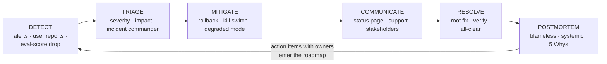

# Incidents & postmortems

*Part of [Technical product management for the AI PM](./README.md)*

*Last reviewed: 2026-11 · Volatility: medium*

<!-- voice: human -->

It's 2:40 on a Wednesday afternoon, and support leads are messaging you that the AI assistant is
telling customers they can get refunds the policy doesn't allow. Engineering is already looking at
logs. Someone in the channel suggests waiting until they understand the cause before touching
anything, and someone else asks whether they should post on the status page. Everyone is looking
at you, because none of these questions is really technical. Owning a product includes owning its
worst hour, and this lesson is about what you do in it and afterwards.

## Respond, recover, learn

An **incident** is any unplanned event that degrades something users depend on. The work around
it has three phases with different tempos. *Respond* means stopping the damage, *recover* means
restoring service and then trust, and *learn* means a postmortem that turns causes into funded
fixes.

Severity drives everything. A top-severity incident, often called a SEV1, is one where users are broadly down or data is at
risk, and it gets a war room and executive updates. A SEV3, a degraded corner case, gets a ticket. Agree the ladder *before* you need it, because arguing about severity during
an incident is how minutes become hours.

Two rules hold across every framework. The first is to **mitigate before you diagnose**. Roll
back first and find the root cause later, which is why [rollback-ready
releases](./launches-rollouts-and-migrations.md) are an incident tool as much as a launch tool.
The second is to have **one incident commander**, a single person directing the response, so ten
helpful engineers don't make eleven uncoordinated changes.

## Your job while it's happening

The PM is rarely the one typing the fix. Your job is the blast radius around it.

- **Size the user impact.** Who is affected, how badly, and is it getting worse? Engineering knows
  what's broken, and you know what it *means* in customers, commitments and revenue.
- **Own the communication.** Keep it honest, plain and on a cadence, through the status page,
  support macros and account teams for the biggest customers. "We know, we're on it, next update
  at half past" beats both silence and spin, because trust is lost less by the outage than by the
  handling.
- **Make the product calls.** Degrade or disable? Ship the risky fast fix or the safe slow one?
  These are product decisions that arrive dressed as technical ones, which is why being in the room
  is the job.
- **Keep the timeline.** Someone should log what happened when. It's the raw material of the
  postmortem, and it can't be rebuilt from memory afterwards.

## Worked example: the refund incident

This example is invented, and so are its numbers. At 14:00, a prompt change for the support
assistant ships to all traffic at once. Normally agents override or correct 8% of the assistant's
answers. By 14:40 the override rate over the last 30 minutes is 21%, which crosses the alert
threshold and pages the on-call engineer.

At 14:45 an incident commander is named and the incident is set at the middle severity. One
feature is giving wrong answers, but nothing is down and no data is lost. You argue for mitigation
first, and at 14:52 the team re-pins the previous prompt version. The override rate is back to
normal within twenty minutes.

Now the sizing. The bad prompt was live from 14:00 to 14:52, which is 52 minutes. The assistant
handles about 60 conversations a minute, so 52 × 60 = 3,120 conversations saw the new prompt. The
override rate rose from 8% to 21%, an excess of 13 points, and 3,120 × 0.13 is about 406. Since
the rate climbed over the window rather than jumping at 14:00, treat 406 as a rough upper estimate
of the conversations that got a wrong answer.

That number drives the product call you make next. You decide to honour any refund the assistant
promised in that window, and support sends a correction to the affected customers. The cost is
some refunds the policy wouldn't normally allow, and in return you don't spend the next month
arguing with customers who were told something by your own product.

The postmortem finds three causes, not one. The prompt change shipped without an eval diff, it
went to all traffic instead of a canary, and the alert looked at a 30-minute window, which added
detection time. Each becomes an action item with an owner and a date. Prompt changes must pass the
refund-policy eval cases before merge. Prompt changes ship through the same staged ramp as code.
And the alert window drops to ten minutes.

## Blameless postmortems

A postmortem starts from the premise that people acted reasonably on the information they had,
and that the *system* let them down. That's a practical choice as much as a kind one. The moment a
postmortem can hurt someone, it stops hearing the truth.

Decide the triggers in advance. The chapter on postmortem culture in Google's site reliability engineering (SRE) book lists five
common ones. They are user-visible downtime or degradation beyond a threshold, data loss of any
kind, an on-call intervention such as a rollback, a resolution time above a threshold, and a
monitoring failure that meant a person found the problem. Any stakeholder can also ask for one. The
same chapter is blunt about review: "An unreviewed postmortem might as well never have existed."

Keep the document short and structured. It covers the impact (users, duration, cost), the
timeline, and the root causes, plural, found by [asking why repeatedly](../first-principles/the-method.md)
until you reach conditions rather than the trigger. A deploy is usually the spark, while the
missing alert, the unbounded retry and the single point of failure are the fuel. It also covers
what went *well*, and **action items with owners and dates**. That last part is where postmortems
go to die, so track the items like features and review them monthly. A repeat incident with an
unshipped action item is a process failure. And a stack of postmortems pointing at the same
subsystem is the best input you'll get for [prioritising reliability
work](./prioritization-and-roadmaps.md).

## What changes for AI features

- **Quality incidents are incidents.** Define them in advance, such as an eval score below the bar
  in production sampling, a spike in overrides, or a
  [guardrail](../content/04-evals-observability/observability.md) firing at ten times its usual
  rate. Wire them to drift detection so a drop pages someone instead of piling up quietly.
- **Every AI feature ships with a kill switch and a chosen degraded mode.** That might mean falling
  back to the previous model or prompt, to retrieval-only answers, or to the human process.
  Turning it off should be a decision made calmly in advance, not invented at 2 a.m.
- **A model or prompt change is a change event.** Treat it with the [pin-and-diff
  discipline](./tpm-for-ai-products.md), so the rollback is a re-pin.
- **The screenshot incident** is its own class, where one appalling output goes viral. Capture the
  trace, reproduce it, add a guardrail for the pattern, and add the case to the eval suite so it
  can't ship again unnoticed.

Quality incidents can hide for weeks. In September 2025, Anthropic published a postmortem on three
infrastructure bugs that intermittently degraded Claude's responses between August and early
September of that year. Its own evaluations didn't capture the degradation users were reporting,
and its privacy controls limited how engineers could look at the conversations involved. Anthropic
said it would make its evaluations more sensitive and run quality evaluations continuously on
production systems. For a PM the takeaway is that an offline suite that passes isn't a detector.
Budget for production sampling, and make sure feedback reports reach someone who can act on them.

## When there's a legal clock

Some AI incidents carry a reporting deadline. Under Article 73 of the EU AI Act, a provider of a
high-risk AI system must report a serious incident to the market surveillance authority. The deadline is no later than 15 days after becoming aware of it, or 10 days if a person died.
For a widespread infringement or certain of the most serious incidents, it's 2 days. Article 73 also
says the provider must not alter the system in a way that could affect the later investigation of
the cause before telling the authorities.

The Digital Omnibus on AI moved the dates for the main high-risk rules. The Commission's AI Act
Service Desk now lists them as 2 December 2027 for high-risk systems under Annex III, and 2 August
2028 for AI in products covered by the laws in Annex I. Confirm the current dates with counsel,
because whether and when the duty applies to your system is a legal question. Your part is to agree in advance who
decides that an incident is "serious", and to make sure the incident runbook doesn't destroy the
evidence.

## From the show: detection and honesty

Jack Hirsch, Okta's VP of product management and AI when the episode was recorded, makes the
point that incidents aren't a sign of a bad team:

> "every organization of any consequence has breaches. Spoiler alert, everyone gets breached. Now, it's how you detect it, how fast you respond, what your internal and public responses are [...]"
> — Jack Hirsch, [*The AI PM's Guide to Security - with Okta's VP of PM & AI, Jack Hirsch*](https://www.youtube.com/watch?v=4dWbwGCPjUY), The Growth Podcast, around 37:44

He's talking about security breaches, but the frame carries over to any incident. Detection,
speed and the honesty of your response are what users judge. Maria Cuasay adds a warning about the
postmortem meeting itself:

> "So you can have like one big meeting. Most of the time you won't actually get anything out of it. People are kind of like too shy to talk."
> — Maria Cuasay, [*How to Build Things Faster as a Product Team*](https://www.youtube.com/watch?v=U8jlVqplC5I), The Growth Podcast, around 37:18

Her fix is smaller meetings and one-to-one conversations with the people who went quiet. That's
the blameless principle in practice, since the truth tends to come out where people feel safe.

## Where it goes wrong

- **Diagnosis before mitigation** spends an hour finding the root cause while the rollback button
  waits, and users pay for the team's curiosity.
- **The headless incident** has no commander, so parallel fixes collide and one of them causes the
  second incident.
- **Blameful postmortems** make the room optimise for self-defence, and the same incident comes
  back with a different name on it.
- **The action-item graveyard** documents lessons and never funds them.
- **Availability-only monitoring** shows the AI feature as up while its answers are wrong, with no
  error, no page and no idea.

## What to do next

- [ ] Write a severity ladder with your engineering lead, and name who commands a top-severity
      incident.
- [ ] For each critical feature, write down the rollback and the date it was last exercised.
- [ ] Give one named person the job of user communication during incidents, with a set cadence.
- [ ] Review open postmortem action items monthly, and escalate any repeat incident.
- [ ] For each AI feature, make a quality drop pageable and choose its degraded mode.
- [ ] If you might sell a high-risk AI system in the EU, ask counsel who decides an incident is
      serious and what your reporting runbook says.

## Related lessons

- [Launches, rollouts & migrations](./launches-rollouts-and-migrations.md)
- [Metrics & experimentation](./metrics-and-experimentation.md)
- [Technical product management for AI](./tpm-for-ai-products.md)
- [Reliability & failure](../technical-product-sense/reliability-and-failure.md) (technical
  product sense): how systems fail, and how to design for it.
- [Observability](../content/04-evals-observability/observability.md): the drift and guardrail
  signals that detect quality incidents.

## Sources

- John Lunney and Sue Lueder, [*Postmortem Culture: Learning from
  Failure*](https://sre.google/sre-book/postmortem-culture/), in *Site Reliability Engineering*,
  Google (the triggers and the unreviewed-postmortem line) (as of 2026-11-28).
- Anthropic, [*A postmortem of three recent
  issues*](https://www.anthropic.com/engineering/a-postmortem-of-three-recent-issues), 17 September
  2025 (as of 2026-11-28).
- European Commission, AI Act Service Desk, [*Article 73: Reporting of serious
  incidents*](https://ai-act-service-desk.ec.europa.eu/en/ai-act/article-73) (the 15-, 10- and
  2-day deadlines and the rule on altering the system) and [*Article 113: Entry into force and
  application*](https://ai-act-service-desk.ec.europa.eu/en/ai-act/article-113) (the dates as
  amended by the Digital Omnibus on AI) (as of 2026-11-28).
- Quotes from The Growth Podcast with Aakash Gupta ([news.aakashg.com](https://www.news.aakashg.com)), used under its licence. The transcript text is machine-made and the quotes have not been checked against the audio.
