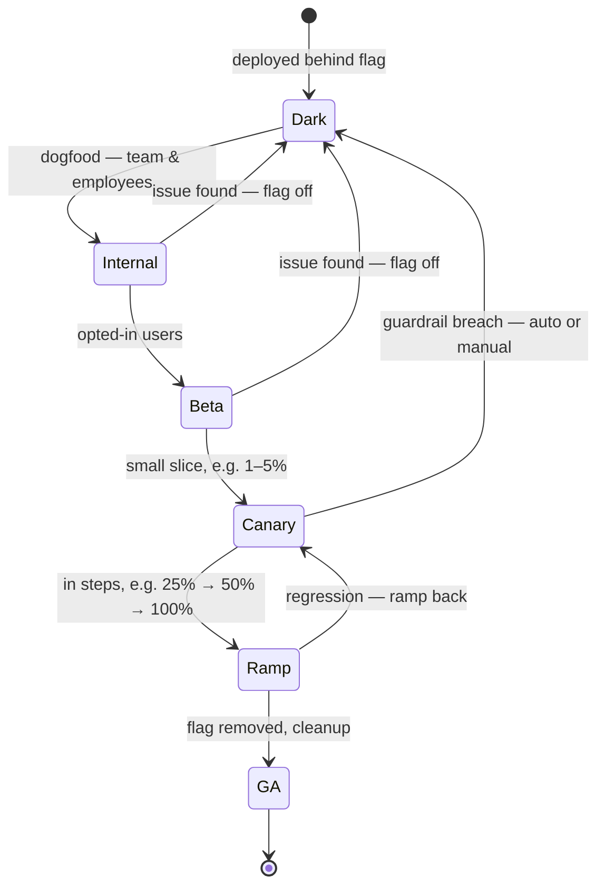

# Launches, rollouts & migrations

*Part of [Technical product management for the AI PM](./README.md)*

*Last reviewed: 2026-11 · Volatility: medium*

<!-- voice: human -->

It's Thursday, and the new AI drafting feature is ready. Marketing has a blog post scheduled for
Monday, and someone suggests turning the feature on for everyone on Friday so it's "live" in time.
Before you agree, there are a few questions to answer. If something is wrong, how many people will
see it before you know? What's the one action that puts things back the way they were, and has
anyone tried it? This lesson is about the machinery that makes those questions easy to answer.

## Deploy is not release

Modern shipping separates two things that used to be one. **Deploy** means the code reaches
production, switched off behind a feature flag. **Release** means users actually see it, at a
percentage you control. That split is what makes **progressive delivery** possible. You go from internal users to a beta, then to a small slice of traffic, and then wider, checking
metrics at each stage. The rollback is a flag flip rather than a fire drill.

Each stage exists to catch a different kind of problem.

- **Dark** checks the integration in production with nobody exposed.
- **Internal use** (dogfooding) gives you the cheapest honest users you'll ever have. If your own
  team routes around the feature, customers will too.
- **Beta** users opted in and expect rough edges. Set expectations explicitly, because a beta user
  surprised by instability is a churn story.
- **Canary** is a small slice of real traffic, say 1 to 5% as an example. It gives you real signal on
  crashes, latency, cost and, for AI, quality, while a disaster is still an apology rather than a
  headline. Write the **abort criteria before you start**, such as "flag off if the error rate passes X or
  acceptance drops by Y points". The middle of an incident is the worst time to negotiate a
  threshold.
- **Ramp** watches the [guardrail metrics](./metrics-and-experimentation.md) at each step. Costs
  and slow-request tails that looked fine at 5% can behave very differently at 50%.
- **General availability** (GA) means the flag comes *out*. A codebase full of permanent flags is
  [tech debt](../technical-product-sense/tech-debt-and-estimation.md) on a timer, so set a removal
  date when you create the flag and give each flag an owner.

**Rollback is a product requirement you own.** Before any stage, ask what single action restores
yesterday's behaviour, who can take it, and whether data written by the new version still works
under the old one. That last question is the sneaky one. A feature that writes a new data format
can make "just turn it off" impossible, and you want to find that out now rather than at 2 a.m.

## Worked example: what a canary buys you

This example is invented, and so are its numbers. Your drafting feature will reach 200,000 daily
users, each with about one session a day. Assume, for the illustration, that it ships with a bug
that gives a bad draft in 1 session in 200, or 0.5%, which no offline test caught.

| Exposure | Users per day | Bad sessions per day (0.5%) |
| --- | --- | --- |
| Canary at 1% | 2,000 | 10 |
| 5% | 10,000 | 50 |
| 25% | 50,000 | 250 |
| Everyone at once | 200,000 | 1,000 |

Each row is the share of 200,000 users, times 0.5%. Say the canary's abort criterion catches the
problem after two days. By then 2 × 10 = 20 sessions have gone wrong. Turn it on for everyone on Friday instead, and the same two days produce 2 × 1,000 = 2,000 bad
sessions. That's a hundred times as many, landing in the same weekend as the blog post.

The canary also changes who finds the bug. At 10 bad sessions a day, your acceptance-rate monitor
or a beta customer finds it. At 1,000 a day, social media probably finds it first. The cost of
going slowly is real, too. A one-week canary means the blog post either waits a week or announces
a feature most readers can't see yet, and that's the trade you're choosing.

## Launch is not release either

Release is traffic percentages, while **launch** is the coordinated moment you tell the world.
You own the machinery for it.

- **Tiering.** Not everything deserves fireworks. A top-tier launch with press and executive
  attention needs weeks of coordination, while a changelog note needs a paragraph. Deciding the
  tier early prevents both over-production and under-communication.
- **Support enablement.** Support sees the surge first, so they get docs, known-issues lists and
  escalation paths *before* the announcement.
- **The go/no-go.** This is a real checkpoint with a named owner, usually you, and a checklist
  covering feature complete, evals green, support ready, comms staged and rollback rehearsed. It
  also needs a genuine option of "no", since a go/no-go that has never said no is a ceremony.
- **The post-launch review.** A few weeks after launch is a reasonable time to book it. Compare the results
  with what the PRD predicted. [Discovery to delivery](./discovery-to-delivery.md) covers why that
  review is what closes the loop.

## Migrations: the transition is the project

Sooner or later you'll run a migration, such as a new billing system, a v2 API, re-platformed
search or a swapped model provider. The pattern that survives contact with reality is **expand,
migrate, contract**.

1. **Expand.** Stand up the new path alongside the old one. Often both run at once, through
   dual writes or **shadow mode**, where the new system processes real traffic but its output is
   only logged and compared.
2. **Migrate.** Move users in cohorts, easiest first, watching the comparisons. For external users
   this is where deprecation notices, timelines and incentives live. You're changing *someone
   else's* roadmap, and goodwill is spent or earned here.
3. **Contract.** Turn the old path off and delete it. Everyone wants to skip this step, which
   leaves two systems to run, secure and reconcile forever. A migration is done when the old thing
   is off, so track that as the milestone rather than "new thing launched".

A model or prompt swap is a migration too, even when it looks like a one-line config change. It
gets the same treatment: an offline eval diff, a shadow or side-by-side run, a staged ramp with
quality gates, and a rollback that re-pins the old version. [Technical product management for
AI](./tpm-for-ai-products.md) covers why, including the retirement notices providers give. In any migration, you own three questions. What breaks for which cohort, and do they know? What
comparison proves the new path matches the old, and what is the rollback at each cohort? Someone
also has to own the long tail, because the last few customers on the old path often take a large
share of the effort.

## A real failure: Knight Capital, August 2012

The US Securities and Exchange Commission's order on Knight Capital is one of the clearest public
records of a deploy going wrong. Knight deployed new trading code to its eight order-routing servers over several days, and a
technician didn't copy it to one of them. No second technician reviewed the deployment. The new code reused a flag that once switched on an old, unused function called Power Peg. Orders
carrying that flag set off the old code on the eighth server.

While staff tried to find the problem in live trading, they uninstalled the new code from the
seven servers where it had been deployed correctly. That made things worse, because incoming
orders then set off the old code on those servers too. In about 45 minutes Knight built up an
unintended multi-billion-dollar position, and it lost more than $460 million. For a PM the lesson isn't about trading. The order describes no supervisory procedures for
incident response, an improvised uninstall that made things worse, a reused flag, and a
deploy with no second check that every server got the same code.

## From the show: always roll out partially

Shuhao Zhang, who demonstrated an agent-run path to production on the show, is firm on staged
rollout even when time is short:

> "If you have the bandwidth and capacity, you should always do this partial rollout. Always. Even for a critical fix that, you know, you take an extra hour."
> — Shuhao Zhang, [*How to Ship to Production with AI Agents*](https://www.youtube.com/watch?v=-xQPRlk7VRE), The Growth Podcast, around 37:58

His argument is that partial rollout used to be costly because a person had to watch the numbers,
and that agents can now do the watching. Whether or not you automate it, the extra hour is cheap
next to the table above. Shobhit Chugh describes the other end of a product's life. His first product at Google came in
through an acquisition, and he decided it had no future with Google Analytics already in the
company:

> "So now it's all about how do we get customers to migrate successfully and still have a good experience."
> — Shobhit Chugh, [*How to land your next PM role without working more, from Google PM turned Career Coach Shobhit Chugh*](https://www.youtube.com/watch?v=B5j84VU9OeY), The Growth Podcast, around 20:19

That sentence is the whole migrate step. The decision to shut something down is the start of the
work, and the customers' experience of moving is what they'll remember.

## Where it goes wrong

- **The big-bang launch** goes from 0 to 100% in one step and finds scale, cost and quality
  problems with the whole user base watching.
- **Rollback theatre** is a rollback plan nobody rehearsed, which a data format change defeats the
  moment it's needed.
- **The flag graveyard** is a codebase of permanent flags, multiplying test paths until nobody
  knows what production actually does.
- **The 95% migration** leaves the old system up "temporarily" for years, doubling the operational
  surface.
- **The silent model swap** changes a prompt or model with no eval diff and no staged ramp, and
  behaviour regresses for a workflow nobody thought to test.

## What to do next

- [ ] Separate deploy from release with flags, and know today's exposure percentage for each
      feature in flight.
- [ ] Write the abort criteria for your current rollout, and decide whether a breach turns the flag
      off automatically or waits for a person.
- [ ] Rehearse the rollback, including the question of whether new data works under the old
      version.
- [ ] Brief support and publish docs before the announcement, not after.
- [ ] Put a date on the contract step of your current migration, when the *old* thing goes off.

## Related lessons

- [Metrics & experimentation](./metrics-and-experimentation.md)
- [Incidents & postmortems](./incidents-and-postmortems.md)
- [Technical product management for AI](./tpm-for-ai-products.md)
- [Reliability & failure](../technical-product-sense/reliability-and-failure.md) (technical
  product sense): why systems fail, and what rollback protects.
- [Versioning & migration (Flowable)](../flowable/phases/08-versioning-and-migration/README.md):
  a migration worked end to end.

## Sources

- US Securities and Exchange Commission, [*In the Matter of Knight Capital Americas LLC*, Release
  No. 34-70694](https://www.sec.gov/litigation/admin/2013/34-70694.pdf), 16 October 2013 (the
  eight-server deployment, the repurposed Power Peg flag, the uninstall that worsened the problem,
  about 45 minutes and more than $460 million) (as of 2026-11-28).
- Quotes from The Growth Podcast with Aakash Gupta ([news.aakashg.com](https://www.news.aakashg.com)), used under its licence. The transcript text is machine-made and the quotes have not been checked against the audio.
