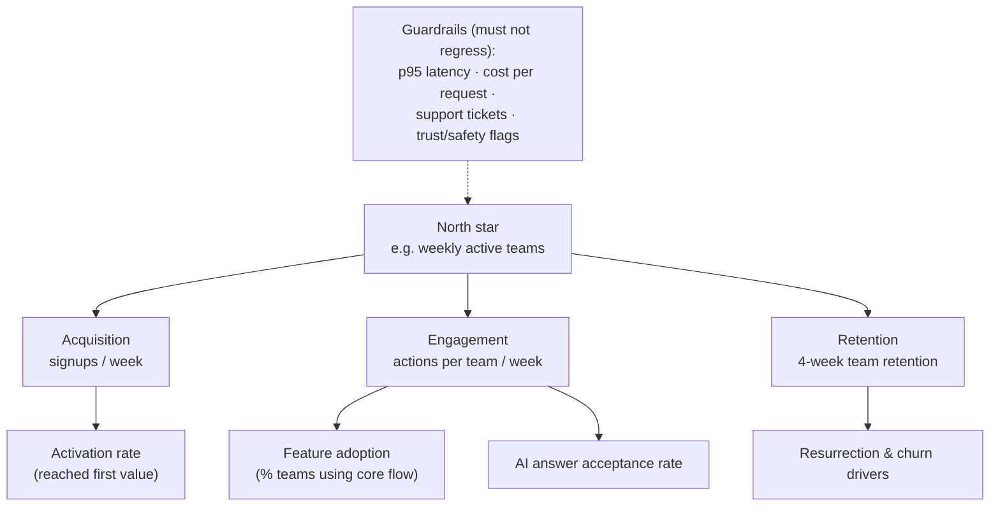

# Metrics & experimentation

*Part of [Technical product management for the AI PM](./README.md)*

*Last reviewed: 2026-11 · Volatility: medium*

<!-- voice: human -->

Your AI answer feature has been live for a month. Latency is fine, errors are near zero, and the
dashboard is green. Then a customer posts a thread of screenshots where the feature confidently
gives wrong answers, and it turns out quality slipped three weeks ago when a retrieval index was
rebuilt. Nothing on the dashboard moved, because nothing on the dashboard measured whether the
answers were right. This lesson is about building the measurement that would have caught it, and
about running experiments that don't fool you.

## The metric tree

A north-star metric on its own is a scoreboard. No team can directly move "weekly active teams",
so the tree breaks it into inputs that teams can own.

The **north star** is one number that stands in for delivered value. It's usually not revenue,
because revenue lags value. **Input metrics** are the branches a team can move this quarter, and a
good one responds in days and plausibly moves its parent. **Guardrails** are the do-no-harm set,
such as latency, cost, support load and trust, and every launch is judged on its target *and* on
leaving the guardrails intact. Retention is a lagging metric, since you learn you failed months
later, while activation is leading. Manage with the leading ones and report with the lagging ones.

A metric made into a target tends to get gamed, usually innocently. "Answers
delivered" as a target produces more answers, not better ones, so pair every target with a quality
counterweight.

It also helps to name which mode a decision is in. **Data-informed** means data is one input
alongside research, domain judgment and strategy, and a PM can overrule a metric with a reasoned
argument. **Data-driven** means the number decides. Most product decisions should be data-informed,
while the ship gate of an A/B test on its primary metric should be data-driven. Mixing them up
causes either paralysis, where "but the data says" blocks a strategic bet, or recklessness, where
"I know better" overrides a clear regression.

## Instrumentation is a requirement

The events you'll need to answer "did it work?" belong in [the PRD](./specs-prds-and-rfcs.md)
before the build. Retrofitting analytics after launch means weeks of blindness followed by data
you only half trust. For each success metric, ask which event, with which properties, fired from
where, proves it. If you can't name the event, you can't have the metric. Then walk the funnel and
check that every step a user takes towards value emits something, or your drop-off analysis will
have holes exactly where the mystery is.

## Experiments without fooling yourself

An A/B test splits users at random, shows each group a variant and compares the results. The
mechanics are well understood, and the discipline is the hard part.

- **Write the hypothesis first.** "We believe moving X will lift Y by about Z% because..." has to
  be written before launch, because afterwards any result can be narrated into a win. Say too
  whether the change is an experiment, a bet that might die, or an incremental improvement that
  should compound, since they're judged by different standards.
- **Check power before launch.** Small effects need a surprising amount of traffic. If the
  calculation says eight months, the honest answer is that this isn't testable here.
- **Don't peek.** Checking daily and stopping at the first p below 0.05 is how teams ship noise.
  Fix the duration up front, or use sequential methods designed for early looks.
- **Check the split before the result.** A **sample ratio mismatch** (SRM) means the groups aren't
  the sizes you configured, which signals that users went missing from one variant. Microsoft
  reports that about 6% of its A/B tests have one, and it flags a test when a chi-square check on
  the split gives p below 0.0005. Don't trust a result with an SRM until someone finds the cause.
- **Judge the guardrails too.** A win on the target that degrades latency or support volume is a
  trade, and you should make it consciously or not at all.
- **Distrust segments.** Slice a neutral result twenty ways and one slice will "win" by chance.
  Segment analyses suggest the *next* test and can't rescue this one.

When you can't test, because traffic is too low, the change too structural or the effect too
slow, use humbler tools. A before-and-after comparison works if you state the seasonality caveat
out loud. A long-running **holdout** works too, which is a small slice of users who don't get the new
experience for a quarter. So does a staged rollout used as a natural experiment ([next
lesson](./launches-rollouts-and-migrations.md)). Weaker evidence honestly labelled beats strong
claims from weak designs.

## Worked example: is this even testable?

This example is invented, and so are its numbers. You want to test AI-suggested replies in a
support inbox. Today 10% of tickets are resolved on the first reply, and you hope the feature lifts
that to 11%. About 2,000 tickets a week are eligible.

A standard sample-size formula for comparing two rates, at 95% confidence and 80% power, needs about 14,700 tickets per arm to detect a change from 10% to 11%. That's about 29,500 tickets in
total, or about 15 weeks of traffic at 2,000 a week. A quarter-long test of a one-point lift isn't
a good use of the inbox.

So you change the question. A lift from 10% to 12% needs about 3,830 tickets per arm, or about 7,670 in total, which is
about four weeks. You decide the feature is only worth building if it delivers at
least two points, and you run the test for four weeks against that bar.

At the end of the four weeks, 7,800 tickets have entered the test, and the split was meant to be
50/50, so you expected 3,900 in each arm. You got 4,100 in the control and 3,700 in the treatment.
The chi-square statistic is (200² ÷ 3,900) + (200² ÷ 3,900), which is about 20.5, and the p-value
is about 0.000006. That's well below 0.0005, so the test has an SRM, and you don't read the result
yet. The cause turns out to be a filter that dropped tickets from the treatment arm when the
suggestion service timed out. The slowest, hardest tickets went missing from one side only. A
result read before that fix would have flattered the feature.

## The quality layer for AI features

For a model-powered feature, wire offline and online measurement together.

- **Offline, eval scores.** The graded example set from your [spec](./specs-prds-and-rfcs.md) runs
  against every prompt, model or retrieval change *before* it ships, as your regression suite for
  quality.
- **Online, behavioural proxies.** Users rarely click thumbs-down. They quietly *edit* the draft,
  *retry* with a rephrased question or *abandon* the flow, so edit distance, retry rate and
  acceptance rate are your best online quality signals. Instrument them from day one.
- **The loop.** Online failures flow back into the eval set, so the offline suite keeps resembling
  reality. That loop is the [data flywheel](./tpm-for-ai-products.md), the subject of the capstone.

## From the show: one number, and enough traffic

Satyajeet Salgar makes the case for a single north star, with the tree around it:

> "And so I like the clarity of North Star metric. I think most teams should aspire to have one and then have guardrails and other metrics."
> — Satyajeet Salgar, [*How to Develop Your Product Strategy, with Satyajeet Salgar*](https://www.youtube.com/watch?v=l2YhkstnRcg), The Growth Podcast, around 01:08:35

He adds that leads still need to understand the nuance behind the one number. Frederic de Todaro
makes the point from the worked example about traffic:

> "When you look at, you know, the sample size you need, you need a good number of visitors, but you also need to look at the metric."
> — Frederic de Todaro, [*Complete Course: AI Experimentation*](https://www.youtube.com/watch?v=MC1FfWdAyX4), The Growth Podcast, around 59:37

His fuller point is that the number of conversions, not only visitors, decides how fast an
experiment can tell you anything. A rare event needs far more traffic than a common one.

## Where it goes wrong

- **Vanity dashboards** show big cumulative numbers that only go up. If no decision changes when a
  number changes, it's decoration.
- **A single metric with no guardrails** gets optimised until support volume or trust pays the
  bill.
- **Ignoring a broken split** means reading results from a test whose arms are the wrong size.
  Microsoft describes an MSN test where a bot filter removed highly engaged users from one
  variant, and fixing it flipped the result.
- **Peeking and p-hacking**, through early stops, after-the-fact hypotheses and twenty segment
  slices, produce a culture that wins every test and moves no annual number.
- **Instrumentation as cleanup** schedules analytics after launch, so the team debates opinions
  during the weeks that matter most.
- **Green-dashboard blindness** is the AI-specific one, where infrastructure is healthy, no
  quality signal is wired, and customers find the drift.

## What to do next

- [ ] Draw your product's metric tree from memory, with the north star, three to five inputs and
      the guardrails.
- [ ] Check that the current PRD names the exact events that will prove or disprove success.
- [ ] Before the next test, write the hypothesis, run the sample-size calculation and fix the
      duration.
- [ ] Add an SRM check to your experiment readout, before anyone looks at the result.
- [ ] For each AI feature, pair an offline eval score with an online behavioural proxy.

## Related lessons

- [Specs, PRDs & RFCs](./specs-prds-and-rfcs.md)
- [Launches, rollouts & migrations](./launches-rollouts-and-migrations.md)
- [Technical product management for AI](./tpm-for-ai-products.md)
- [Motivation & behaviour](../product-sense/motivation-and-behaviour.md) (product sense): the
  behaviour your metrics are trying to move.
- [Observability](../content/04-evals-observability/observability.md): watching quality in
  production.

## Sources

- Aleksander Fabijan and colleagues, Microsoft Experimentation Platform, [*Diagnosing Sample Ratio
  Mismatch in A/B Testing*](https://www.microsoft.com/en-us/research/group/experimentation-platform-exp/articles/diagnosing-sample-ratio-mismatch-in-a-b-testing/),
  Microsoft Research, 14 September 2020 (about 6% of tests, the p below 0.0005 threshold and the
  MSN bot-filter example) (as of 2026-11-28).
- The worked example's figures are derived, not sourced. Sample size per arm uses the standard
  two-proportion formula, (1.96 + 0.84)² × [p₁(1 − p₁) + p₂(1 − p₂)] ÷ (p₂ − p₁)². The p-value
  comes from a chi-square test with one degree of freedom.
- Quotes from The Growth Podcast with Aakash Gupta ([news.aakashg.com](https://www.news.aakashg.com)), used under its licence. The transcript text is machine-made and the quotes have not been checked against the audio.
