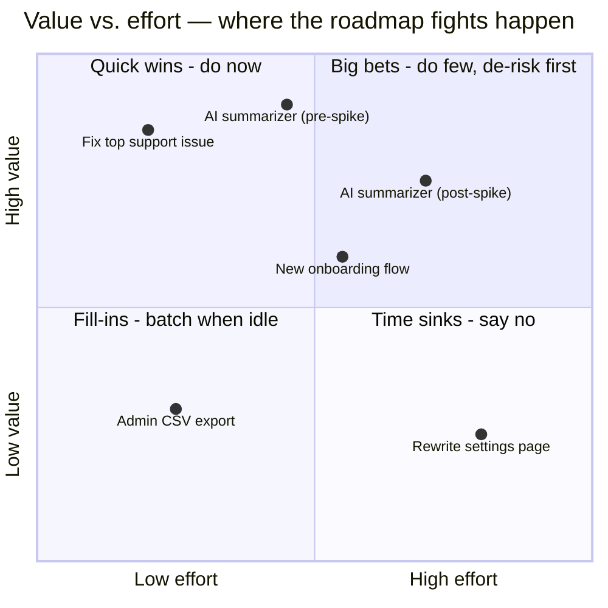

# Prioritization & roadmaps

*Part of [Technical product management for the AI PM](./README.md)*

<!-- voice: human -->

The quarterly planning spreadsheet has forty rows and room for six. Sales wants the enterprise
dashboard, support wants the bug that generates a third of its tickets, and the CEO saw a
competitor's AI demo last week. Every item has a champion and a plausible story. Whatever order
you pick, you're about to disappoint most of the room, so the useful question is how to pick in a
way people can argue with and still trust.

## The order is the strategy

You'll always have far more good ideas than capacity, which means the order you build them in *is*
your strategy, whatever the strategy deck says. Frameworks don't make that decision for you. What
they do is make your reasoning visible, so someone can challenge an assumption instead of
challenging you.

A roadmap only has a stable order once something upstream has decided what the product is going
after. That's product strategy, and [creativity](../product-sense/creativity.md) in the product
sense track covers it in depth. The short version for roadmap work is that OKRs (objectives and
key results) should be set *by* the strategy, not used as the place where the strategy gets
decided. If a proposed key result doesn't trace back to a strategic choice you can name out loud,
cut it, however well it scores.

## The frameworks, and what each one is for

- **RICE** scores an item on reach, impact, confidence and effort. The formula image on Intercom's page shows reach × impact × confidence ÷ effort, and the page's
  text adds that effort divides because more effort is a bad thing. Sean McBride introduced it on
  Intercom's blog in 2018, with impact on a scale from 0.25 (minimal) to 3 (massive) and
  confidence as a percentage. Its most useful term is confidence, because it makes you admit
  which numbers are guesses.
- **Impact, confidence and ease (ICE)** is a quicker cousin. It's fine for triaging a long list in an
  hour, though too coarse for the final call on a big bet.
- **Cost of delay** asks what *waiting* costs per month, rather than what an item is worth. That
  flips priorities when timing matters. A medium-value item due before a compliance deadline
  outranks a high-value item that's worth the same next year. Dividing cost of delay by duration
  gives **WSJF** (weighted shortest job first), which formalises "do the quick, valuable things
  first".
- **The Kano model**, from Noriaki Kano and colleagues in 1984, names three types of quality:
  *must-be*, *one-dimensional* and *attractive*. This lesson uses the names as a prompt rather than
  a definition. Sorting your top ten by how you expect users to react to each item, and asking
  which ones they'd simply take for granted, is a quick way to spot a basic the roadmap has left
  uncovered.

All of them share the same weakness. Bad estimates go in and confident-looking numbers come out.
The discipline isn't the arithmetic, it's writing the assumptions down where someone can tell you
they're wrong.

The summariser appears twice on purpose. A feasibility spike doesn't only reduce risk, it moves
the dot. After the spike, the summariser sits further right, because the work turned out bigger,
and lower, because it handles fewer real inputs well, as the worked example below shows. The
positions are qualitative, not scores. Cheap
discovery work exists to reposition expensive bets before you commit to them.

## Worked example: a spike changes the ranking

This example is invented, and so are its numbers. You're choosing between three items for next
quarter, scored with RICE. Reach is users per quarter, impact uses Intercom's scale, and effort is
in person-months.

| Item | Reach | Impact | Confidence | Effort | Score |
| --- | --- | --- | --- | --- | --- |
| Fix top support issue | 4,000 | 1 | 100% | 2 | 2,000 |
| AI summariser, before a spike | 10,000 | 2 | 50% | 4 | 2,500 |
| New onboarding flow | 6,000 | 1 | 80% | 3 | 1,600 |

Each score uses the formula shown in the image on Intercom's page, reach × impact × confidence ÷
effort. For the summariser that's 10,000 × 2 × 0.5 ÷
4, which is 2,500, so it tops the list. Its confidence is only 50%, though, because nobody has run
it on real inputs. You spend one engineer-week on a spike first.

The spike finds the model handles about 60% of real inputs well, so the summariser's *effective*
reach is 60% of 10,000, or 6,000 users. The spike also shows the work is bigger than hoped, so
effort rises to 6 person-months, while confidence rises to 80% because you now have evidence. The
new score is 6,000 × 2 × 0.8 ÷ 6, which is 1,600.

The support fix now ranks first at 2,000, and the summariser ties with onboarding at 1,600. One
week of spike work moved the decision. The tie is useful too, since it tells you the spreadsheet
can't settle the choice between those two, and that a conversation about strategy has to.

Cost of delay can change the picture again. Say, as an illustration, that the support fix costs $40,000 a month in support time while it
waits, and takes 2 months to build. Onboarding costs $60,000 a month in lost activation and takes
6 months. Their WSJF scores are 40,000 ÷ 2 = 20,000 and 60,000 ÷
6 = 10,000, which agrees with RICE that the support fix goes first. When two frameworks agree, you
can spend less time defending the call.

## Roadmaps are bets, not promises

A roadmap does two jobs at once, aligning stakeholders and guiding the team, and the classic
mistake is to use one artifact for both.

- **Now, next, later** is the right default for most audiences. *Now* is committed and specific,
  *next* is planned but can be reordered, and *later* is a direction. The buckets are honest about
  certainty in a way a dated roadmap isn't. Put a feature on Q3 and by Friday someone has sold it
  to a customer.
- **Outcome-based roadmaps** organise around a problem or a metric ("cut onboarding drop-off")
  instead of a feature. They're harder to write, and they let the team change the solution
  without appearing to change the plan.
- **Date-based roadmaps** are legitimate when the dates are real, such as compliance deadlines,
  contracts or coordinated launches. Use dates where they exist and don't invent them for
  decoration.

Whatever the format, reserve capacity for platform and debt work *before* feature prioritisation
starts. [Tech debt & estimation](../technical-product-sense/tech-debt-and-estimation.md) covers how
to size it. On AI products, add a line for eval and data work too. Debt rarely wins a head-to-head
contest against a shiny feature, which is exactly why it needs its own lane.

## From the show: confidence and timing

Itamar Gilad, who built his confidence meter to help teams calibrate their scores, describes the
problem it was aimed at:

> "I saw way too many executives and PMs being overly confident about their ideas and saying, this is a sure thing."
> — Itamar Gilad, [*Make More of Your Product Launches Succeed with Itamar Gilad, Ex-Google PM*](https://www.youtube.com/watch?v=FOow1L7jkmA), The Growth Podcast, around 07:56

That's the same failure the worked example guards against, an AI bet scored high before anyone
has evidence. Stephanie Leue argues for a different framework when the room includes more than the
product team:

> "I usually recommend cost of delay framework because it is the one that works best for sales teams, marketing teams and product teams."
> — Stephanie Leue, [*How to Build High Performing Product Teams*](https://www.youtube.com/watch?v=erql22ZbLWI), The Growth Podcast, around 30:26

The two views fit together better than they first seem to. RICE is a good tool inside a product
team, where reach and effort are shared language. Cost of delay travels more easily to sales and marketing teams, as Leue says. The likely reason is
that it is stated in money and time.

## Saying no

Every framework ends at the same human moment, telling someone their thing didn't make the cut.
Say no to the idea and yes to the problem. "We're not building custom dashboards this quarter,
but the reporting pain is real, and here's where it sits on the list." Show the trade as well as the verdict. Asking which of three things should move out for this one
to be *now* shifts the argument from whether you care to what it displaces, which is the real
decision. Then
write it down in a visible not-now list, so the same request doesn't come back every month with
the reasoning forgotten.

## Where it goes wrong

- **Framework laundering** means tuning the inputs until the spreadsheet blesses the thing you'd
  already decided. Everyone can tell.
- **The peanut-butter roadmap** spreads capacity so thinly over everything that no bet gets
  enough to win.
- **Roadmap as contract** means shipping what was painted for Q3 instead of responding to what
  you learned in Q2.
- **Demo-driven prioritisation** lets AI bets jump the queue on wow factor, with confidence never
  revisited after the applause.
- **Loudest-voice allocation** sets priority by stakeholder volume. Part of a framework's value
  is political, since it gives you something to point at that isn't a person.
- **OKR theatre** invents key results each quarter to fill a template, disconnected from any
  strategic choice you could defend.

## What to do next

- [ ] For your top five items, write down reach, impact, confidence and effort, and mark which
      numbers are guesses.
- [ ] Look for anything urgent by timing, and score it with cost of delay as well as value.
- [ ] Sort your top ten with the Kano names, and check that the basics users take for granted are
      covered.
- [ ] Reserve debt and eval capacity off the top of the roadmap before feature scoring begins.
- [ ] Put a spike in front of any AI bet scored with confidence below 80%.
- [ ] Tell the requester of the last big thing you turned down why it's not *now*.

## Related lessons

- [Discovery to delivery](./discovery-to-delivery.md)
- [Specs, PRDs & RFCs](./specs-prds-and-rfcs.md)
- [Metrics & experimentation](./metrics-and-experimentation.md)
- [Creativity: strategy, focus, and constraint](../product-sense/creativity.md) (product sense):
  the strategy that sets the order.
- [Tech debt & estimation](../technical-product-sense/tech-debt-and-estimation.md) (technical
  product sense): sizing the reserved lane.

## Sources

- Sean McBride, [*RICE: Simple prioritization for product
  managers*](https://www.intercom.com/blog/rice-simple-prioritization-for-product-managers/),
  Intercom blog, 5 January 2018 (the RICE factors and the impact and confidence scales; the page
  shows the formula itself as an image, and its text says effort divides the total impact) (as of
  2026-11).
- Scaled Agile, [*WSJF*](https://framework.scaledagile.com/wsjf), SAFe extended guidance (WSJF as
  relative cost of delay divided by relative job duration) (as of 2026-11-28).
- Itamar Gilad, [*Product Discovery With ICE and The Confidence
  Meter*](https://itamargilad.com/the-tool-that-will-help-you-choose-better-product-ideas/),
  itamargilad.com (the confidence meter for calibrating ICE confidence scores) (as of 2026-11-28).
- Noriaki Kano, Nobuhiko Seraku, Fumio Takahashi and Shin-ichi Tsuji, [*Attractive Quality and
  Must-Be Quality*](https://www.jstage.jst.go.jp/article/quality/14/2/14_KJ00002952366/_article/-char/en),
  Journal of the Japanese Society for Quality Control, 14(2), 147-156, 1984 (attractive,
  one-dimensional and must-be quality; abstract read, full text restricted) (as of 2026-11).
- Quotes from The Growth Podcast with Aakash Gupta ([news.aakashg.com](https://www.news.aakashg.com)), used under its licence. The transcript text is machine-made and the quotes have not been checked against the audio.
