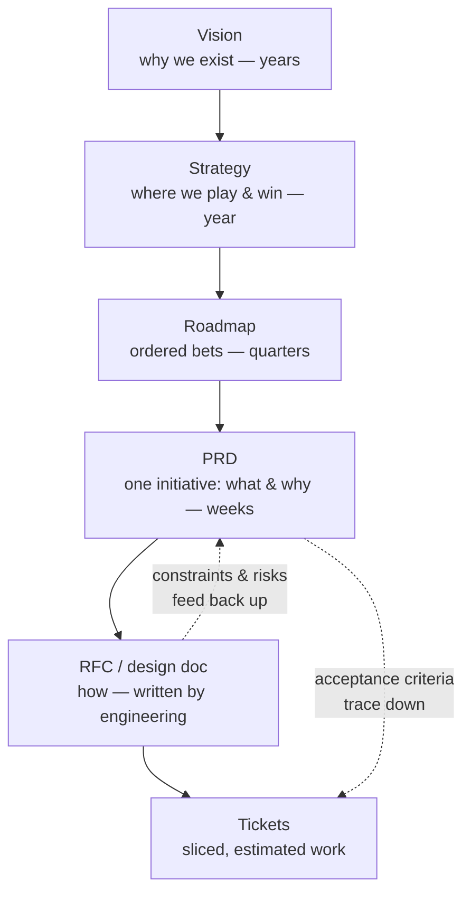

# Specs, PRDs & RFCs

*Part of [Technical product management for the AI PM](./README.md)*

*Last reviewed: 2026-11 · Volatility: medium*

<!-- voice: human -->

It's week eleven of an AI summarisation feature. Engineering says it's ready, and support says the
summaries are sometimes wrong. The sales lead says the demo was great, so what's the hold-up? You open the PRD to settle it and find the requirement that matters, which says the feature
"summarises meetings accurately". Nobody can say whether that has been met, because it was never something you could
test. This lesson is about writing the sentence that would have ended that argument in week one.

## The document stack

Writing is how a PM's thinking reaches a team, and the documents form a stack. Each layer answers
questions the layer below shouldn't have to reopen.

The PRD (product requirements document) is yours, and the RFC (request for comments, or design
doc) belongs to engineering. Two arrows in the stack matter most. Acceptance criteria in the PRD
should trace all the way into tickets, so a ticket that can't be traced to a requirement deserves
the question of why it exists. RFCs also feed *back*. Design work often turns up a constraint, such as "that data doesn't exist" or "that latency
needs precomputation". That constraint has to flow back up and change the PRD rather than get
quietly absorbed.

## A PRD engineers respect

Length isn't quality, and one to four pages usually beats twenty. These are the sections that
earn their place.

- **Problem and evidence.** Whose problem is it, how do you know it's real, and what does it cost
  today? Engineers read this section to decide whether the project is worth caring about, so write
  it best.
- **Goals and non-goals.** A non-goal is often the most useful sentence in the document. "V1 does
  not support bulk import" settles a hundred Slack threads before they start.
- **Requirements with acceptance criteria.** Each one should be testable. *Given* a context,
  *when* the user acts, *then* this observable result follows. "Search should be fast" is an
  opinion, while "search returns first results within 500 ms at p95" is a requirement (p95 means
  95% of requests are at least that fast).
- **Non-functional requirements.** These are the ones forgotten until they become emergencies:
  latency and availability targets, scale, privacy and data residency, accessibility, security
  review and admin tooling. The [technical product sense](../technical-product-sense/README.md)
  track is where you learn to write them.
- **Edge cases and unhappy paths.** Say what happens on an empty state, a failure, a retry or
  abuse. If the PRD only describes the happy path, the engineers design the unhappy ones alone.
- **Success metrics.** Name the numbers that will move if this works, and when you'll check them
  ([Metrics & experimentation](./metrics-and-experimentation.md)).
- **Open questions.** Keep an explicit list. Pretending to a certainty you don't have costs trust,
  and a visible list of open questions builds it.

A PRD shouldn't contain database schemas, API designs, technology choices or a solution dressed
as a requirement. "Build a Redis cache" is a design, and "repeat visits must load in under a
second" is the requirement behind it.

## When a model wrote the first draft

A model can turn a two-line prompt into a PRD with every section present and readable. That
changes where the effort goes, since writing the draft is now quick and checking it is the work.
The general method for reviewing an AI-drafted artifact is in [communication](../product-sense/communication.md)
in the product sense track. For a PRD, watch for three tells in particular. The first is invented
specificity, such as a latency number or a success metric nobody agreed. The second is missing
non-goals, because a draft tends towards scope that sounds complete. The third is a dropped
dependency on another team's roadmap, which the model had no way to know about. If you can't trace
a requirement back to real evidence, cut it or move it to open questions.

## Acceptance criteria for a feature that's sometimes wrong

A deterministic feature can be specified by listing behaviour ("clicking X does Y"). An AI feature
can't, because you can't list every input, so the spec has to define *quality* instead. You can't
write "the summary is always accurate", but you can write criteria like these.

- **Eval-based criteria.** For example, "on the 200-example eval set, at least 90% of summaries
  are graded *acceptable or better* by the rubric in appendix A, with zero *harmful*". The eval
  set, a graded collection of real inputs and ideal outputs, becomes part of the spec.
- **Behavioural bounds.** "When retrieval returns nothing, the feature says it can't answer rather
  than guessing, and it never invents a citation."
- **Consistency across runs.** For agents, one success is weak evidence. The tau-bench paper
  (Yao et al., 2024) proposed pass^k, the chance that an agent succeeds on *all* k tries of the
  same task. It reported that a leading function-calling agent scored under 25% on pass^8 in its
  retail domain. If users repeat a task, write the bar as "succeeds on k of k runs".
- **Budgets.** "p95 end-to-end latency of 3 s or less, and a marginal cost of $0.02 or less per
  request at projected volume."

The consistency point is easy to underrate, so here is the arithmetic. Suppose, as an
illustration, that each run succeeds 90% of the time and runs are independent. The chance of eight
successes in a row is 0.9 multiplied by itself eight times, which is about 0.43. An agent that
works "nine times out of ten" fails a user who repeats the task eight times more often than not.

Ankur Goyal, whose company Braintrust builds eval tooling, puts the shift more bluntly:

> "I think the modern PRD is an eval. It's actually something that an engineering team [...] can use to quantify how well the software that they're building is able to solve the problem."
> — Ankur Goyal, [*Evals are the new PRD*](https://www.youtube.com/watch?v=71qvIkO9d_A), The Growth Podcast, around 07:49

He has a commercial stake in that view, and a PRD still has to carry the problem, the evidence and
the non-goals that no eval holds. Still, the part about engineers being able to *quantify* "good"
without asking you is the real test of an AI spec.

## Worked example: deciding whether the summariser ships

This example is invented, and so are its numbers. Your PRD for the meeting summariser sets three bars on a 200-case eval set. At least 90% of
summaries must be graded acceptable, none may be harmful, and p95 latency must be 3 seconds or
less. At 90%, that means at least 180 acceptable summaries.

| Run | Acceptable | Rate | Harmful | p95 latency | Meets the bar? |
| --- | --- | --- | --- | --- | --- |
| First candidate | 176 of 200 | 88% | 2 | 2.6 s | No: 4 short, and 2 harmful |
| After prompt fix | 183 of 200 | 91.5% | 0 | 2.8 s | Yes |

The rates are the acceptable count divided by 200, so 176 / 200 is 88% and 183 / 200 is 91.5%.
The first run misses the quality bar by four summaries and fails the zero-harm rule twice. Both harmful cases turn out to be summaries that named the wrong person as owning an action
item. The team changes the prompt to quote owners from the transcript, and adds ten more such
cases to the eval set. The second run clears all three criteria.

Notice what didn't happen. Nobody argued about whether the feature felt ready, and the sales
lead's demo didn't enter into it. The launch question became a score, and the PRD defined the
score before anyone was invested in the answer. The cost is real, though. Someone had to grade the
200 cases and agree the rubric, and that work has to be in the plan.

## Reading an RFC like a PM

The RFC is where engineering proposes *how*. You won't judge the architecture, but you may be the
only reader checking it against product intent. Read it for four things.

- **Does the design serve the requirements it cites?** RFCs sometimes relax a requirement quietly,
  such as "we'll refresh nightly instead of in real time". Nightly might be fine, but it's your
  call to make in the open.
- **The tradeoffs section.** An honest RFC lists the alternatives it rejected. Check the reasons
  against product priorities, because engineers optimise for simplicity and ease of running,
  which usually aligns with users but not always.
- **The rollout and migration plan.** How does the world move from old to new? ([Launches,
  rollouts & migrations](./launches-rollouts-and-migrations.md) covers this.) A missing plan is a
  risk that lands on your launch date.
- **New promises.** An RFC that exposes a new API or data contract creates something other teams
  will depend on, which makes it product surface whether or not it has a UI.

Comment with questions rather than directives. "What happens to requirement 4's p95 target under
this design?" moves the conversation on, while "use Postgres instead" ends it.

## From the show: the PRD as a skeleton

Itamar Gilad describes how his own PRDs changed over time, from a long contract into something
lighter:

> "And I started seeing them as skeletons, as kind of conversation starters. They framed the problem. They explained the goals and the non-goals."
> — Itamar Gilad, [*Make More of Your Product Launches Succeed with Itamar Gilad, Ex-Google PM*](https://www.youtube.com/watch?v=FOow1L7jkmA), The Growth Podcast, around 41:04

In his telling, the rest of the document fills in as discovery and delivery answer its open
questions. That fits a living PRD better than a finished one. The risk of the skeleton approach is
that it can become an excuse for never deciding, so the skeleton still needs testable acceptance
criteria before the team builds against it.

## Where it goes wrong

- **The write-once PRD** is treated as done when circulated and never updated. A stale spec is
  worse than none, because people follow it.
- **Solutioneering** puts the implementation in the PRD. You get your design, and you also get the
  full blame when it underperforms.
- **The unread masterpiece** runs to twenty pages nobody finishes. If the team can't recall the
  goals and non-goals, the document failed whatever its quality.
- **Default non-functional requirements** happen when nobody states latency, privacy or scale
  targets, so the system inherits whatever the implementation produced.
- **Consensus by silence** means circulating a doc, hearing nothing and calling it alignment,
  when silence usually means nobody read it.
- **The rubber-stamped AI draft** is a fluent, complete-looking PRD shipped without checking its
  specifics, where the format made it look reviewed.

## What to do next

- [ ] Add explicit non-goals to your current PRD, and check that at least one has already settled
      a scope argument.
- [ ] Make every requirement testable, so QA or an eval could verify it without asking you.
- [ ] State latency, privacy, scale and failure behaviour instead of leaving them to defaults.
- [ ] Read the RFC for your current build and trace each requirement into it.
- [ ] For an AI feature, write the eval bar, the harm rule and the budgets before the build starts.

## Related lessons

- [Discovery to delivery](./discovery-to-delivery.md)
- [Working with engineering](./working-with-engineering.md)
- [Technical product management for AI](./tpm-for-ai-products.md)
- [Communication](../product-sense/communication.md) (product sense): reviewing any AI-drafted
  artifact.
- [Evals: golden sets, adversarial, LLM-as-judge](../content/04-evals-observability/evals.md): how
  to build the eval set the acceptance criteria point at.

## Sources

- Shunyu Yao, Noah Shinn, Pedram Razavi and Karthik Narasimhan, [*τ-bench: A Benchmark for
  Tool-Agent-User Interaction in Real-World Domains*](https://arxiv.org/abs/2406.12045), arXiv,
  17 June 2024 (pass^k, and pass^8 under 25% in the retail domain) (as of 2026-11-28).
- Quotes from The Growth Podcast with Aakash Gupta ([news.aakashg.com](https://www.news.aakashg.com)), used under its licence. The transcript text is machine-made and the quotes have not been checked against the audio.
