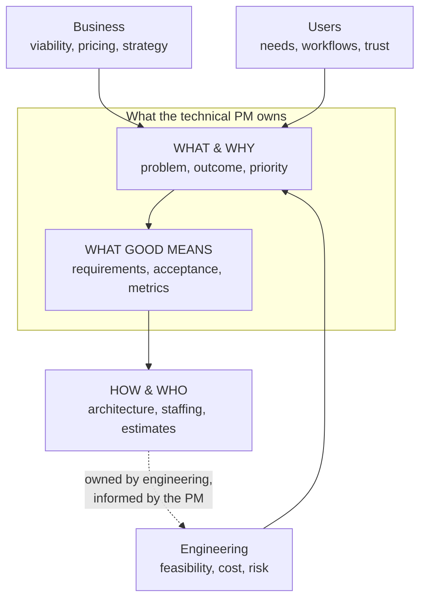

# The technical PM role

*Part of [Technical product management for the AI PM](./README.md)*

<!-- voice: human -->

Your engineering lead pings you on a Tuesday afternoon. The team has two ways to build the new search feature. One answers in under a second but costs
more to run, and the other is cheaper but takes three seconds. She wants to know which one to build. You could say "your call, you're the
expert", or you could pick one because it sounds right. Both answers are wrong, and the reason
they're wrong is most of what this lesson is about.

## What you own, and what you don't

A technical product manager owns what every PM owns, which is outcomes. The difference is the kind
of product. On platforms, APIs, data products and AI features, the hard decisions are technical. A PM who
can't take part in them ends up watching the product get decided by default.

The cleanest way to hold the role is to sort decisions into three groups.

**You own** the problem statement, the priority order and the requirements, including the
non-functional ones such as speed and privacy. You also own the success metrics, the launch
decision, and the communication that keeps everyone pointed at the same outcome.

**You inform but don't own** the architecture, the technology choices, the estimates and how the
team organises its work. You bring constraints and consequences, such as "this must answer in
under two seconds" or "this data can't leave the EU", and engineering brings the design.

**You stay out of** code review, task assignment and performance management. The quickest way to
lose an engineering team is to do their jobs badly.

Back to the search feature. Choosing the architecture isn't your call, but the latency budget is,
because it's a product decision about what users will tolerate. So the useful answer is a question back. What does three seconds do to people who search ten
times a session, and what does the faster option cost per month at our volume? Once you've framed the tradeoff in product terms,
the engineering choice usually makes itself.

## Titles are a mess, so ask

Titles vary wildly between companies, though the underlying jobs don't.

| Role | Optimises for | Customer is | Typical outputs |
| --- | --- | --- | --- |
| Product manager | User and business outcomes | End users, buyers | Strategy, PRDs, roadmaps |
| Technical PM | Outcomes on technical products | Often *developers* or internal teams | PRDs with contracts, API specs, migration plans |
| Program manager (also "TPM" at some companies) | Cross-team execution | The organisation itself | Plans, dependency maps, status |
| Engineering manager | Team health and delivery | The team | Staffing, architecture reviews, career growth |

At many large tech companies, the letters TPM mean *technical program manager* (TPM), which is an
execution and dependency-management job rather than a product-ownership one. Ask what the letters
mean before you interview, and read the job description rather than the title. Platform and API
products also turn the empathy problem around, because your user is another engineer. Docs, error
messages, versioning and the time it takes to make a first successful call become your user
experience.

## Where your influence comes from

You have no authority over the people who build the product, so your influence runs on three
things you can supply.

- **Context.** You know things the team can't see from inside the sprint: what customers said,
  what the business needs, what other teams are shipping. Deliver it steadily and decisions start
  going your way when you're not in the room.
- **Clarity.** A crisp problem statement and an unambiguous definition of done are worth more than
  any number of meetings, since ambiguity is where a team's speed quietly drains away.
- **Trust.** You earn it by learning enough of the technical picture to ask good questions, which is
  what the [technical product sense track](../technical-product-sense/README.md) is for. You keep
  it by never negotiating an estimate you don't understand, and by absorbing ambiguity from above
  instead of passing panic down.

A picture that helps is to think of yourself as the team's interface to the rest of the company.
Requests arrive in business language, you turn them into a prioritised, unambiguous contract, and
the team's work flows back out through you as a story the company understands.

## The job nobody else will do

One responsibility doesn't delegate, which is noticing incomplete work, your own included. Nobody
downstream necessarily knows the right questions to ask. The tell is familiar. You send an answer
already knowing the follow-up question you skipped, and it arrives ten minutes later. Once, that's
a slip, but as a habit it's how products ship at a B-plus when everyone privately knew they could
have been an A. The fix is structural, so before anything leaves your hands, ask what the reader
will ask next and answer it in the same document.

## Worked example: auditing your own week

This example is invented, and so are its numbers. A common rule of thumb for technical PMs is to
split time roughly 40/40/20 across three buckets. *Now* is unblocking the current build, *next*
is discovery and definition for the next one or two bets, and *later* is strategy, metrics
review, debt and the roadmap. It's a heuristic and not a research finding, but it gives you something to measure
against.

Say you're the PM for a payments API and you log a 45-hour week by category.

| Bucket | What went in it | Hours | Share | Rule-of-thumb share | Rule-of-thumb hours |
| --- | --- | --- | --- | --- | --- |
| Now | Standups, spec questions, two scope calls, a review against acceptance criteria | 31 | 69% | 40% | 18 |
| Next | Two customer calls, a data pull | 9 | 20% | 40% | 18 |
| Later | A metrics review | 5 | 11% | 20% | 9 |
| Total | | 45 | 100% | 100% | 45 |

The shares come from dividing each bucket by 45, so 31 / 45 is 69%, 9 / 45 is 20% and 5 / 45 is
11%. The rule-of-thumb hours are 40%, 40% and 20% of 45, which gives 18, 18 and 9. You're spending
13 hours more than the guide on *now*, and 9 hours less on *next*.

Nothing in that week was wasted, which is what makes the pattern dangerous. If it holds for more than a sprint or two, the next build starts without definition. The team
then spends its sprints asking you questions you could have answered in advance. That pushes *now* even higher. The fix
here is concrete. You move two recurring status meetings to a written update, which frees about
four hours, and you put two fixed discovery blocks in your calendar for the next bet. Even that
only gets *next* to 13 hours, so the remaining gap is a conversation with your engineering lead
about which scope questions the tech lead can answer without you.

## The technical PM interview

Technical PM interviews often include a round that product-sense interviews don't have: system or
API design, done from a PM's altitude rather than an engineer's. (For the general interview craft
this round builds on, see [communication](../product-sense/communication.md) in product sense.)

The interviewer isn't grading your architecture. They're watching whether you ask what the data
looks like, what scale you're working at and what you're optimising for before you draw anything.
A candidate who opens with "who calls this API, how often, and what happens if it's down?" is doing the job. One who jumps straight to a diagram is auditioning for a different seat.

A frame that holds up goes like this. State the goal and the users, then name the non-functional
requirements that matter here, such as latency, consistency and who owns which data. Sketch the
contract rather than the implementation, and say the tradeoffs out loud, the same way you'd [read
an RFC](./specs-prds-and-rfcs.md). Then connect each technical choice to a product consequence. A sentence like "we'd need eventual consistency here, so a user could briefly see a stale
balance, and is that acceptable?" marks a technical PM answer. The same frame works for AI versions of the round, on eval design, retrieval and serving.
The extra layer there is reasoning about what happens when the model is wrong.

## From the show: why "technical" became the default

Lewis C. Lin, who coaches candidates for PM interviews, describes a shift in what hiring managers
expect:

> "kind of an unspoken belief that a more effective product manager is a technical product manager. And it kind of makes sense because one of your key stakeholders is engineers."
> — Lewis C. Lin, [*500,000 Professionals Have Used His Book To Crack Interviews at Big Companies*](https://www.youtube.com/watch?v=jkTPnrqs1zw), The Growth Podcast, around 38:57

That's his read of the hiring market, not a measured trend, but it matches why this track exists.
Mike Davey adds a practical warning about the title itself:

> "I applied to a job that was a technical product manager. But the actual job description sounded like a head of product role."
> — Mike Davey, [*How He Became a Series C VP of Product in 10 Years: Mike Davey*](https://www.youtube.com/watch?v=59mpQHNXsPI), The Growth Podcast, around 01:09:08

His point is to read the description, the company stage and the hiring pattern, and to trust
those over the title. The same letters can mean a platform owner, a program manager or a company's
first product hire.

## Where it goes wrong

- **The backseat architect** overrules technical designs they half understand. Engineers stop
  bringing real options and start managing the PM instead.
- **The ticket clerk** writes down whatever the loudest stakeholder or the tech lead wants and
  adds no judgment, even though the judgment is the whole value of the role.
- **The absentee** hands off "the technical stuff" wholesale and is then surprised by a latency,
  cost or privacy property that was knowable months earlier.
- **The hero translator** routes all information through themselves. It feels like influence, but
  it's a bottleneck that stops the day they go on holiday.

## What to do this week

- [ ] Write the outcome your product owes the business, and the problem it solves for users, in
      one sentence each.
- [ ] Draft a list of decisions that are yours, theirs and shared, and walk your engineering lead
      through it.
- [ ] Name the two or three technical constraints that shape your roadmap most, such as a latency
      budget, a data boundary or a dependency.
- [ ] Log one week of your time against now, next and later, and book discovery time if *next* is
      thin.
- [ ] Recall the last time an engineer changed your mind with a better option, and make a point of
      asking for one this week.

## Related lessons

- [Discovery to delivery](./discovery-to-delivery.md)
- [Working with engineering](./working-with-engineering.md)
- [Specs, PRDs & RFCs](./specs-prds-and-rfcs.md)
- [Technical product sense](../technical-product-sense/README.md): the systems knowledge that earns
  the trust described above.
- [Executive influence and stakeholders](../business-acumen/executive-influence-and-stakeholders.md)
  (business acumen): influence without authority, in depth.

## Sources

- Quotes from The Growth Podcast with Aakash Gupta ([news.aakashg.com](https://www.news.aakashg.com)), used under its licence. The transcript text is machine-made and the quotes have not been checked against the audio.
