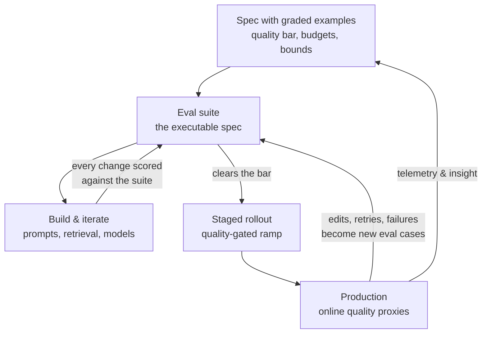

# Technical product management for AI

*Part of [Technical product management for the AI PM](./README.md)*

<!-- voice: human -->

An email arrives from your model provider. The model your feature is pinned to will be retired,
and there's a newer one they recommend. Your engineering lead asks whether you should switch now,
and the room splits. One engineer says the new model is better on every benchmark. A second remembers the last upgrade
broke a customer's workflow, and nobody can say what the switch would do to your product. That debate is the symptom this capstone treats. When you can answer "should
we upgrade?" with a score by the end of the day, most of the AI-specific craft is in place.

## Everything still applies, bent the same way

The previous eight lessons taught the general craft. Every one of those practices still applies to an AI product, and they all bend for the same
reason. Behaviour is probabilistic, and quality is something you discover rather than design. So the operating loop reorganises around
evidence.

Read it as three connected loops. The **inner loop**, build and eval, runs daily, and no prompt,
retrieval or model change lands without a score. The **release loop**, from eval through rollout
to production, runs weekly or monthly, with quality gating the ramp. The **outer loop**, from
production back to the spec, runs quarterly, as what users actually do reshapes what "good" means.
Your job as PM is to make sure all three arrows back into the eval suite actually exist.

## Eval-driven development

The eval suite is to an AI feature what the test suite is to code, except that the PM co-owns it,
because it encodes product judgment. In **eval-driven development**, a graded example set is the
spec, the regression suite and the launch gate at once.

- **Sourcing.** Start with real or realistic inputs from discovery, enough to cover the main kinds of
  request and the failure cases you already know about. Grade the ideal outputs with a rubric.
  This is the graded-examples section of [your PRD](./specs-prds-and-rfcs.md), turned into
  infrastructure.
- **Grading.** There are three tiers, in cost order. Programmatic checks ask simple questions such
  as whether the output is valid JSON or cites a source. Model-graded rubrics use a model to judge
  tone or groundedness, which is cheap and scales but needs spot-checks against people. Human
  review is the gold standard, spent where stakes are highest.
- **Judges.** Hamel Husain and Shreya Shankar's evals FAQ recommends binary pass/fail labels over
  1-to-5 scales, and a separate judge for each failure mode. It also recommends checking each judge
  against human labels, for both real failures caught and good outputs passed. For error analysis, it suggests reviewing at least 100 traces, and continuing past that while
  you're still learning.
- **The bar.** You set a launch threshold *as the PM*, such as "at least 90% acceptable, zero
  harmful". Where the bar sits is a product decision that balances user trust, the cost of errors
  and competitive urgency.
- **Maintenance.** A static suite rots as users find new ways to use and break the feature. Feed
  production failures back in on a schedule, retire cases that no longer tell options apart, and
  give someone ownership of the suite's freshness.
- **The ritual.** Hold a standing PM and engineering session that reads raw production traces
  together, labels failures in free text, and clusters them before deciding which ones deserve an
  automated evaluator. A PM–engineer disagreement about whether an output passes is a requirement
  being discovered, not noise.

Once the suite exists, hard conversations get easier. "Can we ship?" becomes a score, "did the new
model help?" becomes a diff, and comparing two prompts takes an afternoon instead of a meeting.

## What each lesson's craft gains

- **Discovery** ([lesson 2](./discovery-to-delivery.md)). Feasibility is a scored spike, run before
  the bet enters delivery. Add two viability checks. One is unit economics, where cost scales with
  tokens times volume at realistic context sizes. The other is data rights, meaning whether you can
  use this data for this purpose, feedback capture included.
- **Specs** ([lesson 3](./specs-prds-and-rfcs.md)). Acceptance criteria become eval thresholds,
  behavioural bounds and budgets. Spec the **failure experience** too, since what the user sees
  when the model is wrong, slow or down is product surface.
- **Prioritisation** ([lesson 4](./prioritization-and-roadmaps.md)). Discount confidence until a
  spike has run, reserve capacity for eval and data work, and use effective reach, which is reach
  times the share of inputs the feature handles well.
- **Execution** ([lesson 5](./working-with-engineering.md)). Experiment-shaped work runs as
  time-boxed spikes with score-based exit criteria.
- **Metrics** ([lesson 6](./metrics-and-experimentation.md)). Offline eval scores pair with online
  proxies such as acceptance, edit distance and retry rate, and cost per request joins latency on
  the guardrail list.
- **Releases** ([lesson 7](./launches-rollouts-and-migrations.md)). Every model or prompt change is a migration. It gets an eval diff, a shadow or side-by-side run,
  a staged ramp with quality gates, and a rollback that re-pins the old version. That rollback is cheap only if you versioned them.
- **Incidents** ([lesson 8](./incidents-and-postmortems.md)). Quality drops are pageable events,
  and every feature ships with a kill switch and a degraded mode you chose on purpose.

## Worked example: the retirement email

This example is invented, and so are its numbers. Your support assistant is pinned to a model that
the provider says will retire in 60 days, which is the minimum notice Anthropic commits to for
publicly released models. You run the 300-case eval suite on the current model and on the
recommended replacement.

| Slice | Cases | Current model passes | Candidate passes |
| --- | --- | --- | --- |
| Refund-policy questions | 40 | 38 | 33 |
| Everything else | 260 | 232 | 246 |
| All cases | 300 | 270 (90%) | 279 (93%) |

The candidate wins overall, 279 against 270, which is 93% against 90%. Look at the slices, though.
It gains 246 − 232 = 14 cases on everything else and loses 38 − 33 = 5 on refund policy. Refund
answers are the ones most likely to cost you money. A config-change upgrade would have shipped a
regression that the headline number hid.

So you plan it as a migration. You give the team two weeks to fix the refund regression in the prompt and re-run the diff. Then
come two weeks of shadow running on live traffic, and two weeks of staged ramp. That's 14 + 14 + 14 = 42 days, which leaves 60 − 42 = 18 days of slack before the old
model stops answering. Eighteen days is not much if the prompt fix takes a second round, so you
start this week rather than at the next planning cycle. The cost is that six weeks of the team's
time go to an upgrade nobody asked for, and that belongs on the roadmap as a line item.

## Context, flywheels and control points

An important question for an AI feature's quality is what context the model needs to make the
decision well, more than what data you happen to have. A clever prompt on its own answers
that badly, since it breaks under rephrasing and carries no memory between calls. Your job is to
specify the context a decision requires, the same way a [spec](./specs-prds-and-rfcs.md) sets an
eval threshold. [Context engineering for the product leader](../context-engineering/README.md)
covers this in full.

The compounding asset of an AI product usually isn't the model, because competitors can rent the
same one. It's the **data flywheel**, where usage produces captured feedback, which improves the
evals, which makes iteration safer and faster, which improves the product and brings more usage.
Two PM jobs make it spin. Instrument feedback capture (accepted, edited, abandoned) as a launch
requirement, and secure the right to learn from it through the privacy policy, enterprise
contracts and regional law. A competitor with the same model and a faster flywheel tends to pull ahead.

The flywheel's strategic twin is **workflow capture**, which means owning a *control point*, the
workflow step whose outputs the downstream work depends on. When you weigh an adjacent workflow,
ask which way integration would run if another company captured it. Would they integrate into you,
or you into them?

## The long game

Some roadmap truths only bite in a product's second year, so budget for them in its first.

- **Models drift on your watch.** Data shifts, user behaviour changes in response to the product,
  and providers ship new versions. Re-evaluation and periodic re-prompting or re-pinning are a
  permanent line item, not one-off maintenance.
- **Pinned models get retired.** Pinning protects you from silent change but not from retirement.
  Anthropic gives at least 60 days' notice before it retires a publicly released model. OpenAI
  gives at least 6 months for generally available models, unless safety or compliance concerns
  require a faster timeline, and at least 3 months for specialised variants and image models.
  Preview models can go with much shorter notice, such as two weeks. Request parameters change too.
  Anthropic's docs list `temperature`, `top_p` and `top_k` as removed in API version `2026-10-21`.
  Put each retirement date on the roadmap, and check the provider's deprecation page, because dates
  and notice periods change.
- **Ethical debt compounds like tech debt.** Bias audits, explainability, privacy reviews and
  fairness checks deferred at launch don't get cheaper. They get baked into data, behaviour and user
  expectations, so schedule them with the same discipline as [debt
  paydown](./prioritization-and-roadmaps.md), before an incident schedules them for you.
- **Platforms outlast features.** The investments that compound are rarely the visible features.
  They're the eval infrastructure, data pipelines and feedback instrumentation every later feature
  rides on.

## Vibe coding: the prototype is the new spec

AI coding tools such as Claude Code and Cursor have made working software cheap enough that PMs
build it themselves. Andrej Karpathy coined the name for it, "vibe coding", and Collins chose it as
its word of the year for 2025. That changes the operating loop in three ways.

- **Discovery ships artifacts, not documents.** A working prototype in front of five users teaches
  more than a PRD in front of five stakeholders. Increasingly the prototype *is* the spec, and the
  written document records the decisions the prototype forced.
- **The PM–engineering contract gets shorter.** "Here's what I mean" becomes something engineers
  can click, which removes a whole class of ambiguity. It also adds a duty to say plainly that the
  prototype shows *intent*, not architecture.
- **The new failure mode is prototype-grade code in production.** Vibe-coded software demos well
  and hides its corners, such as missing error handling, tenancy and evals. Prototypes are for
  learning, and the eval-gated pipeline above is for shipping.

Use these tools in your own work, too. Generating mock-up variations, clustering bug reports, critiquing a flow and drafting the first
pass of a document are cheap training in where models shine and where they quietly fail. The eval
bar and the scoping calls above run on that intuition.

## From the show: whose job the evals are

Shreya Shankar warns against the most tempting shortcut for a busy PM:

> "But then they think it's worth some human doing error analysis, not them. So they'll just outsource it out, which again, huge pitfall."
> — Shreya Shankar, [*How to Do AI Evals Step-by-Step with Real Production Data*](https://www.youtube.com/watch?v=J7N9FMouSKg), The Growth Podcast, around 01:00:25

Her argument is that error analysis is where you build the product, so handing it off removes your
judgment from it. Ankur Goyal adds a caution that keeps evals honest:

> "And oftentimes it will fit the eval and the product will still suck."
> — Ankur Goyal, [*Evals are the new PRD*](https://www.youtube.com/watch?v=71qvIkO9d_A), The Growth Podcast, around 07:49

In his view that's the PM's cue to improve the evals, which is why the outer loop exists. Shuhao
Zhang, talking about shipping fast with coding agents, draws the line from the vibe-coding section:

> "So first of all, building fast does not mean shipping slop, right? We're talking about production grade."
> — Shuhao Zhang, [*How to Ship to Production with AI Agents*](https://www.youtube.com/watch?v=-xQPRlk7VRE), The Growth Podcast, around 43:39

## Where it goes wrong

- **Demo-driven development** iterates until the demo impresses, ships, and then finds real inputs
  look nothing like the script.
- **Eval-less iteration** ships prompt changes on feel, so every change is a coin flip you can't
  tell apart from progress.
- **The static eval** is built at launch and never fed. A year later it certifies quality on
  problems users stopped having.
- **Flywheel-blind economics** ships without feedback capture, or without the rights to use it, and
  then wonders why the product stopped improving.
- **Treating the model as the moat** bets differentiation on model choice while a competitor with
  the same model out-learns you on data and iteration speed.
- **The surprise retirement** leaves a pinned model's end date off the roadmap until the email
  arrives, and then there's no time for an eval diff.

## What to do next

- [ ] Give every AI feature you own an eval suite with a PM-set bar, and score every prompt or
      model change against it before it ships.
- [ ] Pin and version prompts and models, so a rollback is a re-pin.
- [ ] Write down the context each feature needs, and where it's retrieved or remembered from.
- [ ] Instrument accept, edit and abandon signals, and confirm you have the right to learn from
      them.
- [ ] Put every pinned model's retirement date, or its earliest possible one, on the roadmap.
- [ ] Sketch the three loops for your product, and mark the arrow that's broken today.

## Related lessons

- [Specs, PRDs & RFCs](./specs-prds-and-rfcs.md)
- [Metrics & experimentation](./metrics-and-experimentation.md)
- [Launches, rollouts & migrations](./launches-rollouts-and-migrations.md)
- [Incidents & postmortems](./incidents-and-postmortems.md)
- [Technical sense for AI systems](../technical-product-sense/technical-sense-for-ai.md)
  (technical product sense): what the system can do reliably.
- [Context engineering for the product leader](../context-engineering/README.md): specifying the
  context a decision needs.
- [Evals: golden sets, adversarial, LLM-as-judge](../content/04-evals-observability/evals.md): the
  measurement layer under eval-driven development.

## Sources

- Anthropic, [*Model deprecations*](https://platform.claude.com/docs/en/about-claude/model-deprecations),
  Claude Platform docs (at least 60 days' notice for publicly released models; `temperature`,
  `top_p` and `top_k` removed in API version `2026-10-21`) (as of 2026-11-28).
- OpenAI, [*Deprecations*](https://developers.openai.com/api/docs/deprecations), OpenAI API docs
  (model deprecation notice periods) (as of 2026-11-28).
- Hamel Husain and Shreya Shankar, [*AI Evals: Everything You Need to
  Know*](https://hamel.dev/blog/posts/evals-faq/), hamel.dev, updated 21 September 2026 (binary
  labels, one judge per failure mode, judge validation, at least 100 traces) (as of 2026-11).
- Collins Dictionary, [*Collins' Word of the Year 2025: AI meets authenticity as society
  shifts*](https://blog.collinsdictionary.com/language-lovers/collins-word-of-the-year-2025-ai-meets-authenticity-as-society-shifts/),
  6 November 2025 ("vibe coding", coined by Andrej Karpathy) (as of 2026-11).
- Quotes from The Growth Podcast with Aakash Gupta ([news.aakashg.com](https://www.news.aakashg.com)), used under its licence. The transcript text is machine-made and the quotes have not been checked against the audio.
