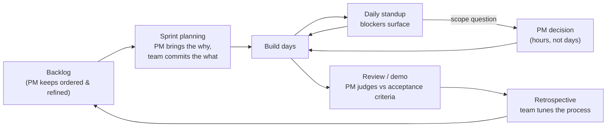

# Working with engineering

*Part of [Technical product management for the AI PM](./README.md)*

<!-- voice: human -->

A sales director stops you in the corridor. A big prospect wants the integration "by end of
next month", which is six weeks away. You know the team's estimate was ten weeks. You also know that if you walk back into planning and
ask whether they can do it in six, they'll probably say yes. The work will still take ten weeks, minus the tests and plus an incident. This lesson is about
the better conversation, and about the habits that make engineers tell you the truth before you
need it.

## The rituals, and your job in each

Most software teams run some form of agile, which means work sliced small, built in short cycles
and corrected by feedback. Some use **sprints**, Scrum's fixed one- or two-week cycles with planning, review and a
retrospective. Others use **flow**, Kanban's continuous pull of work through a board with
work-in-progress (WIP) limits. The rituals are where your product intent
actually enters the build.

**Backlog refinement** is probably the most underrated hour of your week. Stories get clarified,
sliced and estimated *before* planning, so planning becomes a decision meeting rather than an
archaeology session. A PM who arrives at refinement with crisp acceptance criteria does more for
the sprint than one who only shows up to demos.

**Sprint planning** is where you bring the ordered backlog and the context, meaning why these
items and why now. The team decides how much fits, and the commitment has to be theirs, since a
sprint the PM stuffed is a sprint the team never owned.

**The daily standup** isn't a status report to you. You're there to catch the phrase "blocked,
waiting on product" and clear it within hours, because PM decision delay doesn't show up in any
metric but it slows every sprint.

**The review or demo** checks working software against acceptance criteria. Praise specifically
and question honestly. Saying "looks great, ship it" about something that misses a criterion
teaches the team that the criteria are decoration.

**The retrospective** is the team's meeting about how it works. If you're invited, listen more
than you talk, and fix the top complaint if it's yours to fix. It's often that requirements arrive
late or change mid-sprint, which is uncomfortable to hear and usually fair.

Scrum batches work into fixed commitments and suits plannable feature work. Kanban pulls work
continuously and suits interrupt-heavy work, such as platform teams, support-heavy products and
operations. Many teams blend the two. The method's name matters less than whether priorities enter
cleanly and feedback comes out regularly.

## What velocity tells you, and what it doesn't

**Velocity** is the story points a Scrum team completes per sprint, averaged over several sprints.
It's a planning tool, not a performance score, and it isn't comparable between teams, because one
team's "5" is another team's "13". **Throughput** is the Kanban equivalent, items completed per
week, usually paired with **cycle time**, the time one item spends in progress.

Report velocity to leadership as productivity and you'll find the points rising while the
software stays the same. The useful signal is the trend. Stable velocity means a predictable team,
and a sustained dip is often the earliest sign of growing overhead, unclear scope or mounting
debt. If AI coding tools push velocity up, check change-failure and rework rates before you
celebrate. [Measuring and governing](../ai-assisted-development/measuring-and-governing.md) in
the AI-assisted development track covers the delivery metrics for that.

## Worked example: the six-week ask

This example is invented, and so are its numbers. The integration in the opening is 120 points of
work, and the team runs two-week sprints. Its last six sprints delivered 28, 34, 30, 26, 32 and 30
points.

The average is 180 ÷ 6, which is 30 points a sprint, and the range runs from 26 to 34. At the
average, 120 points takes 4 sprints. At the slowest recent pace it takes 120 ÷ 26, or about 4.6,
so call it 5 sprints. At the fastest it takes 120 ÷ 34, about 3.5, so call it 4 sprints. The honest
forecast is 4 to 5 sprints, which is 8 to 10 weeks. Six weeks is 3 sprints, which isn't on the
table at full scope.

So you don't ask for a discount. You ask the tech lead what the expensive part is, and the answer
is bulk import of historical records, at 36 points. The prospect only needs new records synced at
launch. Make bulk import a non-goal for the first release, and the scope drops to 120 − 36 = 84
points. At the average pace that's 84 ÷ 30, or 2.8 sprints, and at the slowest pace it's 84 ÷ 26,
about 3.2 sprints.

Now you can give sales an answer that's true. Six weeks is likely but not safe, and the slip risk
is a few days rather than a month. You say so this week, with the option of a fixed date two weeks
later if the prospect needs certainty. The cost is that bulk import moves to the next quarter, and
someone has to tell the prospect that too.

## Estimates and the trust economy

How to read an estimate is covered in [tech debt & estimation](../technical-product-sense/tech-debt-and-estimation.md).
What belongs here is the relationship around it.

- **An estimate is data, not an opening bid.** The moment you haggle, every later estimate arrives
  quietly padded, and you've lost your best signal. If the estimate doesn't fit the need, change
  the scope. That's your lever, and engineers respect it.
- **Ask for the drivers, not a discount.** "What's the expensive part?" often reveals that much of
  the cost sits in an edge case you didn't need, and cutting *that* is collaboration.
- **Carry bad news upward fast.** If the sprint says the date is wrong, the person who owns the
  date hears it this week, from you, with options. Teams watch what you do with bad news, and it
  decides whether you get early warnings.
- **Don't spend trust you haven't earned.** "It's probably a small change, right?" lands very
  differently from a PM who can draw the [system diagram](../technical-product-sense/how-systems-are-built.md)
  than from one who can't.

Some habits compound over months. Be findable, and answer scope questions the same day. Bring users into the room through session recordings, support tickets or a customer call the
engineers can join. Engineers who've seen the pain build better software than ones working from
your summary. Absorb stakeholder chaos rather than relaying it, so what reaches the sprint is already a
decision. And give credit outward by name. An invented example of how that sounds is "Priya's
retry design is why the launch survived the traffic spike", said in front of leadership.

## AI work doesn't burn down

"Improve answer quality" isn't a ticket that burns down in a straight line. It's an experiment
loop that might converge in two days or not at all, and forcing it into feature-shaped sprints
makes every sprint look like a failure. Run it as a **time-boxed spike with an eval-score exit
criterion** instead, such as "two weeks, ship if the eval clears 85%, escalate if it doesn't". Then
"still at 82% against a bar of 85%" is an informative sprint outcome rather than a slip. The plan
should say which items are builds, where you know what done looks like, and which are experiments,
where you're buying information.

## From the show: trust is the operating system

Tanguy Crusson talks about what happens when engineers ask for clarity you don't yet have, which
is common early in AI work:

> "I think the worst thing you can do is to pretend you have it and send them down the wrong path because then you're going to break that trust."
> — Tanguy Crusson, [*AI Product Discovery: Complete Course*](https://www.youtube.com/watch?v=6oottgko7pQ), The Growth Podcast, around 01:19:49

His alternative is to tell a new team up front that the work is going to be messy. Tom Occhino
puts the same idea in terms of the PM's place on the team:

> "You have to have complete trust of the engineers and your sort of counterpart, engineering management, tech lead, designer, et cetera."
> — Tom Occhino, [*Behind v0 (Top AI Prototyping Tool): Tutorial and Story from the CPO in 2026*](https://www.youtube.com/watch?v=-n8T6S_sD7Y), The Growth Podcast, around 01:03:04

Both are describing the same mechanism as the worked example. A team that trusts you gives you an
honest estimate and an early warning, and those two things are worth more than any ritual.

## Where it goes wrong

- **The feature factory** measures sprints by tickets closed and never by outcomes moved, until
  velocity becomes the product.
- **Estimate haggling** negotiates the number instead of the scope. You get quieter estimates, not
  faster software.
- **Mid-sprint scope injection** adds "one tiny thing" that reshuffles the plan. Do it twice and
  planning stops meaning anything.
- **Standup as a status court** has engineers performing progress for the PM instead of
  coordinating with each other.
- **Research punished as slippage** judges experiment work by feature metrics, which teaches the
  team to propose only safe, boring model work.

## What to do next

- [ ] Keep the top of the backlog ordered, refined and complete with criteria far enough ahead
      that planning never waits on you.
- [ ] Measure how long scope questions wait for your answer, and aim for the same day.
- [ ] The next time a number doesn't fit a date, ask for the drivers and change the scope.
- [ ] Label experiment-shaped work as experiments, with a time box and an eval exit criterion.
- [ ] Carry one piece of bad news upward this week, and give one piece of credit outward by name.

## Related lessons

- [The technical PM role](./the-technical-pm-role.md)
- [Specs, PRDs & RFCs](./specs-prds-and-rfcs.md)
- [Launches, rollouts & migrations](./launches-rollouts-and-migrations.md)
- [Tech debt & estimation](../technical-product-sense/tech-debt-and-estimation.md) (technical
  product sense): reading the estimates you negotiate.
- [Measuring and governing](../ai-assisted-development/measuring-and-governing.md) (AI-assisted
  development): delivery metrics when agents write code.

## Sources

- Quotes from The Growth Podcast with Aakash Gupta ([news.aakashg.com](https://www.news.aakashg.com)), used under its licence. The transcript text is machine-made and the quotes have not been checked against the audio.
