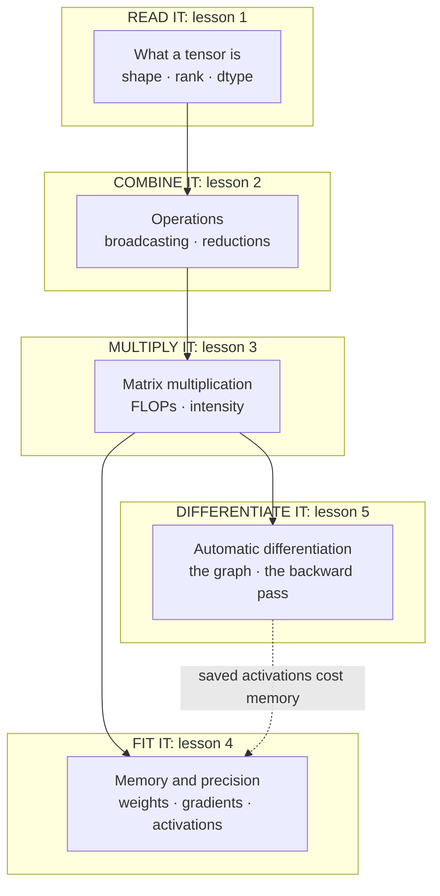

# Tensors for the product and technology leader

*Part of the [foundation modules](../TENSORS_ROADMAP.md). It follows [machine learning](../machine-learning/README.md) and comes before convolutional networks.*

Every model is arithmetic on grids of numbers. The grid is a **tensor**. A table of customers is one. A batch of images is one. The weights of a language model are thousands of them. Once you can read a tensor's shape and its number format, you can estimate what a model needs: memory, compute and cost.

Product and technology leaders make decisions about this every week. Will the model fit on one device? Why does a longer input cost so much? Why does a smaller number format save money, and what does it risk? Why can a model train with no errors and still be wrong? Those decisions do not need the mathematics. They need a clear picture of shapes, of one operation (matrix multiplication), and of how a library gets gradients for free.

This module gives that picture. Every lesson has two layers. The body is for the leader who decides. A short **Under the hood** section is for the engineer who builds. It shows code that runs on the Python standard library alone, with no install, and ends in `assert` lines so the claims in the lesson are checked. If you have NumPy, one extra file checks the code against it.

**One running thread.** The examples reuse the churn data and the tiny network from the machine learning module. The data is invented and generated by code with a fixed seed, so every number can be reproduced. The tensor code here rebuilds that network's forward pass as matrix multiplications, and rebuilds its gradients with a small autograd.

**A note on scope.** This module does not teach how a transformer works, how to serve a model at scale, or how to write PyTorch. [LLMs](../llms/README.md) covers the model most products call. [Inference internals](../content/01-inference-internals/README.md) covers serving in depth. This module stays one level lower. It answers the questions underneath them: what these objects are, what they cost, and how they are differentiated. Convolutional networks, which apply a small learned grid across an image, come in the module that follows.

## Where the depth lives

Each lesson summarizes an idea and points to the lesson that covers it in full.

| If you want the full depth on | Read |
| --- | --- |
| Number formats for a served model (INT8, INT4, FP8) | [Quantization formats](../content/01-inference-internals/quantization-formats.md) |
| Why serving splits into a compute-bound and a memory-bound phase | [Prefill vs. decode](../content/01-inference-internals/prefill-vs-decode.md) |
| The cache that grows with context at serving time | [KV cache management](../content/01-inference-internals/kv-cache-management.md) |
| Batching requests at serving time | [Batching and paged attention](../content/01-inference-internals/batching-and-paged-attention.md) |
| What training and inference mean for a language model | [What an LLM actually is](../llms/what-is-an-llm.md) |
| The training loop and a hand-written backward pass | [Training: loss and gradient descent](../machine-learning/training-loss-and-gradient-descent.md) |
| What a model costs over its life | [Cost optimization](../cost-optimization/README.md) |

## The knowledge graph



Read it as a chain with one loop. You **read** a tensor by its shape and dtype. You **combine** tensors with operations, and broadcasting decides which shapes work. You **multiply**, which is where almost all the compute goes. You **fit** the pieces into memory by counting bytes. You **differentiate** the whole thing automatically, and the graph it keeps feeds back into the memory budget.

## The lessons

1. [What a tensor is: shape, rank and dtype](./what-a-tensor-is.md) — the object every model works on, and how many bytes it takes.
2. [Operations and broadcasting](./operations-and-broadcasting.md) — elementwise operations, reductions, and the shape rule behind most silent bugs.
3. [Matrix multiplication: the workhorse](./matrix-multiplication.md) — what a layer costs, and why one big multiply beats many small ones.
4. [Batching, memory and precision](./batching-memory-and-precision.md) — weights, gradients, optimizer state and activations, and what float16 and bfloat16 trade.
5. [Automatic differentiation](./automatic-differentiation.md) — how a library gets the gradient with no hand-written rules, and how that goes wrong.

Then the [recap and real-world examples](./recap.md), with a self-test.

## Run the code

Every example is in `tensors/code/`. Run them all with one command.

```bash
python3 tensors/code/test_examples.py
```

The files are `lesson1_shapes.py` through `lesson5_autograd.py`, with the shared `tensor.py` and the optional `numpy_check.py`. A passing file checks the direction of each claim, such as the batched multiply reading the weights once. Run a file to see every quoted number printed. The NumPy check prints a skip message when NumPy is not installed.
