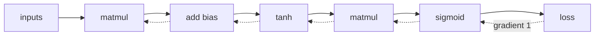

# Automatic differentiation

*Part of [Tensors for the product and technology leader](./README.md)*

*Last reviewed: 2026-10 · Volatility: medium*

## TL;DR

Training needs the gradient: the slope of the loss for every parameter. In the [machine learning module](../machine-learning/model-families.md) we wrote it by hand for a tiny network. Nobody does that for a real model. A library does it, and the method is **automatic differentiation**, often called autograd.

The library records each operation as the forward pass runs. That record is a graph. Then it walks the graph backward from the loss. Each operation knows one small rule for passing a gradient back. The chain rule joins the small rules into the full gradient. Backpropagation is this method applied to a neural network.

You do not need to write the rules. You do need to know what the machine does. It keeps every intermediate value, so it costs memory. It adds gradients together, so it needs resetting. It follows only the operations it recorded, so a cut in the graph silently freezes part of the model.

> 🎯 **For the product leader**
>
> **Why it matters** — Autograd is why a team can try a new architecture in days. It is also why a model can train without error and never learn in part of the network. The failure leaves no trace in the logs.
>
> **What it changes in your decisions** — You ask how the team knows that gradients reach every part of the model, and how new layers are checked. You see memory for activations as the price of automatic gradients.
>
> **Ask your eng team** — *"How do we check that every parameter receives a gradient, and how do we test a new layer's gradient against a slow reference?"*
>
> **Risk if ignored** — A frozen layer. Training loss falls, because the other layers learn. The team ships a model with a part that never trained, and no alarm fires.

## The mental model: record forward, replay backward



The solid arrows are the forward pass. The library notes each operation and saves what the backward rule will need. The dotted arrows are the backward pass. It starts at the loss with a gradient of 1 and passes a gradient back through each operation in reverse order.

## Mechanics

### One small rule per operation

Each operation has a backward rule. Given the gradient arriving from above, it says what gradient to send to each input.

| Operation | Forward | Backward, given the gradient `g` from above |
| --- | --- | --- |
| Matrix multiply | `Y = A B` | `A` gets `g Bᵀ`. `B` gets `Aᵀ g`. |
| Add with broadcasting | `Y = A + b` | Each input gets `g`, summed over any axis that was stretched. |
| tanh | `y = tanh(a)` | `a` gets `g × (1 − y²)`. |
| Sigmoid | `p = σ(a)` | `a` gets `g × p × (1 − p)`. |

The broadcasting row connects to [lesson 2](./operations-and-broadcasting.md). A bias of shape `(6,)` was stretched over 200 rows in the forward pass. In the backward pass, the 200 rows of gradient are summed back into 6 numbers.

The matrix-multiply row connects to [lesson 3](./matrix-multiplication.md). The backward pass is two more matrix multiplies, so it costs about twice the forward pass. That is where the common estimate of 6 FLOPs per parameter per token for training comes from: 2 for the forward pass and about 4 for the backward pass.

### The graph and the saved values

The forward pass builds the graph as it runs. PyTorch's documentation says the graph is recreated from scratch at every iteration, which is why ordinary Python control flow works: "what you run is what you differentiate". The backward rules need values from the forward pass. The documentation says some operations "need intermediary results to be saved during the forward pass". Those saved values are the activations from [lesson 4](./batching-memory-and-precision.md).

### Reverse mode and forward mode

There are two ways to apply the chain rule. **Reverse mode** starts at the output and works back. **Forward mode** starts at the inputs and works forward. Reverse mode gives the slope of one output with respect to all inputs in one backward pass. A loss is one number and the parameters are millions, so reverse mode is the one for training. The survey by Baydin and colleagues presents backpropagation as the special case of reverse-mode automatic differentiation for neural networks.

### Gradients accumulate

A gradient is added into a parameter's slot, not written over it. PyTorch's documentation says that during the backward pass, leaf tensors that require gradients have gradients "accumulated into their `.grad` fields". So you must clear the gradients between steps. The same rule applies inside the graph: a value used twice receives the sum of two gradients.

## Tradeoffs and decisions

- **Memory vs. recompute.** Keeping every activation makes the backward pass fast and uses memory. Recomputing some activations on the way back saves memory and costs compute.
- **Automatic vs. hand-written.** Autograd is general and slightly slower than a hand-tuned rule for a hot operation. Libraries let you supply your own rule for a custom operation. You must then test it.
- **Reverse vs. forward mode.** Reverse mode suits many parameters and one loss. Forward mode suits few inputs and many outputs.
- **A graph per step vs. a fixed graph.** Rebuilding the graph each step gives flexibility. A fixed graph can be optimized ahead of time.

## Failure modes

- **A cut graph.** A value is copied out of the graph, and the layers before it get no gradient. They never learn. Training loss still falls, as the other layers adapt.
- **Gradients that are never cleared.** Each step adds to the last. Updates grow with every step.
- **A changed saved value.** Changing a tensor in place after the forward pass used it can corrupt the gradient. PyTorch checks a version counter and raises an error when it detects this.
- **A wrong custom rule.** A hand-written backward rule that is off gives plausible, wrong updates.
- **Overflow and underflow.** In low precision, small gradients vanish and large ones overflow. See [lesson 4](./batching-memory-and-precision.md).
- **A missing reduction.** A broadcast bias whose gradient is not summed back.

## Under the hood

The file is `tensors/code/lesson5_autograd.py`. It is a small reverse-mode autograd on the tensors from this module. A `Var` holds a value, the variables it came from, and a function that passes a gradient back.

```python
class Var:
    def __init__(self, value, parents=(), backward=None):
        self.value, self.parents, self._backward = value, parents, backward
        self.grad = Tensor.full(value.shape, 0.0)

    def _accumulate(self, g):
        self.grad = self.grad + g                       # gradients add up, they are not overwritten

def matmul(a, b):
    def back(g):
        a._accumulate(g.matmul(b.value.transpose()))    # A gets g Bᵀ
        b._accumulate(a.value.transpose().matmul(g))    # B gets Aᵀ g
    return Var(a.value.matmul(b.value), (a, b), back)

def add(a, b):
    def back(g):
        a._accumulate(unbroadcast(g, a.value.shape))    # sum over every stretched axis
        b._accumulate(unbroadcast(g, b.value.shape))
    return Var(a.value + b.value, (a, b), back)
```

`backward()` visits the graph in reverse order and calls each variable's rule. The network is the machine learning module's `TinyNet`, built from these operations. The example compares its gradients with the hand-written ones, and with a slow numerical slope.

Habits to adopt:

- **Gradient-check any new layer.** Nudge a weight, measure the loss, compare with the autograd gradient.
- **Watch the gradient size per layer** during training. A zero is a frozen layer.
- **Clear gradients every step.**
- **Be careful with in-place changes** to tensors the backward pass needs.

## Worked example: autograd against the hand-written gradient

*This example is invented. The data is generated by code with a fixed seed. The code is in `tensors/code/lesson5_autograd.py`.*

**It matches.** We build `TinyNet` (2 inputs, 6 hidden units, 1 output) from `matmul`, `add`, `tanh` and `sigmoid`, on 200 customers. We call `backward()` once. The largest gap between autograd and the hand-written gradients of the machine learning module is 5.6 × 10⁻¹⁷. That is rounding. A slow numerical check on four weights, nudged up and down by 10⁻⁶, agrees to 3 × 10⁻¹⁰.

**It costs memory.** The graph keeps 4,201 numbers alive for the backward pass. That is three tensors of shape `(200, 6)`, three of shape `(200, 1)` and the loss. This is the activation memory of [lesson 4](./batching-memory-and-precision.md), in a tiny case. Double the batch and it doubles.

**Gradients accumulate.** A second forward and backward pass without clearing doubles the gradients. We check that the output-layer gradient is exactly twice the first.

**A cut graph freezes a layer.** We copy the hidden layer's output out of the graph and call `backward()` again. The hidden weights get a gradient of exactly 0. The output weights still get a gradient, with a largest value of 0.228. If we trained this way, the loss would fall as the output layer learned, and the hidden layer would never change.

**Training works.** Using autograd gradients with a learning rate of 0.8, the loss falls from 0.816 to 0.385 in 300 steps, and never rises between steps.

## Practitioner checklist

- [ ] Is every new layer gradient-checked against a slow reference?
- [ ] Do we log gradient size per layer and alarm on zeros?
- [ ] Are gradients cleared every step?
- [ ] Do we know how much memory the saved activations take?
- [ ] Do we avoid copying values out of the graph by accident?
- [ ] Is any custom backward rule tested against a numerical slope?

## Related lessons

- [Training: loss and gradient descent](../machine-learning/training-loss-and-gradient-descent.md) — the loop that needs the gradient.
- [Model families](../machine-learning/model-families.md) — backpropagation by hand on a tiny network.
- [Operations and broadcasting](./operations-and-broadcasting.md) — why the backward pass sums over stretched axes.
- [Batching, memory and precision](./batching-memory-and-precision.md) — the memory the graph keeps alive.
- [What an LLM actually is](../llms/what-is-an-llm.md) — the same training loop at a very large scale.

## Sources

- Baydin, Pearlmutter, Radul and Siskind, *Automatic differentiation in machine learning: a survey*, Journal of Machine Learning Research 18(153), 1–43, 2018 ([jmlr.org/papers/v18/17-468.html](https://www.jmlr.org/papers/v18/17-468.html)): reverse accumulation as generalized backpropagation. Checked through search-result excerpts, 2026-10.
- PyTorch documentation, [Autograd mechanics](https://pytorch.org/docs/stable/notes/autograd.html): the graph recreated at every iteration, "what you run is what you differentiate", intermediary results saved for the backward pass, leaf gradients "accumulated into their `.grad` fields", and the version counter on saved tensors. Read from the documentation source on GitHub (release 2.5.0), 2026-10.
- Kaplan et al., *Scaling Laws for Neural Language Models*, 2020 ([arxiv.org/abs/2001.08361](https://arxiv.org/abs/2001.08361)): a forward pass costs about `2N` FLOPs per token. The "about 6 per parameter for training" figure is the common approximation of forward plus backward, which the lesson reads as 2 plus about 4. Checked through search-result excerpts and a secondary summary, 2026-10.
- Rumelhart, Hinton and Williams, *Learning representations by back-propagating errors*, Nature 323, 533–536, 1986. [doi.org/10.1038/323533a0](https://doi.org/10.1038/323533a0).
- Goodfellow, Bengio and Courville, *Deep Learning* (2016), chapter 6: back-propagation and the computational graph.
- The data, the network and every number are invented. They come from `tensors/code/lesson5_autograd.py` and can be reproduced with it.
