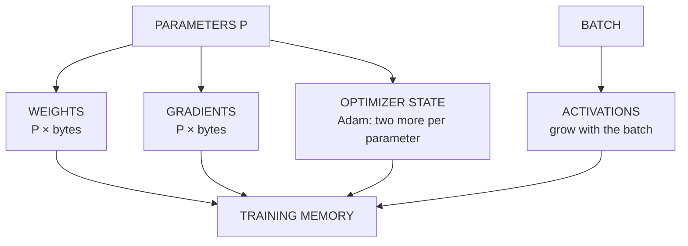

# Batching, memory and precision

*Part of [Tensors for the product and technology leader](./README.md)*

*Last reviewed: 2026-10 · Volatility: medium*

## TL;DR

Will it fit? That question is answered by counting tensors. Training keeps four kinds of numbers on the device: the **weights**, the **gradients**, the **optimizer state** and the **activations**. The first three scale with the number of parameters. The last scales with the batch.

With the Adam optimizer, a common setup needs about 16 bytes per parameter for the first three. A model with 1.5 billion parameters needs about 24 gigabytes (GB) before it stores a single activation. Serving the same model in float16 needs only the weights: about 3 GB.

The number format is the other lever. float16 and bfloat16 use half the bytes of float32. They cannot store every number float32 can. float16 overflows above 65,504 and loses very small numbers. bfloat16 keeps float32's range and gives up precision. These limits are why training keeps a float32 copy of the weights.

> 🎯 **For the product leader**
>
> **Why it matters** — Memory decides what hardware a project needs, and so what it costs. A model that serves on one device may need many to train. The difference is the gradient, the optimizer state and the activations.
>
> **What it changes in your decisions** — You ask for a memory budget by part, not a single "model size". You see that a request to train, to fine-tune or to serve is three different memory problems. You expect a number-format choice to be tested on quality, not assumed.
>
> **Ask your eng team** — *"What is the memory budget for training, split into weights, gradients, optimizer state and activations, and which number format does each part use?"*
>
> **Risk if ignored** — A plan that sizes hardware from the model's file size and finds, in the first run, that training needs seven or eight times as much. Or a switch to a smaller format that quietly degrades the model.

## The mental model: four piles of numbers



Three piles grow with the model. One grows with the batch. When memory runs out, you can shrink the batch, shrink the numbers or spread the piles over more devices. You cannot shrink a pile that is not the problem.

## Mechanics

### What training keeps

- **Weights.** The parameters. One number each.
- **Gradients.** One number per parameter, from [automatic differentiation](./automatic-differentiation.md). Gradient descent needs them for the update.
- **Optimizer state.** Plain gradient descent keeps nothing extra. Momentum keeps one number per parameter. Adam keeps two: a running average of the gradient and of its square.
- **Activations.** The outputs of each layer, kept so the backward pass can use them. PyTorch's documentation says some operations "need intermediary results to be saved during the forward pass in order to execute the backward pass". These grow with the batch size, the layer count and the width.

### Bytes per parameter

The ZeRO paper counts the memory for mixed-precision training with Adam. The weights and gradients are kept in float16, which is 2 + 2 bytes. The optimizer state is 12 bytes per parameter: a float32 copy of the weights, plus Adam's two float32 numbers. The total is 16 bytes per parameter.

Plain float32 training with Adam also comes to 16 bytes: 4 for the weights, 4 for the gradients and 8 for Adam's two numbers. Mixed precision does not shrink these piles. It speeds up the arithmetic and cuts activation memory, since activations are kept in half the bytes.

### Inference is smaller

Serving a model needs the weights, in whatever format you chose, plus the cache for the request. There is no gradient and no optimizer state. [Quantization formats](../content/01-inference-internals/quantization-formats.md) and [KV cache management](../content/01-inference-internals/kv-cache-management.md) cover serving in depth.

### Number formats

| Format | Bits | Exponent bits | Fraction bits | Largest value | Smallest step near 1.0 |
| --- | --- | --- | --- | --- | --- |
| float32 | 32 | 8 | 23 | about 3.4e38 | about 1.2e−7 |
| float16 | 16 | 5 | 10 | 65,504 | about 9.8e−4 |
| bfloat16 | 16 | 8 | 7 | about 3.4e38 | about 7.8e−3 |

The exponent bits set the range. The fraction bits set the precision. bfloat16 keeps float32's exponent, so it has the same range, and keeps only 7 fraction bits. Google describes it as having the same dynamic range as float32, and builds it into its tensor processing units (TPUs). float16 has a small range and more precision.

Two failures follow, both from float16. A number above 65,504 overflows. A very small number rounds to zero. The smallest positive float16 number is about 6 × 10⁻⁸.

### Why training keeps a float32 copy

A weight update is often tiny next to the weight. Add 0.0001 to 1.0 in float16. The smallest step near 1.0 is about 0.001, so the sum rounds back to 1.0. The update vanishes. The mixed precision paper keeps a float32 master copy of the weights for this reason. Each step updates the master copy, then makes a float16 copy for the next forward and backward pass.

Gradients can vanish too. Many gradients are small. In float16, a gradient smaller than the smallest float16 number, about 6 × 10⁻⁸, is lost. Values below half of it round to zero. **Loss scaling** multiplies the loss by a constant before the backward pass, which scales every gradient up. The gradients are divided by the same constant before the update. This is also from the mixed precision paper.

## Tradeoffs and decisions

- **Batch size vs. memory.** A bigger batch uses the hardware better and costs activation memory. The batch you can afford is whatever is left after the three fixed piles.
- **Precision vs. quality.** Smaller formats save bytes and bandwidth and can hurt quality. Test on your task.
- **float16 vs. bfloat16.** float16 has more precision and a small range, so it needs loss scaling. bfloat16 has float32's range and less precision. Kalamkar and colleagues found bfloat16 training matched float32 without hyper-parameter changes in their study.
- **Spread vs. squeeze.** More devices hold more of each pile. Compression keeps the piles on fewer devices. Each costs something else.
- **Train vs. serve.** Plan the two separately. They need different memory.

## Failure modes

- **Sizing training from the file size.** The weights are one pile of four.
- **An out-of-memory error on the largest input.** Activations grew with the batch and the length.
- **A format that overflows.** A value above 65,504 in float16 becomes infinity.
- **Vanishing gradients in float16.** Training stalls with no error. Loss scaling is the usual fix.
- **A stalled update.** Small updates round away. The weights never change.
- **A format change judged on speed alone.** Quality is checked later, or never.

## Under the hood

The file is `tensors/code/lesson4_memory.py`. Part A is a calculator for the piles.

```python
SCHEMES = {
    "fp32 + SGD":            {"weights": 4, "gradients": 4},
    "fp32 + SGD momentum":   {"weights": 4, "gradients": 4, "momentum": 4},
    "fp32 + Adam":           {"weights": 4, "gradients": 4, "adam_m": 4, "adam_v": 4},
    "mixed precision + Adam": {"weights fp16": 2, "gradients fp16": 2, "master weights fp32": 4,
                               "adam_m": 4, "adam_v": 4},
}

def state_bytes(params, scheme):
    return params * sum(SCHEMES[scheme].values())
```

Part B rounds numbers to each format with the standard library. float16 and float32 use `struct`. bfloat16 is the top 16 bits of a float32, rounded.

```python
def round_bf16(x):
    bits = struct.unpack("<I", struct.pack("<f", x))[0]
    bits += 0x7FFF + ((bits >> 16) & 1)          # round to nearest, ties to even
    return struct.unpack("<f", struct.pack("<I", bits & 0xFFFF0000))[0]
```

Habits to adopt:

- **Budget by pile.** Write weights, gradients, optimizer state and activations as four lines.
- **Size for the worst input.** Activations scale with batch and length.
- **Test a format change on quality**, not only on speed and memory.
- **Log the dtype** of every large tensor.

## Worked example: a 1.5 billion parameter model, then a 7 billion one

*This example is invented. Sizes are in decimal gigabytes. The code is in `tensors/code/lesson4_memory.py`.*

**Model state for 1.5 billion parameters.**

| Training setup | Bytes per parameter | Memory |
| --- | --- | --- |
| float32 + SGD | 8 | 12 GB |
| float32 + SGD with momentum | 12 | 18 GB |
| float32 + Adam | 16 | 24 GB |
| mixed precision + Adam | 16 | 24 GB |

The weights alone at float16 are 3 GB. Training needs eight times that. The last two rows show that mixed precision does not cut the state. Both come to 16 bytes per parameter.

**A 7 billion parameter model.** Serving at float16 needs 14 GB for the weights. Training state with mixed precision and Adam is 112 GB, before any activations. The state alone exceeds an invented 80 GB device. Training this model needs the state spread over several devices.

**Activations.** We use an invented model: 32 layers, 2,048 tokens and width 4,096, with one `(tokens, width)` output kept per layer in float16. That is 0.54 GB per sample. Real networks keep several tensors per layer, so this is a lower bound.

**What fits.** A 1 billion parameter model on the 80 GB device has 16 GB of state. The rest, 64 GB, is for activations. At 0.54 GB per sample, the largest batch is 119. If a change halves the activation memory per sample, the batch doubles to 238. The state did not change.

**Number formats.** The smallest step near 1.0 is about 1.2 × 10⁻⁷ in float32, 9.8 × 10⁻⁴ in float16 and 7.8 × 10⁻³ in bfloat16.
- 65,504 is held exactly in float16. 70,000 overflows to infinity. bfloat16 holds 70,000 as 70,144.
- 10⁻⁸ becomes 0 in float16. bfloat16 keeps it as 1.001 × 10⁻⁸.
- Loss scaling works. Multiply 10⁻⁸ by 1,024, store it in float16, then divide. The result is 1.0012 × 10⁻⁸, within 0.2% of the original.
- Adding 0.0001 to 1.0, ten thousand times, in float16 leaves 1.0. In float32 it reaches 2.0002. This is the stalled update, and the reason for a float32 master copy.

## Practitioner checklist

- [ ] Do we have a memory budget by pile: weights, gradients, optimizer state, activations?
- [ ] Is training sized separately from serving?
- [ ] Do we size activations for the largest batch and the longest input?
- [ ] Do we know the dtype of each large tensor?
- [ ] Was any format change tested on task quality?
- [ ] If we train in float16, do we use loss scaling and a float32 master copy?

## Related lessons

- [What a tensor is](./what-a-tensor-is.md) — bytes from shape and dtype.
- [Matrix multiplication](./matrix-multiplication.md) — what the batch buys in speed.
- [Automatic differentiation](./automatic-differentiation.md) — where the gradients and the saved activations come from.
- [Quantization formats](../content/01-inference-internals/quantization-formats.md) — number formats for a served model.
- [KV cache management](../content/01-inference-internals/kv-cache-management.md) — the serving cache that grows with context.
- [Cost optimization](../cost-optimization/README.md) — what memory and compute cost over a model's life.

## Sources

- Rajbhandari, Rajbhandari, Ruwase and He, *ZeRO: Memory Optimizations Toward Training Trillion Parameter Models*, 2020 ([arxiv.org/abs/1910.02054](https://arxiv.org/abs/1910.02054)): the memory accounting for mixed-precision Adam training, with 2 + 2 bytes for the float16 weights and gradients and `K = 12` bytes of optimizer state per parameter. The 24 GB figure for 1.5 billion parameters is this lesson's own arithmetic (16 bytes × 1.5 billion). Checked through search-result excerpts, 2026-10.
- Micikevicius et al., *Mixed Precision Training*, International Conference on Learning Representations, 2018 ([arxiv.org/abs/1710.03740](https://arxiv.org/abs/1710.03740)): a float32 master copy of the weights, a float16 copy for the forward and backward passes, and loss scaling. Checked through search-result excerpts, 2026-10.
- Kalamkar et al., *A Study of BFLOAT16 for Deep Learning Training*, 2019 ([arxiv.org/abs/1905.12322](https://arxiv.org/abs/1905.12322)): bfloat16 has the range of float32, and training matched float32 without hyper-parameter changes. Checked through search-result excerpts, 2026-10.
- Google Cloud, [bfloat16: the secret to high performance on Cloud TPUs](https://cloud.google.com/blog/products/ai-machine-learning/bfloat16-the-secret-to-high-performance-on-cloud-tpus): bfloat16 as one sign bit, eight exponent bits and seven mantissa bits, with the same dynamic range as float32. Checked through search-result excerpts, 2026-10.
- Institute of Electrical and Electronics Engineers (IEEE) 754-2008 binary16 (half precision): five exponent bits, ten stored fraction bits, largest finite value 65,504, smallest positive subnormal 2⁻²⁴. Checked through documentation that quotes the standard, 2026-10.
- PyTorch documentation, [Autograd mechanics](https://pytorch.org/docs/stable/notes/autograd.html): "Some operations need intermediary results to be saved during the forward pass in order to execute the backward pass." Read from the documentation source on GitHub (release 2.5.0), 2026-10.
- The 80 GB device, the 32-layer model and every figure are invented. They come from `tensors/code/lesson4_memory.py` and can be reproduced with it.
