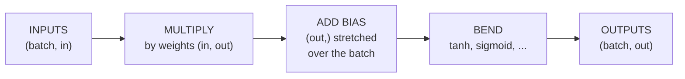

# Matrix multiplication: the workhorse

*Part of [Tensors for the product and technology leader](./README.md)*

*Last reviewed: 2026-10 · Volatility: medium*

## TL;DR

Almost all the compute in a neural network is **matrix multiplication**. A layer takes a batch of inputs and multiplies it by a table of weights. The shapes follow one rule: `(m, k)` times `(k, n)` gives `(m, n)`. The inner sizes must match and then disappear.

The cost is easy to count. Each of the `m × n` outputs needs `k` multiplies and about `k` adds. The standard count is `2 × m × k × n` floating-point operations (FLOPs). For one input, a layer costs about two FLOPs per weight.

The count is not the whole story. Speed depends on how much data moves per operation. One input at a time reads all the weights for very little arithmetic. A batch reads them once and uses them many times. That is why one big multiply beats many small ones, and why batching is the main lever on cost.

> 🎯 **For the product leader**
>
> **Why it matters** — The size of the weight tables sets the compute per request. A model with twice the weights costs about twice as much per input. The batch size decides how well the hardware is used. Both drive cost per request.
>
> **What it changes in your decisions** — You ask for FLOPs per request and the batch size, not only the parameter count. You treat "we serve one request at a time" as a cost choice. You ask whether requests can be grouped without hurting latency.
>
> **Ask your eng team** — *"What is the batch size at serving time, and how much of the hardware's capacity does it use?"*
>
> **Risk if ignored** — A service that pays for a large accelerator and runs it at a small fraction of its capacity, because requests arrive one by one.

## The mental model: a layer is one multiply and a bias



This is the layer from [lesson 6 of the machine learning module](../machine-learning/model-families.md): a weighted sum of the inputs, plus a starting value, then a bend. Written for a whole batch at once, the weighted sums are a single matrix multiplication. The bias is a broadcast from [lesson 2](./operations-and-broadcasting.md).

## Mechanics

### The shape rule

`(m, k)` times `(k, n)` gives `(m, n)`. The two `k` sizes must match. If they do not, the operation raises an error. In the layer view, `m` is the batch size, `k` is the number of inputs and `n` is the number of outputs.

An input with a leading batch axis, `(batch, tokens, features)`, can be multiplied by a `(features, out)` table. Each of the `batch × tokens` positions gets the same weights. PyTorch's `Linear` layer is documented the same way: input `(*, H_in)`, output `(*, H_out)`, where the star means any number of leading dimensions.

### Counting FLOPs

Each output is a dot product of `k` pairs. That is `k` multiplies and `k − 1` adds. The usual count is `2 × m × k × n`. For a layer, divide by the batch to get the cost per input: `2 × k × n`, which is two FLOPs per weight.

For a whole transformer language model, Kaplan and colleagues give the forward cost per token as about `2N` plus an attention term, where `N` counts the non-embedding parameters. The matrix-multiply count explains the `2N`: two FLOPs per weight per token.

### Why batching helps: arithmetic intensity

**Arithmetic intensity** is the FLOPs done per byte moved from memory. Hardware has a ratio of compute speed to memory speed. If an operation does fewer FLOPs per byte than that ratio, it waits on memory. If it does more, it is limited by compute.

NVIDIA's performance guide gives the formula for a matrix multiply. For matrices of sizes `M × K` and `K × N`, the FLOPs are `2 × M × N × K`, and the bytes moved are the sizes of the three matrices if each is read or written once. The guide notes that a matrix-vector product, where `M` or `N` is 1, always has an intensity below 1, for numbers of 2 or 4 bytes. So it is memory limited. The guide calls the method a simplified rule of thumb.

Now apply it. With a `4096 × 4096` weight table at float32, one input (`m = 1`) does half a FLOP per byte. A batch of 512 does about 205. The weights are the same size in both cases. A batch reuses each weight 512 times after reading it once.

### The batch axis

The batch is the leading axis. The weights do not depend on it. Doubling the batch doubles the FLOPs, and leaves the weight memory unchanged. Activation memory grows with the batch, which is the subject of [lesson 4](./batching-memory-and-precision.md).

## Tradeoffs and decisions

- **Big batch vs. latency.** Waiting to fill a batch raises hardware use and adds delay for the first request in it. Serving systems balance the two.
- **Big layers vs. cost.** More weights give a model more capacity. Compute per input grows in proportion.
- **FLOPs vs. wall-clock time.** Equal FLOPs can take very different time, depending on the intensity and the hardware. Measure, do not only count.
- **Precision vs. throughput.** Smaller number formats move fewer bytes per FLOP. See [lesson 4](./batching-memory-and-precision.md).

## Failure modes

- **A shape mismatch on the inner axes.** The error is loud, and usually means a transposed weight table.
- **A transposed weight table that fits anyway.** A square table multiplies either way. The result is wrong.
- **Counting parameters instead of FLOPs.** A convolution or an attention layer reuses weights many times, so parameters understate compute.
- **Serving one input at a time.** Memory-bound, expensive per request.
- **Reading a speed-up from a toy.** A small matrix on a big device is dominated by overhead, not arithmetic.

## Under the hood

The file is `tensors/code/lesson3_matmul.py`. Matrix multiplication is three loops.

```python
def matmul(self, other):
    m, k = self.shape
    n = other.shape[1]
    out = [0.0] * (m * n)
    for i in range(m):
        row = self.data[i * k: (i + 1) * k]
        for j in range(n):
            out[i * n + j] = sum(row[t] * other.data[t * n + j] for t in range(k))
    return Tensor(out, (m, n))
```

The example rewrites the machine learning module's `TinyNet` forward pass as two multiplies and compares it with the hand-written loop. The largest difference is 0. It uses the intensity formula from NVIDIA's guide, with 4 bytes per number.

```python
def intensity(m, k, n, dtype="float32"):
    """FLOPs per byte moved, if each matrix is read or written once. A model, not a measurement."""
    moved = DTYPE_BYTES[dtype] * (m * k + k * n + m * n)
    return matmul_flops(m, k, n) / moved
```

Habits to adopt:

- **Count FLOPs** for any layer you plan to scale: `2 × batch × in × out`.
- **Check the inner sizes** whenever you write a multiply.
- **Test a transposed weight table** on a non-square layer.
- **Measure on the real device.** The intensity model is a simplified guide, as NVIDIA's guide says.

## Worked example: the same layer, one input or a batch

*This example is invented. The data is generated by code with a fixed seed. The code is in `tensors/code/lesson3_matmul.py`.*

**The rule.** A `(2, 3)` table times a `(3, 2)` table gives `[[58, 64], [139, 154]]`. A `(2, 3)` times a `(2, 3)` is refused.

**TinyNet as two multiplies.** The network has 2 inputs, 6 hidden units and 1 output. For a batch of 200 customers, the first multiply is `(200, 2)` times `(2, 6)`. The second is `(200, 6)` times `(6, 1)`. The FLOP count is `2 × 200 × 2 × 6` plus `2 × 200 × 6 × 1`, which is 4,800 plus 2,400, or 7,200. The probabilities match the machine learning module's loop exactly.

**A batch of sequences.** A `(2, 3, 4)` input times a `(4, 5)` table gives `(2, 3, 5)`. Every position gets the same weights.

**Why a batch pays.** Take a `4096 × 4096` weight table at float32. That is 64 MiB of weights. We count FLOPs per byte moved, if each matrix is read or written once:

| Batch size | FLOPs per byte |
| --- | --- |
| 1 | 0.5 |
| 8 | 4.0 |
| 64 | 31.0 |
| 512 | 204.8 |

At a batch of 1 the intensity is below 1, as NVIDIA's guide says it must be for a matrix-vector product. Serving 512 requests one by one reads the weights 512 times, which is 32 GiB moved, against 64 MiB for one batched multiply. The model is a first-order estimate. It does not include caches, overhead or the real hardware's ratio.

## Practitioner checklist

- [ ] Do we know the FLOPs per request, not only the parameter count?
- [ ] Do we know our serving batch size and the latency it adds?
- [ ] Have we compared our arithmetic intensity with the hardware's ratio?
- [ ] Do shape tests cover a non-square layer, so a transposed table fails?
- [ ] Are we measuring on the real device, not on a toy size?

## Related lessons

- [What a tensor is](./what-a-tensor-is.md) — shape and size.
- [Operations and broadcasting](./operations-and-broadcasting.md) — the bias add in a layer.
- [Batching, memory and precision](./batching-memory-and-precision.md) — what a batch costs in memory.
- [Prefill vs. decode](../content/01-inference-internals/prefill-vs-decode.md) — compute-bound and memory-bound phases of serving a language model.
- [Batching and paged attention](../content/01-inference-internals/batching-and-paged-attention.md) — batching requests at serving time.
- [Model families](../machine-learning/model-families.md) — the layer as a weighted sum plus a bend.

## Sources

- NVIDIA, [Matrix Multiplication Background User's Guide](https://docs.nvidia.com/deeplearning/performance/dl-performance-matrix-multiplication/index.html): matrix-multiplication FLOPs `2 × M × N × K`, arithmetic intensity as FLOPs over bytes, matrix-vector products always below an intensity of 1, and the method as a simplified rule of thumb that assumes each matrix is read or written once. Checked through search-result excerpts, 2026-10.
- Kaplan et al., *Scaling Laws for Neural Language Models*, 2020 ([arxiv.org/abs/2001.08361](https://arxiv.org/abs/2001.08361)): forward cost per token of about `2N` plus an attention term, with `N` the non-embedding parameters. Checked through search-result excerpts, 2026-10.
- PyTorch source, `torch/nn/modules/linear.py` (release 2.5.0): `Linear` input `(*, H_in)` and output `(*, H_out)`. Read 2026-10.
- Goodfellow, Bengio and Courville, *Deep Learning* (2016), chapter 6: feed-forward networks as layers of matrix multiplication.
- The tables, the FLOP counts and the intensities are computed by `tensors/code/lesson3_matmul.py`. The data is invented.
