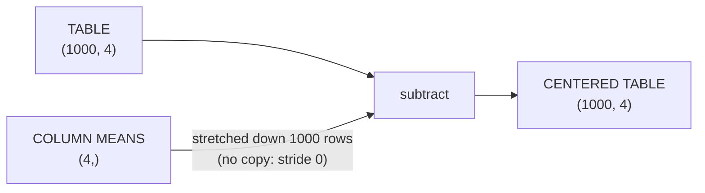

# Operations and broadcasting

*Part of [Tensors for the product and technology leader](./README.md)*

*Last reviewed: 2026-10 · Volatility: medium*

## TL;DR

Most tensor work is three kinds of operation. **Elementwise** operations act on each number: add, multiply, apply a function. **Reductions** collapse an axis: sum, mean, maximum. **Reshapes** change the shape without changing the numbers.

When two tensors have different shapes, **broadcasting** decides whether they can combine. Line the shapes up from the right. Each pair of axis sizes must be equal, or one must be 1, or one must be missing. The small tensor is then stretched to fit. A bias vector added to every row of a table is the usual case.

Broadcasting is convenient and dangerous. A wrong axis can still have a legal shape. Then the code runs, the numbers are wrong, and nothing warns you. This is a common cause of silent bugs in model code.

> 🎯 **For the product leader**
>
> **Why it matters** — A shape bug does not always crash. It can produce a model that trains, scores and ships, and is wrong. The cost shows up as weak quality that no one can explain.
>
> **What it changes in your decisions** — You ask how the team guards against shape errors: shape checks in tests, a batch of one and a batch of many, and a comparison to a slow reference on a small input. You treat "it ran without errors" as weak evidence.
>
> **Ask your eng team** — *"Which of our tensor operations rely on broadcasting, and what test would fail if an axis were wrong?"*
>
> **Risk if ignored** — A loss function that quietly averages over the wrong axis. The loss looks plausible and the model never improves.

## The mental model: stretch the small one



Write the two shapes one above the other, right-aligned. Compare column by column. A column passes if the sizes are equal or one is 1. A missing size counts as 1. The result takes the larger size in each column. If any column fails, the operation raises an error.

```text
Table         (1000, 4)
Column means          (4,)    ->  works, result (1000, 4)

Predictions   (300, 1)
Labels             (300,)     ->  works, but the result is (300, 300)
```

The second pair is legal. It is almost never what you meant.

## Mechanics

### Elementwise operations

Add, subtract, multiply and divide act on matching positions. If the shapes match, there is nothing to decide. A function such as tanh applies to each number on its own.

### Reductions

A reduction removes an axis by combining its numbers. `sum(axis=0)` on a `(1000, 4)` table gives 4 numbers, one per column. `sum(axis=1)` gives 1,000 numbers, one per row. Choosing the axis is choosing what to combine.

Most libraries offer **keepdims**: keep the reduced axis with size 1. A `(1000, 4)` table averaged over axis 1 with keepdims has shape `(1000, 1)`. That shape broadcasts back against the table in the way you want, one mean per row. Without keepdims the shape is `(1000,)`, which does not.

### The broadcasting rule

The rule is in the NumPy documentation. It compares shapes starting with the trailing dimension and works left. Two dimensions are compatible when they are equal or one of them is 1. Missing dimensions count as size 1. The documentation's own example: shapes `8 × 1 × 6 × 1` and `7 × 1 × 5` give `8 × 7 × 6 × 5`. PyTorch follows the same rules.

### Stretching without copying

The documentation says the stretching is conceptual. NumPy uses the original data without making copies. One way to do that is a stride of 0, and the code below uses it. A stride says how far to step in memory along an axis. A stride of 0 steps nowhere, so the same number is read again for each position along that axis. A `(4,)` vector stretched to `(1000, 4)` has strides `(0, 1)`.

The documentation also warns that broadcasting can be a bad idea when it leads to inefficient use of memory. The `(300, 300)` result above is a real array of 90,000 numbers.

### Reshape

A reshape reads the same numbers with a new shape. One size can be left as -1 for the library to work out. A reshape returns a view when the layout allows it, so it usually costs nothing. The numbers must fill the new shape exactly.

## Tradeoffs and decisions

- **Convenience vs. explicit shapes.** Relying on broadcasting keeps code short. Writing the shapes out, or adding axes with size 1 by hand, makes the intent visible.
- **Stretched views vs. real copies.** A view saves memory. Some operations still create the full-size result, as with the `(300, 300)` difference.
- **Strictness vs. speed of development.** Shape assertions cost a few lines. A silent shape bug can cost weeks.
- **Reduce first vs. reduce last.** The axis you reduce changes the meaning of the result, not only its shape.

## Failure modes

- **The wrong axis on a square table.** On a `4 × 4` table, a mean over rows and a mean over columns both have shape `(4,)`. Either one subtracts without complaint.
- **A column against a row.** Predictions of shape `(n, 1)` against labels of shape `(n,)` produce an `n × n` difference. The loss averages over all pairs.
- **A forgotten keepdims.** A row mean without keepdims broadcasts along the wrong axis.
- **Memory blow-up.** An intended `(n,)` result becomes `(n, n)`, and memory grows with the square.
- **A bug that shows only on one size.** The same slip raises an error on a `5 × 4` table and passes on `4 × 4`. Tests that use a square toy input miss it.

## Under the hood

The file is `tensors/code/lesson2_broadcasting.py`. The rule is a short function.

```python
def broadcast_shapes(a, b):
    out = []
    for i in range(1, max(len(a), len(b)) + 1):
        x = a[-i] if i <= len(a) else 1          # a missing size counts as 1
        y = b[-i] if i <= len(b) else 1
        if x != y and x != 1 and y != 1:
            raise ValueError(f"shapes {tuple(a)} and {tuple(b)} cannot be broadcast together")
        out.append(max(x, y) if x != 1 and y != 1 else (y if x == 1 else x))
    return tuple(reversed(out))
```

The stride trick is a one-line change to the strides.

```python
def broadcast_strides(self, shape):
    pad = (1,) * (len(shape) - self.rank) + self.shape
    own = (0,) * (len(shape) - self.rank) + self.strides
    return tuple(0 if p == 1 and s != 1 else st for p, st, s in zip(pad, own, shape))
```

If NumPy is installed, `tensors/code/numpy_check.py` compares this code with NumPy on matrix products, reductions, reshapes, strides and broadcast shapes. It prints a skip message if NumPy is missing.

Habits to adopt:

- **Assert shapes** at the entry and exit of every important function.
- **Test with a non-square input.** A shape bug hides on a square one.
- **Use keepdims** when you plan to broadcast a reduction back.
- **Check the output size** of any operation that mixes a column and a row.

## Worked example: two silent bugs and one loud one

*This example is invented. The data is generated by code with a fixed seed. The code is in `tensors/code/lesson2_broadcasting.py`.*

**The rule works.** Shapes `(8, 1, 6, 1)` and `(7, 1, 5)` broadcast to `(8, 7, 6, 5)`, as in the NumPy documentation. We standardize the churn table from the [machine learning module](../machine-learning/data-features-labels-and-leakage.md). We subtract a `(4,)` vector of column means from a `(1000, 4)` table. The result has shape `(1000, 4)`. Its column means are zero to within rounding. The vector was read with strides `(0, 1)`: the row axis was re-read, not copied.

**Silent bug 1: the wrong axis.** Take a `4 × 4` table. To center each row, we subtract the row means with keepdims, shape `(4, 1)`. The row means of the result are all zero. Now forget keepdims. The row means have shape `(4,)`, which lines up with the columns. The code runs. The row means of the result are −5.6, −3.1, −8.1 and 16.9. Nothing is centered. Try the same slip on a `5 × 4` table and the library raises an error. The error is a lucky accident of the shape.

**Silent bug 2: the loss that averages over the wrong thing.** We have 300 predictions of shape `(300, 1)` and 300 labels of shape `(300,)`. The difference is `(300, 300)`, which is 90,000 numbers instead of 300. The squared-error loss is 0.188. The correct loss, with the predictions reshaped to `(300,)`, is 0.041. The wrong version averages every prediction against every label. Even a perfect model, whose predictions equal the labels, scores 0.295 under this loss. The loss has a high floor, so it hides progress. We chose predictions that carry signal on purpose. If every prediction were the same number, the two averages would match and the bug would hide.

**The loud one.** Adding a `(3,)` tensor to a `(4,)` tensor raises an error. This is the good case: the shapes cannot be broadcast, and the library says so.

## Practitioner checklist

- [ ] Does each important function assert the shapes it expects and returns?
- [ ] Do tests include a non-square input and a batch of one?
- [ ] Do we use keepdims when broadcasting a reduction back?
- [ ] Have we checked the shape of every loss before it is averaged?
- [ ] Do we compare against a slow reference on a tiny input?
- [ ] Do we know which operations create a full-size result from stretched inputs?

## Related lessons

- [What a tensor is](./what-a-tensor-is.md) — shape, rank and strides.
- [Matrix multiplication](./matrix-multiplication.md) — the operation with its own shape rule.
- [Automatic differentiation](./automatic-differentiation.md) — the backward pass must undo each broadcast.
- [Measuring a model](../machine-learning/measuring-a-model.md) — why a loss number needs a sanity check.
- [Learning and doing ML with Claude Code](../machine-learning/learning-and-doing-ml-with-claude-code.md) — checks an agent can run for you.

## Sources

- NumPy documentation, [Broadcasting](https://numpy.org/doc/stable/user/basics.broadcasting.html): the rule (trailing dimensions equal or one of them 1, missing dimensions count as 1), the `8 × 1 × 6 × 1` and `7 × 1 × 5` example, that stretching is conceptual and avoids copies, and that broadcasting can use memory inefficiently. Read from the documentation source on GitHub, 2026-10.
- PyTorch documentation, [Broadcasting semantics](https://pytorch.org/docs/stable/notes/broadcasting.html): the same rules for PyTorch tensors, with "without making copies of the data". Read from the documentation source on GitHub (release 2.5.0), 2026-10.
- The churn data, the tables and every number are invented. They come from `tensors/code/lesson2_broadcasting.py` and can be reproduced with it.
