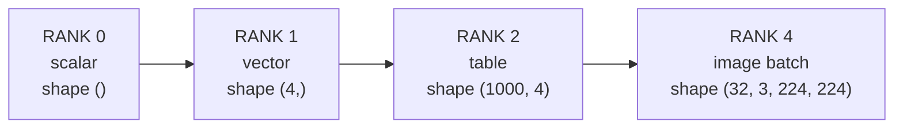

# What a tensor is: shape, rank and dtype

*Part of [Tensors for the product and technology leader](./README.md)*

*Last reviewed: 2026-10 · Volatility: medium*

## TL;DR

A **tensor** is a grid of numbers with a **shape**. A single number is a tensor with no axes. A list of numbers has one axis. A table has two. A batch of images has four. The number of axes is the **rank**. Each axis has a size, and the list of sizes is the shape.

Every input, every weight and every gradient in a model is a tensor. So the size of a model, the cost of a batch and the memory of a graphics processing unit (GPU) all come from counting numbers and multiplying by bytes. The number format is the **dtype**. A float32 number takes 4 bytes. A float16 number takes 2.

The shape is also the contract between the parts of a program. A layer expects one shape and returns another. Many framework errors are shape errors. You can read a shape the way you read a unit.

> 🎯 **For the product leader**
>
> **Why it matters** — Shape and dtype turn vague claims into arithmetic. "We will process a batch of 32 images" has a size you can compute. So does "we will fit a longer context". That arithmetic decides which hardware you need and what it costs.
>
> **What it changes in your decisions** — You ask for the shape and dtype of the big tensors, not only the parameter count. You check that a requirement such as a larger image or a longer input is paid for in memory, since memory grows with the product of the axes.
>
> **Ask your eng team** — *"What are the shapes of our largest tensors, in which dtype, and how many bytes is that per request?"*
>
> **Risk if ignored** — A feature that works on a demo image and runs out of memory on a real one. Or a bug where two tensors with the wrong axis order still combine, and the model learns from nonsense.

## The mental model: axes stack up



Think of a tensor as nested lists. A table is a list of rows, and each row is a list of numbers. A batch of images is a list of images. Each image is a list of colour channels. Each channel is a list of pixel rows. Each row is a list of pixels. The shape records the length of each list, from the outside in.

## Mechanics

### Shape, rank and size

The **shape** is the tuple of axis sizes. The **rank** is its length. The **size** is the product of the sizes, which is the count of numbers.

| Data | Shape | Rank | Size |
| --- | --- | --- | --- |
| One number | `()` | 0 | 1 |
| One customer's four features | `(4,)` | 1 | 4 |
| A table of 1,000 customers | `(1000, 4)` | 2 | 4,000 |
| A batch of 8 text snippets, 512 tokens each, with a 768-number vector per token | `(8, 512, 768)` | 3 | 3,145,728 |
| A batch of 32 colour images, 224 by 224 pixels | `(32, 3, 224, 224)` | 4 | 4,816,896 |

Libraries agree on the idea and disagree on conventions. One common order for images is batch, channels, height, width. PyTorch's `Conv2d` expects it. Other libraries put the channels last. Always check which order a function expects.

### dtype and bytes

The **dtype** is the number format. It fixes how many bytes each number takes.

| dtype | Bytes per number | Notes |
| --- | --- | --- |
| float64 | 8 | Double precision. Rare in deep learning. |
| float32 | 4 | The classic default for training. |
| float16, bfloat16 | 2 | Half the memory. Different range and precision, see [lesson 4](./batching-memory-and-precision.md). |
| int8 | 1 | Used for compressed inference. See [quantization](../content/01-inference-internals/quantization-formats.md). |

The memory for a tensor is its size times the bytes per number. A batch of 32 images at float32 is 4,816,896 × 4 = 19,267,584 bytes, which is 18.4 MiB. At float16 it is half that.

### Storage and strides

A tensor is stored as one flat list in **row-major** order. The last index changes fastest. The **strides** say how far to move in that flat list to step one place along each axis. For a `(1000, 4)` table, the strides are `(4, 1)` in numbers. One step down a row jumps over 4 numbers. One step along a row moves 1.

This is why some operations are free. A **reshape** keeps the same numbers and changes only the shape and strides. When the layout allows it, it is a view. Reshaping `(12,)` to `(3, 4)` copies nothing. On a non-contiguous tensor, such as one just transposed, NumPy's documentation says reshape creates a view where possible or a copy otherwise. NumPy's documentation describes the same idea for arrays: views share data, so a change through one is visible through the other.

## Tradeoffs and decisions

- **Bytes vs. precision.** A smaller dtype fits more in memory and moves faster. It stores each number less exactly. [Lesson 4](./batching-memory-and-precision.md) shows where that bites.
- **Big batch vs. memory.** A bigger batch adds an axis size, so every tensor that carries the batch axis grows in proportion.
- **Flexible ranks vs. clear contracts.** Libraries let a layer accept any number of leading axes. That is convenient. It also lets a wrong axis slip through. Write the expected shape next to every important function.
- **View vs. copy.** A view saves memory and time. It also means that a change through one name changes the other. Know which operations copy.

## Failure modes

- **Axis order mix-up.** The batch axis and the feature axis swap. Shapes can still line up, so nothing fails.
- **A forgotten batch axis.** One example has shape `(4,)`. A batch has `(32, 4)`. Code written for one breaks on the other, or quietly does the wrong thing.
- **A giant tensor nobody sized.** A change to input size multiplies memory. The job dies on the largest case.
- **Dtype surprises.** Integer labels mixed with float predictions. Or float16 where the range is too small.
- **Reading a view as a copy.** One edit changes two names.

## Under the hood

The file is `tensors/code/lesson1_shapes.py`. It uses a small `Tensor` class from `tensors/code/tensor.py`, written with the standard library so you can read it. A real library does the same bookkeeping in compiled code.

```python
class Tensor:
    def __init__(self, data, shape):
        if len(data) != prod(shape):
            raise ValueError(f"{len(data)} numbers cannot fill the shape {shape}")
        self.data = data            # one flat list, row-major
        self.shape = tuple(shape)

    @property
    def strides(self):              # how far to move in the flat list per step on each axis
        return row_major_strides(self.shape)

    def reshape(self, *shape):      # a view: the same list of numbers, a new shape
        return Tensor(self.data, shape)
```

The example builds the churn table from the [machine learning module](../machine-learning/what-machine-learning-is.md) as a tensor, then checks the arithmetic in the table above with `assert` lines.

Habits to adopt:

- **Print the shape** of every important tensor while you build.
- **Write the expected shape in a comment** or a test next to each function.
- **Compute bytes before you run.** Size times bytes per number takes one line.

## Worked example: sizing three batches

*This example is invented. The shapes are typical. The code is in `tensors/code/lesson1_shapes.py`.*

We size three tensors.

| Tensor | Shape | Numbers | float32 | float16 | int8 |
| --- | --- | --- | --- | --- | --- |
| Customer table | `(1000, 4)` | 4,000 | 15.6 KiB | 7.8 KiB | 3.9 KiB |
| Text batch | `(8, 512, 768)` | 3,145,728 | 12.0 MiB | 6.0 MiB | 3.0 MiB |
| Image batch | `(32, 3, 224, 224)` | 4,816,896 | 18.4 MiB | 9.2 MiB | 4.6 MiB |

The customer table is tiny. The text batch is 12 MiB at float32. Now double the tokens to 1,024. The text batch doubles to 24 MiB. The size is the product of the axes, so a longer input costs memory in proportion.

The example also checks reshape. A list of 12 numbers becomes a `(3, 4)` grid with strides `(4, 1)`. Reading the grid at row 1, column 2 gives the number 6. The list was never copied: the grid and the flat list share the same storage.

Last, it checks the contract. Asking for a `(2, 2)` tensor from three numbers raises an error. This is the good case: the shape contract refuses a mismatch up front.

## Practitioner checklist

- [ ] Do we know the shape and dtype of our largest tensors?
- [ ] Have we computed the bytes for a worst-case input?
- [ ] Is the axis order written down, and does every function agree on it?
- [ ] Does every function state the shape it expects and returns?
- [ ] Do we know which operations copy and which return a view?
- [ ] Do tests cover a batch of one and a batch of many?

## Related lessons

- [Operations and broadcasting](./operations-and-broadcasting.md) — what happens when shapes differ.
- [Batching, memory and precision](./batching-memory-and-precision.md) — turning sizes into a memory budget.
- [Quantization formats](../content/01-inference-internals/quantization-formats.md) — what fewer bits do to a served model.
- [What an LLM actually is](../llms/what-is-an-llm.md) — where a text batch of vectors fits.
- [Model families](../machine-learning/model-families.md) — the models whose weights these tensors hold.

## Sources

- NumPy documentation, [Copies and views](https://numpy.org/doc/stable/user/basics.copies.html): a view changes metadata such as strides and shares the data buffer, so a change through the view shows in the original. Read from the documentation source on GitHub, 2026-10.
- PyTorch source, `torch/nn/modules/conv.py` (release 2.5.0): `Conv2d` input shape `(N, C_in, H_in, W_in)`. Read 2026-10.
- Data type sizes are fixed by the format definitions: the Institute of Electrical and Electronics Engineers (IEEE) 754 standard for float16, float32 and float64. See the sources in [lesson 4](./batching-memory-and-precision.md) for float16 and bfloat16.
- The customer table, the batch shapes and every size are computed by `tensors/code/lesson1_shapes.py`. The churn data is invented.
