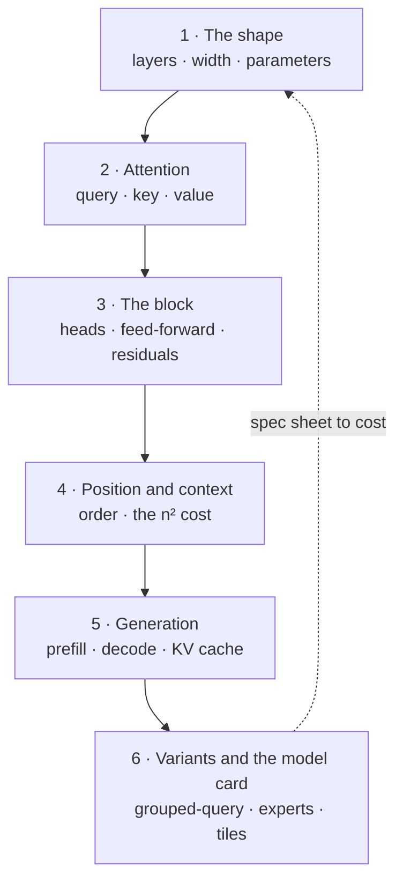

# Transformers for the product and technology leader

*Part of the [foundation modules](../tensors/README.md). It follows [machine learning](../machine-learning/README.md), [tensors](../tensors/README.md) and [convolutional networks](../cnns/README.md).*

Almost every language model you buy or build is a **transformer**. It is a stack of identical blocks, and each block does two things. Attention lets each token read from the others. A feed-forward layer then reworks each token on its own. That is the whole design. The rest is scale, and a few well-chosen tricks.

You do not need the mathematics to decide well. You need to count. How many parameters? How many are active for each token? How much memory does a request add? How does cost change when the input is ten times longer? This module teaches the parts, so you can turn a model's spec sheet into memory, compute and cost on one page.

Every lesson has two layers. The body is for the leader who decides. A short **Under the hood** section is for the engineer who builds. It points to code that runs on the Python standard library, with no install, and ends in `assert` lines. The code builds one small transformer, with random weights, and a counter for multiply-adds. The weights say nothing useful. Their job is to let every claim be counted and checked. The matrix multiplication underneath is the one from [Tensors](../tensors/matrix-multiplication.md).

**A note on scope.** [LLMs](../llms/README.md) covers the model most products call: tokens, context, prompting and choosing. This module goes one level lower, into the machine. [Inference internals](../content/01-inference-internals/README.md) covers serving in engineering depth. Here you get the arithmetic behind those lessons. The delta over `llms/what-is-an-llm` is the counted, runnable version: parameters, multiply-adds, the cache and the model card.

## Where the depth lives

Each lesson summarizes an idea and points to the lesson that covers it in full.

| If you want the full depth on | Read |
| --- | --- |
| What an LLM is, and how to choose one | [What an LLM actually is](../llms/what-is-an-llm.md) and [Choosing a model](../llms/choosing-a-model.md) |
| The context window as a product limit | [The context window](../llms/the-context-window.md) |
| Serving: prefill, decode, batching and the cache | [Prefill vs. decode](../content/01-inference-internals/prefill-vs-decode.md) and [KV cache management](../content/01-inference-internals/kv-cache-management.md) |
| Smaller number formats for weights and cache | [Quantization formats](../content/01-inference-internals/quantization-formats.md) |
| Why the multiplies dominate | [Matrix multiplication: the workhorse](../tensors/matrix-multiplication.md) |
| The training loop and gradients | [Training: loss and gradient descent](../machine-learning/training-loss-and-gradient-descent.md) and [Automatic differentiation](../tensors/automatic-differentiation.md) |
| The same block applied to images | [CNNs vs. vision transformers](../cnns/cnns-vs-vision-transformers.md) |
| What a model costs over its life | [Cost optimization](../cost-optimization/README.md) |

## The knowledge graph



Read it as a chain with one loop. You see the **shape**: five numbers on a spec sheet. **Attention** is the one step where tokens exchange information. The **block** pairs it with a feed-forward layer and keeps a running notebook, the residual stream. **Position** fixes order, and the cost of attention grows with the square of the length. **Generation** writes one token at a time, and a cache of keys and values keeps that affordable and sets how many requests fit on a machine. The **variants** change these costs. Reading a model card then closes the loop, from spec sheet back to the shape.

## The lessons

1. [The shape of a transformer](./the-shape-of-a-transformer.md) — five numbers, where the parameters live, and what a forward pass costs.
2. [Attention](./attention.md) — queries, keys and values, the scale, the mask, and a head you can build by hand.
3. [The block: heads, the feed-forward layer and the residual stream](./the-block.md) — what one block does, and why the feed-forward layer is most of the weight.
4. [Position, and the cost of context](./position-and-the-cost-of-context.md) — why order must be added, and when attention takes over the bill.
5. [Generating text and the KV cache](./generating-text-and-the-kv-cache.md) — prefill, decode, and why memory per request limits serving.
6. [Variants, and reading a model card](./variants-and-reading-a-model-card.md) — grouped-query attention, mixtures of experts and tiled kernels.

Then the [recap and real-world examples](./recap.md), with a self-test.

## Run the code

Every example is in `transformers/code/`. Run them all with one command.

```bash
python3 transformers/code/test_examples.py
```

The files are `lesson1_shape.py` through `lesson6_variants.py`, built on `mini_transformer.py`. A passing file checks the direction of each claim, such as the cache giving the same tokens as recomputing. Run a file to see every quoted number printed.
