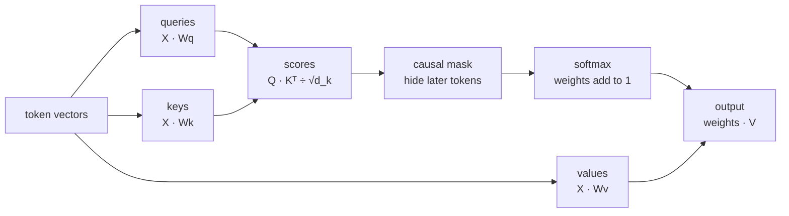

# Attention

*Part of [Transformers for the product and technology leader](./README.md)*

*Last reviewed: 2026-10 · Volatility: medium*

## TL;DR

**Attention** lets each token read from the tokens before it. Every token makes three vectors. A **query** says what it is looking for. A **key** says what it offers. A **value** is what it hands over. The model compares a token's query with every key. The scores go through a **softmax**, which turns them into weights that add up to 1. The token's new vector is the weighted sum of the values.

Two details make it work. The scores are divided by `√d_k`, so the softmax does not saturate. And a **causal mask** hides later tokens, so the model cannot read the answer it is meant to predict.

Attention is the only step where tokens exchange information. Everything else in a transformer treats each token on its own. That is why context length, cost and many failures trace back to this one step.

> 🎯 **For the product leader**
>
> **Why it matters** — Attention is the reason a model can use something said 5,000 words ago. It is also why more context costs more, and why a model can attend to the wrong sentence.
>
> **What it changes in your decisions** — You stop treating the prompt as a bag of text. Each token competes with the others for attention. Clear, well-placed information beats more information.
>
> **Ask your eng team** — *"For the failures we see on long inputs, do we know if the information was missing, or present and ignored?"*
>
> **Risk if ignored** — Prompts stuffed with near-duplicates and distractors. The model has the answer in view and weights something else higher.

## The mental model: a lookup that blends

Picture a library card catalogue. Your query is a question. Each card has a key, a short label, and a value, the page it points to. A normal lookup returns the one best card. Attention returns a blend of all the pages, weighted by how well each key matches the question.



## Mechanics

### The four steps

1. **Project.** Multiply the token vectors by three learned matrices to get queries, keys and values.
2. **Score.** For each pair of tokens, take the dot product of one token's query and the other's key. A large number means a good match.
3. **Normalize.** Divide by `√d_k`. Hide later tokens. Apply a softmax across each row. Each row now holds weights that sum to 1.
4. **Blend.** Multiply the weights by the values. Each token gets a new vector that mixes what it attended to.

### Why divide by the square root

A dot product of two vectors of `d_k` numbers adds `d_k` products. If the numbers are random with variance 1, the sum has variance `d_k`. Large scores make the softmax nearly one-hot, and the gradient through it nearly zero. Dividing by `√d_k` puts the variance back at 1. Vaswani and colleagues gave this reason in the original paper.

### The causal mask

A language model learns by predicting each next token. If token 5 could read token 6, it would copy the answer. The mask sets the score for every later token to minus infinity. After the softmax, those weights are exactly zero.

### What attention is not

The weights are not a clean explanation of an answer. Jain and Wallace showed that attention weights often disagree with other measures of what mattered. Treat them as one signal among many.

Studies of trained models do find clear patterns in some heads. Olsson and colleagues at Anthropic found heads that look at the previous token, and heads that finish a repeated pattern. Those heads are a large part of how models copy text from their context.

## Tradeoffs and decisions

- **Sharp vs. blurred attention.** Sharp weights pick one source. Blurred weights average many. A model needs both, and it chooses per token.
- **Every pair vs. a window.** Full attention compares every pair of tokens. A window compares only nearby ones. Windows are cheaper and lose long-range links.
- **Clean context vs. complete context.** Extra text can add useful facts. It also adds keys that compete for weight.

## Failure modes

- **Distractors.** A near-duplicate of the right passage takes weight from it.
- **Position bias.** Models often use the start and end of a long prompt better than the middle. See [Lost in the middle](../rag-vector-databases/rag-vs-long-context-vs-finetuning.md).
- **Treating weights as proof.** A heat map of attention is not a reason for an answer.
- **Unscaled scores.** A hand-written attention without the `√d_k` division trains badly or not at all.
- **A leaky mask.** A bug that lets a token see the future makes training look perfect and serving fail.

## Under the hood

The file is `transformers/code/lesson2_attention.py`. It writes one head from scratch, with the matrix multiply from the previous lesson.

```python
def attention(q, k, v, scale=True, causal=True):
    dk = len(q[0])
    scores = matmul(q, transpose(k), "attn")
    weights = []
    for i, row in enumerate(scores):
        row = [(s / math.sqrt(dk) if scale else s) if (not causal or j <= i) else float("-inf")
               for j, s in enumerate(row)]
        weights.append(softmax(row))
    return matmul(weights, v, "attn"), weights
```

The file also builds a head with hand-set weights that copies the previous token. Trained models learn heads like it. The queries ask for "the position before me", the keys say "I am position `i`", and the values carry the token.

## Worked example: a head that reads the previous token

*This example is invented. The numbers come from `transformers/code/lesson2_attention.py`.*

The input is `the cat sat on the mat`. The hand-set head attends to the position before each token. Its output, read as the token each position took in, is:

`the, the, cat, sat, on, the`

The first position has nothing before it, so it reads itself. Every other position reads the token before it. The last row of weights is `[0, 0, 0, 0, 1.0, 0]`. All the weight sits on `on`, the token before `mat`. Every row sums to 1. Every weight on a later token is exactly 0, so the mask works.

**The scale.** We draw random queries and keys with variance 1.

| Key length `d_k` | Variance of a dot product |
| --- | --- |
| 16 | 16.7 |
| 256 | 248.0 |

The variance tracks `d_k`, as the argument says. With 8 random keys at `d_k = 256`, the largest softmax weight averages 0.92 without the scale. With the scale it averages 0.34. Without it, the softmax picks one key almost every time.

## Practitioner checklist

- [ ] Do we know which failures come from missing information and which from ignored information?
- [ ] Is the most important text near the start or the end of the prompt?
- [ ] Have we removed near-duplicates and boilerplate from long inputs?
- [ ] Do we avoid presenting attention heat maps as explanations?
- [ ] Do we test on long inputs, with the answer at different positions?

## Related lessons

- [The block](./the-block.md) — how many heads work together, and what comes after attention.
- [Position and the cost of context](./position-and-the-cost-of-context.md) — why the score matrix grows with the square of the length.
- [What an LLM actually is](../llms/what-is-an-llm.md) — a worked example of what "it" looks at.
- [Matrix multiplication: the workhorse](../tensors/matrix-multiplication.md) — the operation underneath.
- [Retrieval quality](../rag-vector-databases/retrieval-quality.md) — why sending fewer, better passages helps.

## Sources

- Vaswani et al., *Attention Is All You Need*, NeurIPS 2017 ([arxiv.org/abs/1706.03762](https://arxiv.org/abs/1706.03762)): scaled dot-product attention, the `√d_k` division and the reason for it, and the masked decoder.
- Jain and Wallace, *Attention is not Explanation*, NAACL 2019 ([arxiv.org/abs/1902.10186](https://arxiv.org/abs/1902.10186)): attention weights often disagree with other importance measures.
- Olsson et al., *In-context Learning and Induction Heads*, Anthropic, 2022 ([arxiv.org/abs/2209.11895](https://arxiv.org/abs/2209.11895)): previous-token heads and induction heads.
- Liu et al., *Lost in the Middle*, TACL 2024 ([arxiv.org/abs/2307.03172](https://arxiv.org/abs/2307.03172)): position effects in long prompts.
- The tokens, the hand-set head and every number are invented. They come from `transformers/code/lesson2_attention.py`. This module's sources were not re-opened during the build, and its fact-check is pending.
