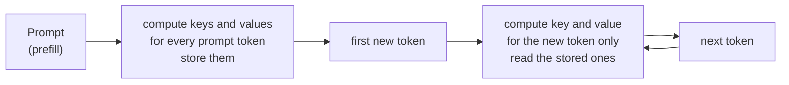

# Generating text and the KV cache

*Part of [Transformers for the product and technology leader](./README.md)*

*Last reviewed: 2026-10 · Volatility: medium*

## TL;DR

A transformer writes one token at a time. It reads the whole text so far, picks the next token, adds it, and reads again. Done naively, each step repeats almost all of the last step's work.

The fix is the **KV cache**. When a token passes through a layer, the model computes its key and value vectors. Those never change for that token. So the model stores them. For each new token it computes one query, one key and one value, and reads the stored keys and values of every earlier token.

The cache has a price. It grows with every token in every request, and it lives in the memory of the accelerator. For a long context or many users, the cache, not the weights, sets how many requests one machine can serve. **Prefill**, which reads the prompt in one pass, and **decode**, which makes one token per pass, have different costs, because decode must read every weight to make a single token.

> 🎯 **For the product leader**
>
> **Why it matters** — The cache explains why long prompts raise price, why concurrency drops as context grows, and why the first token is slower than the rest.
>
> **What it changes in your decisions** — You size serving by cache memory, not by weights alone. You see why shorter prompts and shared prefixes lower cost.
>
> **Ask your eng team** — *"At our target context length, how many requests fit on one accelerator beside the weights, and what limits us: compute or cache memory?"*
>
> **Risk if ignored** — A capacity plan built on the weights alone. The first week of real traffic runs out of memory at a fraction of the planned concurrency.

## The mental model: notes you keep versus notes you rewrite

Imagine writing a report one sentence at a time. After each sentence you could re-read the whole page and re-derive your notes on every earlier sentence. Or you could keep the notes and add one line. The cache is the notebook.



## Mechanics

### Prefill and decode

**Prefill** processes all prompt tokens at once. The multiplies are large matrix by matrix products, which hardware handles well. The model reads its weights once and uses them for hundreds of tokens.

**Decode** produces one token per pass. Each pass multiplies the weights by a single vector. The model must still read every weight from memory to do it. Each 16-bit weight takes 2 bytes and does one multiply-add, which is 2 FLOPs. That is 1 FLOP per byte. Prefill over 512 tokens does about 512 FLOPs per byte. Decode is limited by memory speed. Prefill is limited by compute. The [Tensors module](../tensors/matrix-multiplication.md) explains the ratio.

### What the cache holds

For each layer and each token, the cache holds one key vector and one value vector. The size in bytes is

`2 × layers × kv_heads × d_head × tokens × bytes per number`

The `2` is for keys and values. In a standard model, `kv_heads × d_head` equals `d_model`.

### What it saves

Without the cache, each step recomputes keys and values for every token so far. With `n` tokens in total, the work is proportional to `n²` over the whole generation. With the cache, it is proportional to `n`.

### How it limits serving

The accelerator holds the weights once. Each active request then needs its own cache. After the weights, the leftover memory divided by the cache per request gives the number of requests that fit. Techniques such as [paged attention](../content/01-inference-internals/batching-and-paged-attention.md) manage this memory without waste. **Grouped-query attention**, covered in [lesson 6](./variants-and-reading-a-model-card.md), cuts the cache by sharing key and value heads.

## Tradeoffs and decisions

- **Memory vs. recompute.** Keeping the cache costs memory. Dropping it costs compute. Almost all production systems keep it.
- **Precision.** A 16-bit cache is the default. Lower precision saves memory and can cost quality. See [quantization](../content/01-inference-internals/quantization-formats.md).
- **Prefix sharing.** If many requests share a prompt prefix, the cache for that prefix can be reused. This is the basis of prompt caching.
- **Batch size vs. latency.** More requests per pass use the weights better. Each needs cache memory.

## Failure modes

- **Weights-only capacity plan.** Memory for the weights fits. Cache memory for real traffic does not.
- **Long prompts at high concurrency.** Cache memory per request multiplies by the number of requests.
- **Cache fragmentation.** Reserving the maximum length for every request wastes memory.
- **Mixed-up latency.** A slow first token, from prefill, is blamed on decode, and the reverse.
- **Stale cache.** A cached prefix reused after the prompt template changed.

## Under the hood

The file is `transformers/code/lesson5_kv_cache.py`. The model has a `step` method that handles one token and a cache of keys and values.

```python
def generate_with_cache(model, prompt, steps):
    cache, tokens = model.new_cache(), list(prompt)
    for pos, t in enumerate(prompt):                      # prefill
        logits = model.step(t, pos, cache)
    for i in range(steps):                                # decode
        tokens.append(argmax(logits))
        if i < steps - 1:
            logits = model.step(tokens[-1], len(tokens) - 1, cache)
    return tokens, cache
```

The no-cache version calls `model.forward` on the whole list at every step. The file runs both and compares them.

## Worked example: the same text, seven times less key and value work

*This example is invented. The numbers come from `transformers/code/lesson5_kv_cache.py`.*

**Same output.** A 2-layer tiny model reads a 6-token prompt and generates 10 more tokens. With the cache and without it, the 16 tokens are identical.

**Less work.** Counting the multiply-adds spent on keys and values:

| Method | Key and value multiply-adds |
| --- | --- |
| Recompute everything at each step | 107,520 |
| Keep a cache | 15,360 |

That is 7.0 times fewer. The gap widens as generation gets longer.

**The cache size matches the formula.** The cache holds 960 numbers for 15 tokens. The formula `2 × layers × d_model × tokens` gives `2 × 2 × 16 × 15 = 960`.

**Real sizes, at 16-bit.**

| Model shape | Tokens | Cache per sequence |
| --- | --- | --- |
| GPT-2 small (12 layers, 12 heads of 64) | 1,024 | 36 MiB |
| 7B-class, 32 layers, 32 heads of 128 | 8,192 | 4.0 GiB |
| Same, with 8 key and value heads | 8,192 | 1.0 GiB |

**Concurrency on an 80 GiB accelerator.** This ignores activations and overhead, so real numbers are lower. The dense 7B-class card has 12.6 GiB of weights and 4.0 GiB of cache per 8,192-token request. That leaves room for 16 requests. The grouped-query card has 11.1 GiB of weights and 1.0 GiB of cache. That fits 68 requests. The same hardware serves four times as many long requests.

## Practitioner checklist

- [ ] Do we compute cache memory per request at our target context length?
- [ ] Is the capacity plan weights plus cache, with a margin for overhead?
- [ ] Do we measure time to first token and time per token separately?
- [ ] Are shared prompt prefixes cached and reused?
- [ ] Is the serving stack managing cache memory without fixed reservations?
- [ ] Do we know the key and value head count of each model we compare?

## Related lessons

- [Position and the cost of context](./position-and-the-cost-of-context.md) — the cost of attention over a long cache.
- [Variants and reading a model card](./variants-and-reading-a-model-card.md) — shrinking the cache with grouped-query attention.
- [KV cache management](../content/01-inference-internals/kv-cache-management.md) — the engineering view.
- [Prefill vs. decode](../content/01-inference-internals/prefill-vs-decode.md) — two phases, two bottlenecks.
- [Prompt caching vs. semantic caching](../content/01-inference-internals/prompt-vs-semantic-caching.md) — reusing a prefix across requests.

## Sources

- Vaswani et al., *Attention Is All You Need*, NeurIPS 2017 ([arxiv.org/abs/1706.03762](https://arxiv.org/abs/1706.03762)): autoregressive decoding with masked attention.
- Pope et al., *Efficiently Scaling Transformer Inference*, 2022 ([arxiv.org/abs/2211.05102](https://arxiv.org/abs/2211.05102)): the cost of the key-value cache and the memory-bound decode phase.
- Kwon et al., *Efficient Memory Management for Large Language Model Serving with PagedAttention*, SOSP 2023 ([arxiv.org/abs/2309.06180](https://arxiv.org/abs/2309.06180)): cache memory waste in serving and paged allocation.
- The tiny model, the model shapes and every number are invented or illustrative. They come from `transformers/code/lesson5_kv_cache.py`. This module's sources were not re-opened during the build, and its fact-check is pending.
