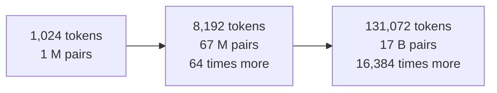

# Position, and the cost of context

*Part of [Transformers for the product and technology leader](./README.md)*

*Last reviewed: 2026-10 · Volatility: medium*

## TL;DR

Attention has two blind spots and one large bill.

The first blind spot is order. Attention treats its input as a set. Shuffle the tokens and the outputs shuffle the same way. A model needs a **position signal** to tell "dog bites man" from "man bites dog". Three kinds are common: fixed sine waves, learned vectors, and **rotary** embeddings that turn each query and key by an angle set by position.

The second blind spot is length. A model trained on 8,000-token inputs may fail on 100,000-token inputs. The position signal was never tested there.

The bill is the score matrix. Every token scores every other token, so work grows with the square of the length. For short inputs, the rest of the model dominates. Past a length of about six times the hidden size, attention dominates.

> 🎯 **For the product leader**
>
> **Why it matters** — "Supports 1 million tokens" is a claim about what fits. It says nothing about cost, speed or accuracy at that length. All three change with length.
>
> **What it changes in your decisions** — You test at your real input lengths, with the answer at different positions. You price long inputs by their true cost, not by a flat rate.
>
> **Ask your eng team** — *"At the longest input we plan to send, what are the latency, the cost per request and the accuracy, compared with a short input?"*
>
> **Risk if ignored** — A feature that passes demos with short documents and slows, costs more and misses facts on the long documents customers actually upload.

## The mental model: a seating plan and a handshake count

Without positions, tokens are guests in a room with no seats. Each guest can talk to all the others, but nobody knows who sat where. A position signal hands out seat numbers.

The cost is the handshakes. If `n` guests each greet every other guest, there are about `n²` greetings. Double the guests and the greetings quadruple.



## Mechanics

### Why attention is order-blind

The score between two tokens depends on their vectors only. It does not depend on where they sit. So a permutation of the inputs permutes the outputs. Nothing inside attention can tell the difference. Position must be added from outside.

Causal models get some order information for free. A token can see only earlier tokens, so a token at position 5 sees five tokens and one at position 50 sees fifty. Researchers have found that models can learn some position from this alone. Real models still add an explicit signal.

### Four ways to add position

| Method | Idea | Where used |
| --- | --- | --- |
| Sinusoidal | Add fixed sine and cosine waves of different speeds. | The original transformer. |
| Learned | A table of vectors, one per position, learned in training. | GPT-2. Fixed maximum length. |
| Rotary (RoPE) | Turn each pair of numbers in a query and key by an angle that grows with position. | Many current open models. |
| ALiBi | Subtract a penalty from each score that grows with distance. | Some models built for length. |

Rotary has a clean property. The dot product of a rotated query and a rotated key depends only on how far apart the two tokens are. Position enters as a distance, not an address.

### Going past the trained length

A model sees only certain positions in training. Beyond them, the position signal is untested, and quality falls. Methods that rescale positions let a model run longer than it was trained, usually with some extra training. Chen and colleagues describe one such method. A longer limit on a spec sheet can come from this kind of extension. It does not guarantee the same quality across the range.

### What the length costs

Count multiply-adds for one layer with `d_ff = 4d`. Projections and the feed-forward layer cost `12nd²`. Attention costs `2n²d`. They are equal when `n = 6d`. For a hidden size of 4,096, that is 24,576 tokens. Below that, the model's weights dominate the work. Above it, attention does.

Memory is a second bill. A plain implementation stores the full `n × n` score matrix for each head. FlashAttention computes the same result in tiles and never stores the whole matrix, so memory grows with the length instead of its square. The compute still grows with the square.

## Tradeoffs and decisions

- **Longer window vs. cost.** Every extra token adds to every later token's attention.
- **Window vs. retrieval.** Sending the whole document costs more than sending the right passages. See [RAG vs. long context](../rag-vector-databases/rag-vs-long-context-vs-finetuning.md).
- **Explicit vs. implicit position.** Explicit signals are tested and standard. They fix a trained length.
- **Exact vs. approximate attention.** Windowed or sparse attention cuts cost and can lose long-range links.

## Failure modes

- **Length not tested.** A long-context claim accepted on the spec sheet.
- **Answer position.** Accuracy drops when the answer sits in the middle of a long input.
- **Flat pricing for long inputs.** A plan built on the cost of short requests.
- **Order bugs.** A pipeline that shuffles chunks or drops position information in preprocessing.
- **Memory surprise.** A long request that fits the weights and fails on the attention or cache memory.

## Under the hood

The file is `transformers/code/lesson4_position_cost.py`. Rotary embeddings take a few lines:

```python
def rope(vec, pos, base=10000.0):
    out = []
    for i in range(0, len(vec), 2):
        angle = pos / base ** (i / len(vec))
        c, s = math.cos(angle), math.sin(angle)
        out += [vec[i] * c - vec[i + 1] * s, vec[i] * s + vec[i + 1] * c]
    return out
```

The cost check runs a one-layer model with the multiply-add counter and compares attention with everything else.

## Worked example: a shuffle, a rotation and a crossover

*This example is invented. The numbers come from `transformers/code/lesson4_position_cost.py`.*

**Order-blindness.** A 2-layer model reads 5 tokens, then the same tokens in another order, with no mask. With no position signal, the outputs are the same rows in the new order. The largest difference is 4.4 × 10⁻¹⁵. With learned positions, it is 11.9.

**Rotary is relative.** A random query and key, 16 numbers each. The score for the query at position 10 and the key at 4 is -5.144915. Move both 100 places on, to 110 and 104. The offset is the same, 6, and so is the score: -5.144915. With the offset changed to 3, at positions 10 and 7, the score is -0.512778.

**The crossover.** A one-layer model with `d_model = 8` reads 48 tokens, which is `6 × d_model`. Attention costs 36,864 multiply-adds. Everything else costs 36,864. At 24 tokens, attention costs 9,216 and the rest costs 18,432. At 96 tokens, attention costs 147,456 and the rest costs 73,728.

**The stored matrix.** For 32 heads and 16-bit numbers, one layer's full score matrices take:

| Tokens | Memory per layer |
| --- | --- |
| 1,024 | 64 MiB |
| 8,192 | 4 GiB |
| 131,072 | 1 TiB |

This is why a plain implementation cannot reach long contexts, and why tiled attention is standard.

## Practitioner checklist

- [ ] Have we measured latency, cost and accuracy at our longest realistic input?
- [ ] Have we tested with the answer at the start, the middle and the end?
- [ ] Do we know whether the context limit is native or extended?
- [ ] Is our price model aware that cost grows faster than length at long inputs?
- [ ] Does our serving stack use a tiled attention implementation?
- [ ] Does preprocessing keep the token order?

## Related lessons

- [Attention](./attention.md) — where the score matrix comes from.
- [Generating text and the KV cache](./generating-text-and-the-kv-cache.md) — the other memory cost of length.
- [The context window](../llms/the-context-window.md) — the context limit from the product side.
- [Prefill vs. decode](../content/01-inference-internals/prefill-vs-decode.md) — how length affects serving.
- [Cost optimization](../cost-optimization/README.md) — pricing long inputs.

## Sources

- Vaswani et al., *Attention Is All You Need*, NeurIPS 2017 ([arxiv.org/abs/1706.03762](https://arxiv.org/abs/1706.03762)): sinusoidal positions.
- Su et al., *RoFormer: Enhanced Transformer with Rotary Position Embedding*, 2021 ([arxiv.org/abs/2104.09864](https://arxiv.org/abs/2104.09864)).
- Press et al., *Train Short, Test Long: Attention with Linear Biases Enables Input Length Extrapolation* (ALiBi), ICLR 2022 ([arxiv.org/abs/2108.12409](https://arxiv.org/abs/2108.12409)).
- Haviv et al., *Transformer Language Models without Positional Encodings Still Learn Positional Information*, 2022 ([arxiv.org/abs/2203.16634](https://arxiv.org/abs/2203.16634)).
- Chen et al., *Extending Context Window of Large Language Models via Positional Interpolation*, 2023 ([arxiv.org/abs/2306.15595](https://arxiv.org/abs/2306.15595)).
- Dao et al., *FlashAttention: Fast and Memory-Efficient Exact Attention with IO-Awareness*, NeurIPS 2022 ([arxiv.org/abs/2205.14135](https://arxiv.org/abs/2205.14135)).
- The tiny models and every number are invented. They come from `transformers/code/lesson4_position_cost.py`. This module's sources were not re-opened during the build, and its fact-check is pending.
