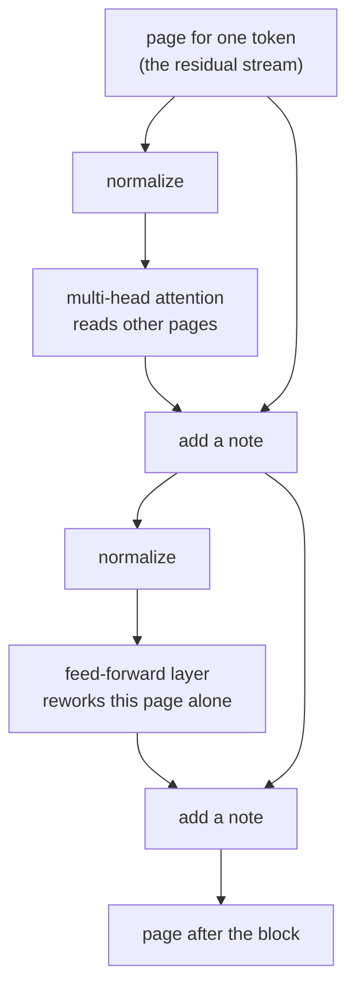

# The block: heads, the feed-forward layer and the residual stream

*Part of [Transformers for the product and technology leader](./README.md)*

*Last reviewed: 2026-10 · Volatility: medium*

## TL;DR

A transformer block has two parts. **Multi-head attention** lets tokens read from each other. A **feed-forward layer**, also called the MLP, then reworks each token's vector alone. Around both sit two helpers. A **residual connection** adds each part's output to its input, so nothing is overwritten. **Layer normalization** rescales each vector so the numbers stay in a stable range.

The best way to picture a block is a shared notebook, the **residual stream**. Each token has a page. Every head and every feed-forward layer reads the page and writes a small note on it. Nothing erases. The last page, after all the blocks, is what the model uses to predict the next token.

This view explains three facts a leader meets often. Models can be made deeper without retraining from scratch, because a block that writes nothing changes nothing. Heads add up, so they can be studied, and pruned, one by one. And the feed-forward layers hold most of the weights, so they set most of the memory and the cost.

> 🎯 **For the product leader**
>
> **Why it matters** — "Layers" and "heads" are on every spec sheet. They are not decoration. They set how much a model can compose, and how much it weighs.
>
> **What it changes in your decisions** — You see compression as a choice of where to cut. Quantizing or pruning the feed-forward layers saves the most. Pruning attention heads saves less, and can hurt long-range tasks.
>
> **Ask your eng team** — *"Where does the size reduction come from, which layers did we compress, and what did we measure on long inputs?"*
>
> **Risk if ignored** — A compressed model that passes short tests and loses accuracy on the long, multi-step tasks your product depends on.

## The mental model: a shared notebook



## Mechanics

### Multi-head attention

One attention step has one set of weights. It can attend to only one kind of thing at a time. **Multi-head** attention splits the vector into `h` slices of size `d_k = d_model / h`. Each head runs its own attention on its slice. The heads' outputs are joined and multiplied by one output matrix.

The result has a useful property. Joining the heads and then applying the output matrix gives the same answer as applying a slice of that matrix to each head and adding the results. So each head writes its own note into the stream, and the notes add. Elhage and colleagues used this view to study trained models head by head.

### The feed-forward layer

The feed-forward layer takes one token's vector. It widens it to `4 × d_model`, applies a nonlinear function such as GELU, and narrows it back. Many newer models use a gated version with three matrices, which gives a slightly different width. The layer works on each token separately. No information crosses between tokens here.

It holds about two thirds of a block's parameters. Research suggests that these layers store much of what a model knows as facts, with attention moving information to the right place. Geva and colleagues described them as key-value memories.

### Residuals and normalization

A **residual connection** computes `x + f(x)`. If `f` outputs nothing, the block returns `x` unchanged. This does two things. Gradients flow straight through the stack during training, so deep models train. And each layer only has to learn a small change.

**Layer normalization** rescales each vector to mean 0 and spread 1. Most current models normalize before each part. The original paper normalized after. GPT-2 moved the norm to the input of each part, which trains more stably in deep stacks.

## Tradeoffs and decisions

- **More heads vs. wider heads.** Same total width, split more ways. More heads attend to more kinds of things. Each head has less room.
- **Depth vs. width.** Each added block adds one more read and write on the stream.
- **Dense vs. gated feed-forward.** A gated layer often gives better quality for the same cost. It has three matrices, so its hidden size is set to keep parameters level.
- **Compress here or there.** The feed-forward layers are the largest target. They are also where much of the stored knowledge sits.

## Failure modes

- **Unstable training.** Without normalization or with the wrong placement, the numbers blow up in deep stacks.
- **Dead heads.** Some heads learn little. Teams find them by pruning. Counting heads overstates capacity.
- **Compression that hurts the wrong thing.** A cut that keeps average accuracy and loses rare facts.
- **Mistaking layers for steps of thought.** A block is a layer of computation, not one reasoning step.

## Under the hood

The file is `transformers/code/lesson3_block.py`. It checks three facts about the block on the tiny model.

```python
def zero_block_is_identity(seed=4):
    model = Transformer(Config(d_model=8, n_heads=2, n_layers=1, vocab=10, max_len=8), seed)
    L = copy.deepcopy(model.layers[0])
    L["wo"] = [[0.0] * 8 for _ in range(8)]           # attention writes nothing
    L["w2"] = [[0.0] * 8 for _ in range(model.cfg.d_ff)]   # feed-forward writes nothing
    x = add([model.tok[t] for t in (1, 2, 3)], model.position_rows(0, 3))
    return max(abs(a - b) for r, s in zip(x, model.block(x, L)) for a, b in zip(r, s))
```

The other two checks are that the heads' notes add up, and that layer normalization gives mean 0 and mean square 1.

## Worked example: three facts about a block

*This example is invented. The numbers come from `transformers/code/lesson3_block.py`.*

**Heads add.** A model with 3 heads and `d_model = 12`. We run all heads and apply the output matrix. We also keep one head's slice at a time, apply the output matrix, and sum the three results. The largest difference is 4.4 × 10⁻¹⁶. That is rounding.

**A block can do nothing.** We set the two output matrices of a block to zero. The block returns its input exactly: the largest change is 0.0. This is why a new block can be added to a trained model and start as a no-op.

**Normalization sets the scale.** One row has values near 3, 9 and -1. Another has values near 100. After layer normalization, both rows have mean 0 and mean square 1.0.

**The weight split.** In GPT-2 small, attention has 33.3% of the block parameters and the feed-forward layer has 66.7%, as [lesson 1](./the-shape-of-a-transformer.md) counted.

## Practitioner checklist

- [ ] Do we know the share of weights in attention and in feed-forward layers for the models we compare?
- [ ] When a model is compressed, do we know which layers were cut?
- [ ] Do we test compressed models on long and multi-step tasks, not only short ones?
- [ ] Do we avoid describing layers as steps of reasoning?
- [ ] Do we know if the model normalizes before or after each part, if we change it?

## Related lessons

- [Attention](./attention.md) — the first part of a block.
- [The shape of a transformer](./the-shape-of-a-transformer.md) — the parameter counts.
- [Quantization formats](../content/01-inference-internals/quantization-formats.md) — compressing the weights.
- [Automatic differentiation](../tensors/automatic-differentiation.md) — why residual paths help gradients.
- [Model families](../machine-learning/model-families.md) — where a transformer sits among the model kinds.

## Sources

- Vaswani et al., *Attention Is All You Need*, NeurIPS 2017 ([arxiv.org/abs/1706.03762](https://arxiv.org/abs/1706.03762)): multi-head attention, the feed-forward layer, residual connections and layer normalization.
- Radford et al., *Language Models are Unsupervised Multitask Learners*, OpenAI, 2019: layer normalization moved to the input of each sub-block.
- Elhage et al., *A Mathematical Framework for Transformer Circuits*, Anthropic, 2021 ([transformer-circuits.pub/2021/framework](https://transformer-circuits.pub/2021/framework/index.html)): the residual stream, and heads that add to it independently.
- Geva et al., *Transformer Feed-Forward Layers Are Key-Value Memories*, EMNLP 2021 ([arxiv.org/abs/2012.14913](https://arxiv.org/abs/2012.14913)).
- Shazeer, *GLU Variants Improve Transformer*, 2020 ([arxiv.org/abs/2002.05202](https://arxiv.org/abs/2002.05202)): gated feed-forward layers.
- The tiny model and every number from it are invented. They come from `transformers/code/lesson3_block.py`. This module's sources were not re-opened during the build, and its fact-check is pending.
