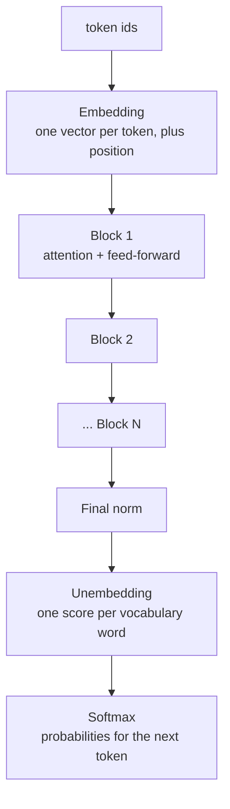

# The shape of a transformer

*Part of [Transformers for the product and technology leader](./README.md)*

*Last reviewed: 2026-10 · Volatility: medium*

## TL;DR

A **transformer** is a stack of identical blocks. Tokens go in at the bottom as numbers. Each block updates a vector for every token. At the top, the last vector becomes a score for every word in the vocabulary. The model picks one token, adds it to the input, and runs again.

That picture lets you count. Where do the parameters live? Where do the multiplies go? How much memory does a request need? Most answers come from five numbers on a model's spec sheet: layers, hidden size, number of heads, vocabulary size and context length.

Two rules carry most of the weight. In a block, the **feed-forward layer** holds about two thirds of the parameters and attention holds one third. And a forward pass costs about two multiply-adds per parameter, per token. The rest of this module opens each part of the stack.

> 🎯 **For the product leader**
>
> **Why it matters** — "A 7 billion parameter model" is one number. Cost, speed and memory depend on the shape behind it. Two models with the same parameter count can differ by four times in memory per request.
>
> **What it changes in your decisions** — You ask for the spec sheet, not the headline. You can turn it into memory, compute and cost on one page, before the team runs a single test.
>
> **Ask your eng team** — *"What are the layers, hidden size, heads, vocabulary and context length, and what do they give for weights, memory per request and compute per token?"*
>
> **Risk if ignored** — A plan that fits the model on a device and forgets the request memory. Or a vendor comparison that ranks two models by parameter count when their serving costs differ widely.

## The mental model: a stack that keeps one vector per token



Think of a table with one row per token. The embedding fills each row with a vector of `d_model` numbers. Each block rewrites the table. Attention lets a row read from other rows. The feed-forward layer then reworks each row on its own. The table keeps the same shape all the way up. Only the last row matters for the next token.

## Mechanics

### The five numbers

| Number | Symbol | What it sets |
| --- | --- | --- |
| Layers | `L` | How many blocks. Depth. |
| Hidden size | `d_model` | The length of each token's vector. Width. |
| Heads | `h` | How many attention comparisons run side by side. |
| Vocabulary | `V` | How many tokens the model knows. |
| Context length | `n_max` | The most tokens it can read at once. |

### Where the parameters live

In one block, attention has four matrices of size `d × d`: query, key, value and output. That is `4d²` numbers. The feed-forward layer widens each vector to `4d`, then narrows it again. That is two matrices of `d × 4d`, or `8d²`. So the feed-forward layer holds `8 / 12`, about two thirds, of a block.

Outside the blocks sits the embedding table, with `V × d` numbers. Many models reuse it as the output matrix, so it counts once.

The small model in the GPT-2 family (generative pre-trained transformer, GPT) has 12 layers, `d = 768`, `V = 50,257` and 1,024 positions. It has 124,439,808 parameters. Embeddings hold 31.6% of them. Attention holds 22.8% and the feed-forward layers hold 45.5%. The vocabulary is a large share here. In bigger models it shrinks, because blocks grow with `d²` and the table grows with `d`.

Doubling the width multiplies a block's size by four. Doubling the depth doubles it.

### Where the multiplies go

For one token, each weight in a block does one multiply-add. A multiply-add counts as two floating-point operations. So the forward pass costs about `2N` FLOPs per token, where `N` is the non-embedding parameter count. Kaplan and colleagues use the same rule.

Attention adds a term that depends on context. For `n` tokens, the scores and the weighted sum cost `2n²d` multiply-adds in each layer. [Lesson 4](./position-and-the-cost-of-context.md) shows when that term takes over.

## Tradeoffs and decisions

- **Deep vs. wide.** More layers give more steps of reasoning-like composition. More width gives each step more room. Both cost parameters, and depth also adds latency, because layers run in sequence.
- **Big vocabulary vs. small.** A large vocabulary shortens text, which saves tokens at run time. It also grows the embedding table and the output matrix.
- **Long context vs. memory.** A larger `n_max` costs nothing in parameters for models with rotary positions. It costs a great deal in request memory and compute.
- **Parameters vs. active parameters.** Some models use only part of their weights per token. [Lesson 6](./variants-and-reading-a-model-card.md) covers them.

## Failure modes

- **Counting only parameters.** The headline number leaves out the cache that grows with every request.
- **Forgetting the embedding.** A small model can spend a third of its weights on the vocabulary.
- **Mixing up depth and width.** A change from 32 to 40 layers is a 25% change in blocks. A change in width is a quadratic change.
- **Trusting a rule past its range.** "2 FLOPs per parameter" ignores attention, which dominates at long context.
- **Comparing models across vocabularies.** Cost per token and cost per word differ when the tokenizers differ.

## Under the hood

The file is `transformers/code/mini_transformer.py`. It is a small decoder-only transformer in plain Python, with random weights and a counter for multiply-adds. The weights say nothing useful. The point is that every claim in this module can be counted.

```python
def count_params(d, layers, vocab, max_len, d_ff=None, bias=True, layernorm=True, tied=True):
    d_ff = d_ff or 4 * d
    attn = 4 * d * d + (4 * d if bias else 0)           # query, key, value and output matrices
    mlp = 2 * d * d_ff + ((d_ff + d) if bias else 0)
    norms = 4 * d if layernorm else 0                    # two norms per block
    block = attn + mlp + norms
    emb = vocab * d + max_len * d
    return emb + layers * block + (2 * d if layernorm else 0) + (0 if tied else vocab * d)
```

`lesson1_shape.py` calls this for GPT-2 small, and for the tiny model. For the tiny model it also counts the real weights and the real multiply-adds, and checks both against the formulas.

## Worked example: counting a model on one page

*This example uses a published configuration and an invented tiny model. The numbers come from `transformers/code/lesson1_shape.py`.*

**GPT-2 small.** The formula gives 124,439,808 parameters. That matches the 124 million usually quoted for the released small model.

| Part | Parameters | Share |
| --- | --- | --- |
| Embeddings (tokens and positions) | 39,383,808 | 31.6% |
| Attention, 12 blocks | 28,348,416 | 22.8% |
| Feed-forward, 12 blocks | 56,669,184 | 45.5% |

Inside the blocks, attention is 33.3% and the feed-forward layer is 66.7%.

**The tiny model.** It has 2 layers, `d = 16`, 4 heads, a vocabulary of 32 and 64 positions. The formula says 7,680 weights. Counting the real matrices gives 7,680.

Run it on 8 tokens. The counter shows 57,344 multiply-adds. The formula for projections, feed-forward layers, attention scores and the output matrix also gives 57,344. The model does exactly the arithmetic the formula predicts.

## Practitioner checklist

- [ ] Do we have the five numbers for every model we compare: layers, hidden size, heads, vocabulary and context length?
- [ ] Do we know the share of parameters in embeddings, attention and feed-forward layers?
- [ ] Do we know total parameters and active parameters per token?
- [ ] Have we added the request memory to the weight memory?
- [ ] Are we comparing costs per word or per task, not only per token?

## Related lessons

- [Attention](./attention.md) — the first of the two parts of a block.
- [What an LLM actually is](../llms/what-is-an-llm.md) — the same machine described for the product reader.
- [Matrix multiplication: the workhorse](../tensors/matrix-multiplication.md) — why the multiplies dominate.
- [Batching, memory and precision](../tensors/batching-memory-and-precision.md) — turning parameters into bytes.
- [Choosing a model](../llms/choosing-a-model.md) — reading a spec sheet in a buying decision.

## Sources

- Vaswani et al., *Attention Is All You Need*, NeurIPS 2017 ([arxiv.org/abs/1706.03762](https://arxiv.org/abs/1706.03762)): the transformer, its block and its attention.
- Radford et al., *Language Models are Unsupervised Multitask Learners*, OpenAI, 2019: the GPT-2 family, with a 1,024-token context and a vocabulary of 50,257. The 124 million figure for the small model is the one usually quoted for the released weights.
- Kaplan et al., *Scaling Laws for Neural Language Models*, 2020 ([arxiv.org/abs/2001.08361](https://arxiv.org/abs/2001.08361)): about `2N` FLOPs per token for a forward pass, with `N` excluding embeddings.
- The tiny model and every number from it are invented. They come from `transformers/code/lesson1_shape.py`. This module's sources were not re-opened during the build, and its fact-check is pending.
