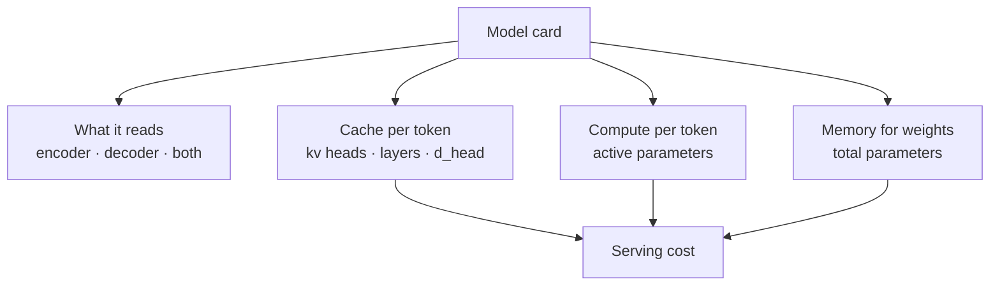

# Variants, and reading a model card

*Part of [Transformers for the product and technology leader](./README.md)*

*Last reviewed: 2026-10 · Volatility: fast*

## TL;DR

The transformer of 2017 has many descendants. Most changes fall into four groups. Some change **what the model reads**: encoder-only, decoder-only and encoder-decoder designs. Some change **how attention is stored**: grouped-query attention shares key and value heads, which shrinks the cache. Some change **how much of the model runs per token**: a **mixture of experts** keeps many feed-forward layers and uses only a few for each token. And some change **how attention is computed**: tiled kernels such as FlashAttention, and windows.

For a product leader the skill is reading a model card. A model card lists layers, hidden size, heads, key and value heads, feed-forward size, vocabulary, context length, and for mixtures, the number of experts. From those, you can compute total parameters, active parameters, weight memory and cache per token, and so serving cost.

Two models with the same headline size can differ four times in cache memory, or three and a half times in total weights. The spec sheet shows it, if you know where to look.

> 🎯 **For the product leader**
>
> **Why it matters** — Architecture choices, not just size, decide your serving bill. Vendors name models by size, and the details that move cost sit lower down.
>
> **What it changes in your decisions** — You compare models on weights, active parameters and cache per token. A mixture of experts is cheap per token and expensive in memory. Grouped-query attention is cheap in memory.
>
> **Ask your eng team** — *"For each candidate, what are the total and active parameters, the number of key and value heads, and the cache per token at our context length?"*
>
> **Risk if ignored** — A model chosen for its low active parameter count that needs a cluster of accelerators to hold its weights. Or one chosen for quality that cannot serve your concurrency.

## The mental model: four dials



## Mechanics

### Encoder, decoder or both

An **encoder-only** model reads all tokens in both directions. It produces a vector for each token or for the whole text. BERT is the best-known example. Encoder models suit search embeddings, classification and ranking. Many of the embedding models behind [RAG](../rag-vector-databases/embeddings-and-semantic-search.md) work this way.

A **decoder-only** model, with the causal mask, writes text one token at a time. GPT-style models and most chat models are decoder-only.

An **encoder-decoder** model reads an input with an encoder, then writes an output with a decoder that attends to the encoder. T5 is an example. It suits translation and summarization. Most general chat models are now decoder-only.

### Grouped-query attention

In standard multi-head attention, each head has its own query, key and value. **Multi-query attention** shares one key and value head across all query heads. **Grouped-query attention** is in between: query heads are split into groups, and each group shares one key and value head. The weights and the cache for keys and values shrink by the ratio of heads to groups. Quality falls little for a large memory saving. Ainslie and colleagues introduced the grouped form.

### Mixture of experts

A mixture replaces one feed-forward layer with `E` of them, called experts. A small router picks the top `k` experts for each token. The token passes through only those. The model holds `E` times the feed-forward weights and does `k` times the work of one.

So a mixture has two sizes. **Total parameters** set the memory to hold the model. **Active parameters** set the compute per token. A model with 47 billion total and 13 billion active needs the memory of a 47 billion model and computes like a 13 billion one. Shazeer and colleagues proposed the sparse form. Jiang and colleagues' Mixtral model is a well-known example with 8 experts, 2 used per token.

### Faster attention and windows

**FlashAttention** computes exact attention in small tiles in fast memory. It never stores the full score matrix. The answer is the same and it runs faster and uses less memory. **Sliding-window** attention limits each token to its nearest neighbours, trading long-range reach for cost.

Other designs replace attention, such as state-space models. They scale linearly with length. They are newer, and their quality at the largest scales is still being tested.

### Reading a card

| Field | What you compute from it |
| --- | --- |
| Layers, hidden size, feed-forward size, vocabulary | Weights, in parameters and bytes |
| Heads and key and value heads, head size | Cache per token |
| Experts and experts per token | Total and active parameters |
| Context length | Cache per request, attention cost |
| Number format | Bytes per weight and per cache number |

## Tradeoffs and decisions

- **Mixture vs. dense.** A mixture gives more quality per unit of compute. It needs more memory and a router that must spread load.
- **Fewer key and value heads vs. quality.** Fewer heads shrink the cache. Past a point, quality drops.
- **Native window vs. extension.** A longer window from extension may not match native quality.
- **New architecture vs. tested tooling.** Serving software and kernels are tuned for the common designs first.

## Failure modes

- **Judging by active parameters.** A mixture that fits no machine you own.
- **Judging by total parameters.** A mixture that is cheap to run and ranked as expensive.
- **Ignoring the cache.** Two models of equal size, one with four times the cache per token.
- **Spec sheet from a blog post.** Numbers that do not match the released weights.
- **Router imbalance.** A mixture whose requests pile onto a few experts, so latency spikes.

## Under the hood

The file is `transformers/code/lesson6_variants.py`. A card is a dictionary of numbers. One function turns it into the four quantities.

```python
def card(c, gated=True, bytes_per=2):
    d, dh = c["d"], c["d"] // c["heads"]
    attn = d * d * 2 + 2 * d * c["kv_heads"] * dh                     # query and output, then key and value
    mlp = (3 if gated else 2) * d * c["d_ff"]
    emb = 2 * c["vocab"] * d
    total = emb + c["layers"] * (attn + c["experts"] * mlp) + (2 * c["layers"] + 1) * d
    active = emb // 2 + c["layers"] * (attn + c["top_k"] * mlp) + (2 * c["layers"] + 1) * d
    kv_per_token = 2 * c["layers"] * c["kv_heads"] * dh * bytes_per
    return dict(total=total, active=active, weight_bytes=total * bytes_per, kv_per_token=kv_per_token)
```

The file also runs the tiny model with 8 heads and then with 2 key and value heads, and counts the numbers in the cache.

## Worked example: three cards

*These three cards are illustrative configurations, not products. The numbers come from `transformers/code/lesson6_variants.py`.*

All three have 32 layers, a hidden size of 4,096 and a vocabulary of 32,000. All use 16-bit weights.

| Card | Key and value heads | Experts | Total parameters | Active parameters | Weights | Cache per token |
| --- | --- | --- | --- | --- | --- | --- |
| Dense | 32 | 1 | 6.74 billion | 6.61 billion | 12.6 GiB | 0.500 MiB |
| Grouped-query | 8 | 1 | 5.93 billion | 5.80 billion | 11.1 GiB | 0.125 MiB |
| Mixture | 8 | 8, top 2 | 46.70 billion | 12.75 billion | 87.0 GiB | 0.125 MiB |

**Grouped-query vs. dense.** Fewer key and value heads cut the cache to a quarter. They also remove 0.8 billion weights. The tiny model confirms the cache ratio: with 8 heads, 6 tokens fill 384 numbers. With 2 key and value heads, they fill 96.

**Mixture vs. dense.** The mixture computes with 12.75 billion parameters per token. That is about twice the dense model. It holds 46.70 billion, 6.9 times more. At 16-bit it needs 87.0 GiB for weights, more than one 80 GiB accelerator holds. Its per-token compute is moderate and its memory need is large.

The published Mixtral 8x7B has a similar design, with about 47 billion total and 13 billion active parameters, according to its authors.

## Practitioner checklist

- [ ] For each model, do we have total and active parameters, not one size?
- [ ] Do we know the key and value head count and the cache per token?
- [ ] Do we know whether the model is a mixture, and its experts per token?
- [ ] Have we checked the card against the released weights?
- [ ] Is context length native, or extended?
- [ ] Have we priced serving with weights plus cache, at our concurrency?

## Related lessons

- [Generating text and the KV cache](./generating-text-and-the-kv-cache.md) — why the cache sets concurrency.
- [The block](./the-block.md) — the feed-forward layer a mixture multiplies.
- [Choosing a model](../llms/choosing-a-model.md) — the buying decision.
- [Convolutional networks vs. vision transformers](../cnns/cnns-vs-vision-transformers.md) — the same block applied to image patches.
- [Cost optimization](../cost-optimization/README.md) — turning a card into a serving bill.

## Sources

- Devlin et al., *BERT: Pre-training of Deep Bidirectional Transformers for Language Understanding*, NAACL 2019 ([arxiv.org/abs/1810.04805](https://arxiv.org/abs/1810.04805)): the encoder-only model.
- Raffel et al., *Exploring the Limits of Transfer Learning with a Unified Text-to-Text Transformer* (T5), JMLR 2020 ([arxiv.org/abs/1910.10683](https://arxiv.org/abs/1910.10683)): encoder-decoder.
- Shazeer, *Fast Transformer Decoding: One Write-Head is All You Need*, 2019 ([arxiv.org/abs/1911.02150](https://arxiv.org/abs/1911.02150)): multi-query attention.
- Ainslie et al., *GQA: Training Generalized Multi-Query Transformer Models from Multi-Head Checkpoints*, EMNLP 2023 ([arxiv.org/abs/2305.13245](https://arxiv.org/abs/2305.13245)): grouped-query attention.
- Shazeer et al., *Outrageously Large Neural Networks: The Sparsely-Gated Mixture-of-Experts Layer*, ICLR 2017 ([arxiv.org/abs/1701.06538](https://arxiv.org/abs/1701.06538)).
- Jiang et al., *Mixtral of Experts*, 2024 ([arxiv.org/abs/2401.04088](https://arxiv.org/abs/2401.04088)): 8 experts, 2 per token, about 47 billion total and 13 billion active parameters.
- Dao et al., *FlashAttention*, NeurIPS 2022 ([arxiv.org/abs/2205.14135](https://arxiv.org/abs/2205.14135)).
- Gu and Dao, *Mamba: Linear-Time Sequence Modeling with Selective State Spaces*, 2023 ([arxiv.org/abs/2312.00752](https://arxiv.org/abs/2312.00752)).
- The three cards and every number are illustrative. They come from `transformers/code/lesson6_variants.py`. This module's sources were not re-opened during the build, and its fact-check is pending. Model architectures change fast, so this lesson is stamped fast.
